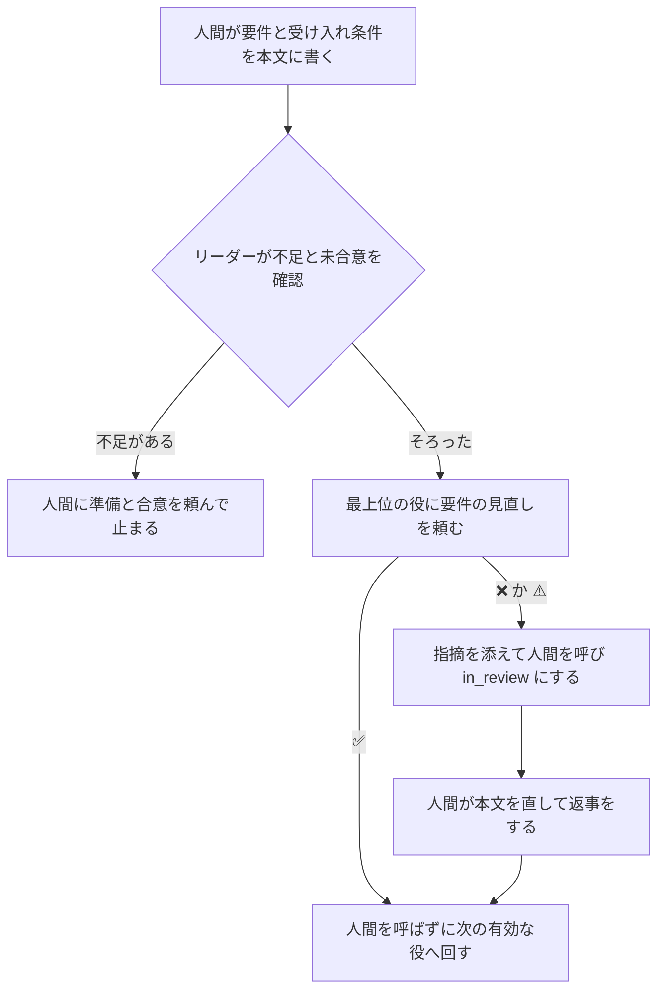

# 要件を最上位のモデルで決める

要件を決める役を、Claude なら Fable 5.2、Codex なら Astra の思考の深さ high で動かす。質問は 1 回のコメントにまとめ、「推奨で」を合意として扱う。役を置かない構成では、最上位の役が人間の用意した要件を見直してから次の役へ回す。

この文書は、[workflow.md の後続のタスクの候補](workflow.md#後続のタスクの候補)の候補 4 の設計である。役を置く理由と使用量の見積りは [workflow.md の要件・設計の役を置かない構成](workflow.md#要件設計の役を置かない構成)と[使用量の見積り](workflow.md#使用量の見積り)にあり、ここでは写さない。

## 目的と範囲

要件は手戻りの起点になる工程なので、最上位のモデルで決める。質問を 1 回にまとめ、人間を待つ回数と、要件を決める役の実行の回数を減らす。

次は対象にしない。

- ほかの役のモデル。設計の役は候補 5 で扱う
- 使用率が上限に近いときに系統を移すか待つ決まり。候補 3 で入れる
- バージョンを上げること。VERSION と MANIFEST は、バージョンを上げる PR で扱う
- 要件を決める役の評価の場面を足すこと
- 要件を決める役を外せないようにすること
- 使用率に応じてモデルを下げること

## 役のモデルと思考の深さ

要件を決める役の front matter を、ランタイムの印で分ける。モデルは印を外したあとに読むので、FORMAT の今の決まりのまま、どの構成でも次のとおりになる。

| 使うランタイム | モデル | 思考の深さ |
| --- | --- | --- |
| 両方 | `claude-fable-5-2`（Fable 5.2） | high |
| Claude Code だけ | `claude-fable-5-2`（Fable 5.2） | high |
| Codex だけ | `gpt-6-astra`（Astra） | high |

`common/agents/planner.md` の front matter は、次の形にする。

```text
<!-- IF runtime-claude -->
model: claude-fable-5-2
<!-- ELSE -->
model: gpt-6-astra
<!-- ENDIF -->
thinking_level: high
```

FORMAT の「Claude のモデルの役は、runtime-claude がなければ Codex の実装と同じモデルにする」は、印を外したあとに `claude-` のモデルが残るときの決まりである。Codex だけの構成では印で Astra が残るので、この決まりは働かず、Codex の実装のモデル（Sol）に移らない。最上位の役と同じく、ない方のモデルへ移さない形になる。FORMAT の文は変えない。

## 要件を決める役の指示

質問を 1 つずつ聞く決まりをやめ、仮定と質問を 1 回のコメントにまとめる。人間は、推す答えのままでよければ「推奨で」と返すだけで済む。

`common/agents/planner.md` の「人間に確認するとき」の「質問は 1 つずつ…」の行を、次の 4 項目に替える。

1. 置いた仮定と質問を 1 回のコメントにまとめる。質問ごとに、選択肢と、それぞれの良い点・悪い点、推す答えを添える
2. 「推奨で」の返事は、すべての仮定と推す答えへの合意とみなす。違う点だけを答えた返事は、残りの仮定と推す答えへの合意とみなす
3. 合意できたら本文に書き、人間に確認し直さずにリーダーへ返す
4. 質問の往復は 2 回までを目安にする。3 回目が要るときは、決めることを 1 つに絞り、絞った理由を添える

「結果の出し方」の「合意できたら、本文に書き」の文に、「人間に確認し直さずに」を足す。ほかの節は変えない。

## 役を置かない構成の要件の見直し

要件を決める役を外した構成では、リーダーが、人間の用意した要件を次の役へ回す前に、最上位の役に見直しを頼む。ラベル `重要` の有無によらず頼む。見直しの頼み方と最上位の役の選び方は、[principal-review.md の設計の見直し](principal-review.md#設計の見直し)と同じにする。



### 頼むとき

見直しは、1 タスクにつき 1 回だけ頼む。タスクに `見直しの種類: 要件の見直し` の依頼がすでにあれば、頼み直さない。人間が直した要件はもう一度見直さず、次の役へ回す。

| 場面 | リーダーがすること |
| --- | --- |
| 要件がそろい、見直しの依頼がまだない | 最上位の役を選び、要件の見直しを頼む |
| 見直しの結果が ✅ | 人間を呼ばずに、次の有効な役（設計の役、なければ実装の役）へ回す |
| 見直しの結果が ❌ か ⚠️ | 指摘を添えて人間を呼び、`in_review` にする |
| 人間が直して返事をした | 見直しを頼み直さず、次の有効な役へ回す |
| 複数のリポジトリにまたがる | 親のタスクで見直してから、リポジトリごとの sub-issue に分ける。sub-issue では見直さない |

ラベル `重要` のあるタスクでは、印の判断を先に行う。要件の見直しと、そのあとの設計の見直しは別に頼み、片方の結果でもう片方を飛ばさない。

### 依頼と返事の行

依頼の行は今の形のまま、種類を 1 つ足す。要件の見直しには PR もコミットもないので、確認する対象をタスクの本文の sha256 で表す。squad-handoff の「レビューと E2E の返事を返す」の、コミットの代わりに名前と識別値で合わせる決まりに当たる。

```text
見直しの種類: 要件の見直し
返事を待つ役: <最上位の役の名前>
確認するコミット: タスクの本文 <sha256>
```

sha256 は、`multica issue get <タスク> --output json | jq -j .description | shasum -a 256` の先頭の値にする。最上位の役は同じ方法で読み直し、`確認したコミット: タスクの本文 <sha256>` で返す。値が依頼と合わなければ、コミットが合わないときと同じく頼み直し、2 回続けて合わなければ人間を呼ぶ。行の名前は、`squad-review-wait` と今の手順に合わせて変えない。

返事の待ち方は、今の `squad-review-wait watch`、`report`、`proceed` の手順のままにする。結果を置く PR がないので、最上位の役は結果を `squad-review-wait report` でタスクに返す。

### 最上位の役の見るもの

最上位の役のひな形（`claude-principal.md` と `codex-principal.md`）の見直しの種類に、`要件の見直し` を足す。足す文は `<!-- IF planner --><!-- ELSE -->…<!-- ENDIF -->` の ELSE 側に置き、要件を決める役がある構成には出さない。

| 見るもの | 主な観点 |
| --- | --- |
| タスクの本文の背景・要件・やらないこと・受け入れ条件と、タスクのコメント | 受け入れ条件で確認できるか、抜けた場合や矛盾、リポジトリ間の I/F の合意、作業先の `AGENTS.md` の方針との食い違い |

結果の先頭の行とマーク、指摘の書き方は今のとおりにする。`設計` と `コード` の種類は添えない。ひな形の「ラベル `重要` があるタスクだけで呼ばれます」の文には、ELSE 側で、要件の見直しは印によらず呼ばれることを足す。

## 文書と指示の変更

変えるファイルと変えることは、次のとおりである。どれもこの文書の節を名前で案内し、決まりを写しすぎない。

| 変えるもの | 変えること |
| --- | --- |
| `common/agents/planner.md` | front matter のモデルと思考の深さ、「人間に確認するとき」と「結果の出し方」の文 |
| `common/agents/claude-principal.md`、`codex-principal.md` | 役を置かない構成で、見直しの種類に `要件の見直し` を足す |
| `common/agents/orchestrator.md` | 「このスクワッドの役」の要件を決める役の ELSE の文に、次へ回す前の要件の見直しを足す。「場面と手順」の重要の判断・最上位の役の行に、要件の見直しを足す |
| `leader-flow.md` | 「要件と設計を進める」と「複数のリポジトリにまたがる要望」の、役がないときの段落に要件の見直しを足す |
| `leader-principal.md` | 「印と最上位の役」に例外を足し、「最上位の役を呼ぶところ」を 4 つにする。依頼の行の種類と、要件の見直しの結果の扱いを足す |
| `common/squad.md` | 流れの要件を決める役がない側に、最上位の役が要件を見直すことを足す |
| `manual.md` | 片方だけのランタイムの役の表で、要件定義の行を最上位の役と同じ並びにする。「外す役」の要件定義の行の「ほかに変わること」に、最上位の役の見直しを足す |
| `docs/principal-review.md` | 「最上位の役を呼ぶところ」に、要件の見直しはこの文書にあると 1 文で案内する |
| `docs/leader-principles.md` | 場面の一覧と場面を確認するテストに、新しい型の場面を足す |
| `CHANGELOG.md` の「次のバージョン」 | 下の[利用者への知らせ](#利用者への知らせ)の内容 |

最上位の役の選び方は、`leader-principal.md` の「最上位の役の選び方」を節の名前で参照する。候補 3 が選び方を `squad-usage-wait pick principal` に替えても、この変更の文は書き換えずに済む。候補 3 の `decide` は、設計の見直しの回と同じく、要件の見直しの回でもリーダーを起こす必要がある。後に入る方の実装で、回の種類の表に `見直しの種類: 要件の見直し` を足す。

## テスト

役のモデルと指示の文は自動テストで確認し、リーダーの振る舞いはリーダーの評価の場面で確認する。

### 自動テスト

次のテストの期待する値を変える。どれも `tests/run.sh` と CI で流れる。

| テスト | 確認すること |
| --- | --- |
| `tests/agent-templates-test.sh` | Claude だけで `claude-fable-5-2` と high、Codex だけで `gpt-6-astra` と high、両方で `claude-fable-5-2` と high になる。展開した planner に「推奨で」と往復の目安があり、「質問は 1 つずつ」がない |
| `tests/agent-templates-test.sh` | 役を外した構成で、リーダーの指示に要件の見直しがあり、最上位の役の指示に `要件の見直し` がある。役を置く構成のリーダーは要件を決める役へ回し、最上位の役の指示に `要件の見直し` が出ない |
| `tests/project-runtimes-test.sh` | 片方だけのランタイムで登録する planner のモデル |
| `tests/setup-runtimes-test-lib.sh` | 期待するモデルの表で、planner を Fable 5.2／Astra にし、medium の組から外す |
| `tests/leader-eval-test.sh` | 新しい型の場面の ID と型を受け付け、場面の一覧に新しい場面がある |

### リーダーの評価の場面

役を外した構成を評価で流せるよう、場面ごとに外す役を指定できるようにする。今の `run.sh` は、すべての役を有効にして指示を 1 回だけ描くためである。

- `scene.md` の先頭に、任意の `- 外す役: planner` の行を置けるようにする。`leader_eval.py` の `parse_scene` がこの行を読む
- `run.sh` は、今と新しいバージョンと、外す役の組ごとに指示を描き、場面ごとに対応する指示を渡す

新しい場面は、過去の出来事ではなく新しい手順を確認するので、型 1〜6 にも「保」にも当たらない。型を `新`、ID を `add-<番号>` にし、`tests/leader-eval-test.sh` の ID と型の検査を広げる。今のリーダーはこの手順を持たないので、`新` の場面では今のリーダーが落ちてよく、新しいリーダーが 3 回とも基準を満たせば合格とする。

| ID | 外す役 | 入力の要点 | 合格の基準の要点 |
| --- | --- | --- | --- |
| `add-1` | planner | 人間が要件と受け入れ条件を本文に書き、設計を頼む | 最上位の役に `見直しの種類: 要件の見直し` で頼み、`squad-review-wait watch` と `返事を待つ役:` の行を置く。設計の役へまだ回さない |
| `add-2` | planner | 要件の見直しが ✅ で返った | 人間を呼ばずに設計の役へ回し、見直しを頼み直さない |
| `add-3` | planner | 要件の見直しが ⚠️ で返った | 指摘を添えて人間を呼び、`in_review` にする |
| `add-4` | なし | 新しい要望を受け付けた | 要件を決める役へ頼み、最上位の役に要件の見直しを頼まない |

## 使用率の確認

実装を始める前に、Fable と Opus の実行 1 回ずつの前後で使用率を読み、結果をこのタスクに残す。最上位のモデルへ移すと週の上限にどれだけ効くかが、[workflow.md の使用量の見積り](workflow.md#使用量の見積り)で未確認だからである。結果で自動に止めず、人間が設計の承認で読んで決める。

### 測る時機と条件

最上位の役の設計の見直しのあと、人間に承認を頼む前に測る。リーダーが設計の役に測定を頼み、設計の役が次の条件を確認してから流す。条件が満たせなければ、流さずに満たせなかった条件を返し、人間が測るか待つかを決める。

1. 同じ Claude のアカウントを使うすべてのホストで、動いている実行が測る実行だけである。`multica daemon status --output json` の `running_task_count` が 1（人間が流すなら 0）であることを見る
2. Claude の週と 5 時間の使用率が 80% 未満で、測る間に区切りの時刻をまたがない
3. 測る前の 10 分に、同じアカウントで Claude を使っていない

### 測り方

1 回のコマンドの中で、使用率を読み、Opus を流し、読み、Fable を流し、読む。エージェントが測るときも、自分の実行のトークンが読みの間に入らないよう、1 回の前景のコマンドで流す。

```bash
prompt='docs/planner-requirements.md と docs/workflow.md を読み、要件と食い違う点を 3 つまで挙げてください。ファイルは変えないでください。'
squad-usage-read >tmp/usage-r0.json
claude -p "$prompt" --model claude-opus-5-5 --effort medium --allowedTools Read Grep Glob --output-format json >tmp/run-opus.json
squad-usage-read >tmp/usage-r1.json
claude -p "$prompt" --model claude-fable-5-2 --effort high --allowedTools Read Grep Glob --output-format json >tmp/run-fable.json
squad-usage-read >tmp/usage-r2.json
```

Opus は今の要件を決める役の深さ（medium）、Fable は新しい深さ（high）で流す。2 回とも同じ読み取りだけの依頼を、この PR のブランチで流す。順は Opus を先にし、5 時間の枠が終わりに近いほど増え方が変わることがないよう、2 回を続けて流す。

### 結果の残し方

結果は、タスクのコメント 1 件に、`使用率の確認:` で始まる行と次の表で残す。5 つの JSON はそのコメントに添付する。

| 列 | 値の出どころ |
| --- | --- |
| モデルと思考の深さ | 流したコマンド |
| 始めと終わりの時刻 | `squad-usage-read` の `read_at` |
| トークン（入力、キャッシュの作成、キャッシュの読み、出力） | `claude -p` の JSON の `usage` |
| 週と 5 時間の使用率の前と後、増えた分 | `squad-usage-read` の `claude.week` と `claude.session` |
| 1M トークンあたりの増えた分と、Fable と Opus の比 | 上の値から計算する |
| 20 件あたりの見込み | 比を、workflow.md の要件を決める役の実測（20 件あたり約 50M）に掛ける |

使用率は整数の % なので、1 回の実行では増え方が 0〜2 ポイントにとどまることがある。両方とも 0 なら、比を「未確認（分解能が足りない）」と書き、推して埋めない。5 時間の枠のほうが小さいので、比は 5 時間の値を主に読む。

人間は、設計の承認のときにこの結果を読んで進めるかを決める。リーダーは、このコメントがタスクにないうちは実装のフェーズを頼まない。

## 未マージの候補との重なり

変えるファイルのほとんどは、未マージのほかの候補も変える。同じファイルを変える候補が先にマージされたら、そのあとに入れる。重ならないものだけ、先に並べて始めてよい。

| 変えるファイル | 重なる候補 | 重なる箇所 |
| --- | --- | --- |
| `common/agents/planner.md` | なし | なし |
| `common/agents/orchestrator.md` | 2、3、5、7 | 「場面と手順」の表。候補 3 は使用率の待ちのウェイクアップの行を足す |
| `leader-flow.md` | 3、5 | 候補 3 は要件と設計の役に頼む前の `squad-usage-wait pick` を足す。候補 5 は設計の役がない段落を変える |
| `leader-principal.md` | 3、6、7 | 候補 3 は最上位の役の選び方と、上限に近いときの待ちを替える。候補 7 は呼ぶところを広げる |
| `claude-principal.md`、`codex-principal.md` | 3、6 | 候補 3 は `report` の行を替え、候補 6 は思考の深さを xhigh にする |
| `common/squad.md`、`manual.md` | 5 | 設計の役の行と片方だけのランタイムの表 |
| `tests/agent-templates-test.sh` | 2、3、5 | 候補 5 は同じモデルの期待の行で、設計の役を変える |
| `tests/project-runtimes-test.sh`、`tests/setup-runtimes-test-lib.sh` | 5 | 同じモデルの表の行 |
| `tests/leader-eval/` と `tests/leader-eval-test.sh` | 2、3、6 | 候補 3 は場面を足し、候補 6 は診断の場面を足す |
| `docs/leader-principles.md` | 2、3 | 場面の一覧 |
| `docs/principal-review.md` | 7 | 「最上位の役を呼ぶところ」 |
| `CHANGELOG.md`、`MANIFEST` | 2、3 ほか | 「次のバージョン」の段落と一覧の行 |

候補 3 の PR は、リーダーのひな形と参照ファイルの多くを変える。[workflow.md の後続のタスクの候補](workflow.md#後続のタスクの候補)のとおり、候補 3 をこの変更より前に入れる。候補 1 は開発用の手順だけ、候補 8 はまだ設計がないので、この表に入れない。候補 8 の設計が出たら、役の指示と squad-handoff の重なりを確認する。

## 互換性と影響を受ける利用者

この変更は役のひな形とリーダーの指示を変えるので、導入済みのプロジェクトでセットアップを流し直すと動作が変わる。エージェントとオートパイロットの数、回答ファイル、`excluded_roles` は変わらず、回答ファイルの移し替えは要らない。

影響を受けるのは、原本を導入・更新する人と、導入したプロジェクトの担当である。

- 要件を決める役のモデルと思考の深さが変わる。登録済みのエージェントは、流し直しで Fable 5.2 か Astra の high に更新される
- 要件を決める役の質問が 1 回にまとまり、「推奨で」で合意になる
- 要件を決める役を外した構成では、リーダーと最上位の役の指示が変わる。タスクごとに最上位の役の実行が 1 回増え、指摘がなければ人間を呼ばずに進む
- 最上位のモデルの使用が増えるので、更新の前に利用枠を確認する必要がある

流し直す前から動いているタスクは、流し直したあとの指示で続きを進める。役を外した構成で、すでに設計か実装へ回ったタスクは、次の役へ回す前の時点を過ぎているので、要件の見直しを頼まない。

### 利用者への知らせ

`CHANGELOG.md` の「次のバージョン」に、段落で次の 3 つを書く。

1. 要件を決める役が Fable 5.2（Codex だけなら Astra）の high で動き、質問を 1 回にまとめ、「推奨で」を合意とすること
2. 要件を決める役を外した構成では、リーダーが人間の要件を最上位の役に見直してもらってから次の役へ回すこと。指摘がなければ人間を呼ばず、指摘があれば人間が直し、直した要件は見直さないこと
3. 更新の前に、Claude と Codex の利用枠に余裕があるかを確認してほしいこと。最上位のモデルの使用が増えるため

## 残る危うさ

使用率の確認は 1 回ずつなので、依頼の大きさや時刻で値がぶれる。整数の % で読むため、比が出ないこともある。比が出なければ、人間は承認のときに、候補 9 の測り直しまで様子を見るかを決める。

「推奨で」を合意とすると、人間が推す答えを読まずに返すことがある。要件の本文は、設計と最上位の役の見直しで読まれるので、そこで気づける。

要件の見直しの対象を本文の sha256 で表すので、改行や空白だけの直しでも値が変わる。値が合わなければ頼み直すだけで、誤って進むことはない。

## 検討した案

- 要件を決める役を外せない形にする案は選ばない。要件で合意したとおり、外した構成は人間の要件を最上位の役が見直すことで足りるため
- 人間が直した要件をもう一度見直す案は選ばない。見直しが続くと枠を使い続け、人間が指摘を読んで直せば足りるため。設計の見直しと同じ扱いにする
- 要件の見直しをラベル `重要` のタスクだけにする案は選ばない。役を外した構成では、要件の工程を最上位のモデルが通る経路がほかにないため
- 見直しの対象をタスクの `updated_at` で表す案は選ばない。コメントやラベルの変更でも値が変わり、本文が同じでも頼み直しになるため
- Codex だけの構成で FORMAT の決まりのとおり Sol に移す案は選ばない。要件を最上位のモデルで決める目的に合わないため
