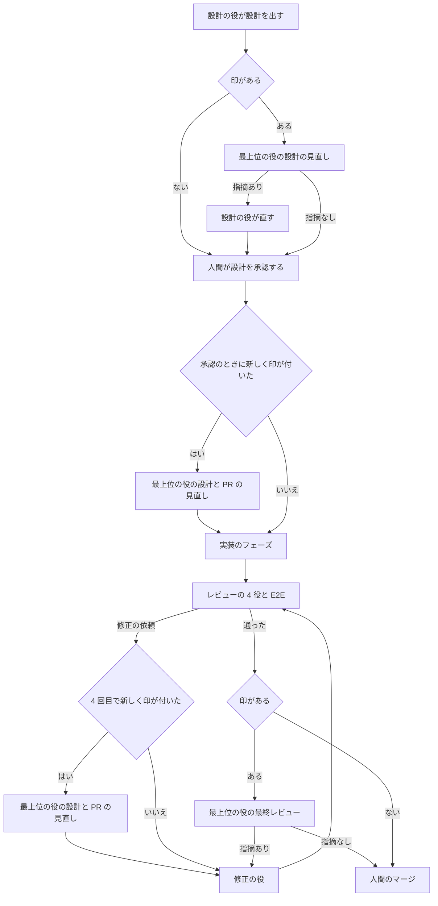

# 最上位の役で重要なタスクを見直す

重要なタスクにだけ、最上位のモデルで動く役を呼び、設計の見直しとマージ前の最終レビューをしてもらう。最上位の役は、Claude の Fable 5.2 と Codex の Astra の 2 体で、使うランタイムの分だけ必ず置く。どのタスクが重要かはラベル `重要` だけで表し、リーダーが基準に当てはめて付ける。

この文書は、役の置き方、印の付け方、呼ぶところ、使用率による選び方と、その理由を書く。今の役とフロー、レビューの 4 役、修正の役が直す決まりは置き換えない。現在のリーダーの手順は、squad-handoff の参照ファイル [leader-principal.md](../common/skills/squad-handoff/references/leader-principal.md) にある。指示の構成と移した理由は、[leader-principles.md の手順の移し先](leader-principles.md#手順の移し先)を参照する。

## 目的と範囲

最上位のモデルは枠の消費が大きいので、全タスクには使わず、重要なタスクに絞る。重要なタスクでは、設計のあとの実装と修正の往復が多くなりやすい。設計のあとと、マージの前の 2 か所で、最も強いモデルの目を通して往復を減らす。

次は対象にしない。

- 最上位の役に修正を引き受けさせること。まず見直しと最終レビューで往復が減るかを見るため
- 今の役のモデルを変えること。最上位のモデルは、新しい役だけで使う
- レビューの 4 役を最上位の役に置き換えること
- セットアップで最上位の役を外せるようにすること。どのプロジェクトでも同じ流れにするため
- 枠が戻るのを待って自動で再開すること。人間を呼んで止まる今の決まりに揃える
- 1 体のエージェントが、タスクごとにモデルを切り替えること

## 役とモデル

最上位の役は、ランタイムごとに 1 体ずつ、別の役のキーで置く。実装・修正と同じく、系統をキーで分ければ、使用率で選んだ側をそのまま依頼先にできるため。

| 役のキー | エージェントの名前 | モデル | 思考の深さ | 置く条件 |
| --- | --- | --- | --- | --- |
| `claude-principal` | `<p>-claude-principal-<m>` | `claude-fable-5-2`（Fable 5.2） | high | 使うランタイムに Claude Code がある |
| `codex-principal` | `<p>-codex-principal-<m>` | `gpt-6-astra`（Astra） | high | 使うランタイムに Codex がある |

`<p>` はプロジェクトの区別、`<m>` はメンバーの区別である。両方のランタイムを使えば 2 体、片方だけなら、その片方の 1 体だけを置く。

役のファイルは `common/agents/claude-principal.md` と `common/agents/codex-principal.md` にする。front matter の `role` は「最上位のレビュー。重要なタスクの設計と PR を見直す」、スキルは `squad-handoff, verify` にする。同時実行数は既定のままにする。

### 置き方

最上位の役は、リーダーと同じく「外す役」の候補に出さず、常に入る役として表示する。外せるのは、使うランタイムにないときだけで、実装・修正の系統と同じく、選ばれていなくても無効にする。

ほかの役と違い、ない方のランタイムのモデルへ移さない。Claude の最上位を Codex のモデルで動かすと、2 体とも Astra になり、Fable 5.2 の役がなくなるだけだから。片方だけのときに 1 体にすることは、要件のとおりである。

セットアップで変えるのは、次の 3 か所である。登録の処理（モデルとランタイムの照合、エージェントの作成、スクワッドへの追加）は、今のままで新しい役を扱える。

1. 役の一覧（`lib/render.sh` の `template_roles`）に 2 つのキーを足す
2. 「外す役」の質問（`lib/questions.sh`）で、使うランタイムにない系統の実装・修正を外す処理に、同じ系統の最上位の役を加える。常に入る役の表示に、リーダーと並べて最上位の役を出す
3. 前回の答えの検査（`lib/answers.sh`）の、外してよい役の一覧には足さない。答えのファイルで最上位の役を外そうとしたら、今の未知の役と同じく直してもらう

### 役の指示

最上位の役は、読んで指摘するだけで、直さない。ブランチへの push、PR の本文の書き換え、タスクの状態の変更をしない。修正は修正の役、設計の直しは設計の役が行う。

頼まれる見直しは、次の 3 種類である。種類は、リーダーの依頼に書く。

| 種類 | 見るもの | 主な観点 |
| --- | --- | --- |
| 設計の見直し | タスクの要件と受け入れ条件、PR の設計文書の差分、フェーズの一覧 | 要件を満たすか、見落とした場合や互換性、戻しにくさ、フェーズの切り方 |
| 設計と PR の見直し | 上に加え、その時点の PR の実装の差分 | 設計と実装の食い違い、手戻りの原因、このまま進めてよいか |
| 最終レビュー | 確かめるコミットまでの PR の差分全体と、ほかの役の結果 | 4 役が見ていない観点の取りこぼし、設計との一致、マージしてよいか |

結果は、ほかのレビューと同じく、squad-handoff の「PR にレビューやテストの結果を書く」の形で PR のコメントにする。先頭の行のマークと、重大度・場所・影響・直し方の書き方は変えない。設計と PR の見直しでは、指摘ごとに `設計` か `コード` の種類を添え、リーダーが直す役を選べるようにする。

タスクへの返事は、squad-handoff の「レビューと E2E の返事を返す」に従い、`squad-review-wait report` で返す。

## 重要の印

タスクが重要かは、ラベル `重要` だけで表す。コメントの記録や metadata は、判断の理由と経緯を残すためのもので、印の正にはしない。人間は、いつでもラベルを付け外しできる。

ラベルは原本のラベルの一覧（`common/labels`）に `重要|<色>|最上位の役に設計の見直しと最終レビューを頼むタスク` の 1 行を足して作る。色は既存の 4 つと重ならない赤系（`#dc2626`）にする。セットアップの流し直しで、既存のワークスペースにも作られる。

### 基準

次のどれか 1 つに当てはまれば重要とする。共通の基準は、リーダーの指示に書く。

1. 外部の利用者やシステムとの契約を変える。公開の API・データの形式・利用者向けの手順など、変えるときに人間の承認が要るもの
2. 認証・権限・秘密の情報・関所など、安全の仕組みに触れる
3. 戻しにくい変更をする。データの移行や削除、すでに動いている環境の設定を書き換えるもの
4. 手戻りが続いている。実装を始めたあとに設計を変えた、または同じ PR の修正の依頼が 3 回を超えた

プロジェクトの基準は、プロジェクトの説明の節「重要の基準」に番号付きで書く。リーダーは共通の基準のあとに読み、同じ扱いで当てはめる。節がないか空なら、共通の基準だけを使う。

プロジェクトの説明のひな形（`skeleton/project.md`）に、この節と記入欄を置く。記入欄には、共通の基準に加えたい条件を書くこと、なければ空のままでよいことを示す。

### 判断する時機

リーダーは、次の 3 つの時機にだけ判断する。ほかの時機には判断せず、ラベルを付けない。

| 時機 | 当てはめる基準 | 新しく印を付けたとき |
| --- | --- | --- |
| 受け付けて最初に振り分けるとき | 共通の 1〜3 と、プロジェクトの基準 | そのまま振り分ける。設計の見直しは設計が出たあとに頼む |
| 設計が承認されたとき | 共通の 1〜4 と、プロジェクトの基準 | 実装のフェーズを頼まずに止め、設計と PR の見直しを頼む |
| 修正を振り分けるとき | 共通の 4 だけ | 修正を頼まずに止め、設計と PR の見直しを頼む |

最初の振り分けでは、まだ実装も修正もないので、基準の 4 は当てはまらない。修正のときに 4 だけを見るのは、実装が進んだあとで基準の 1〜3 を見直すと、要件の時点で判断できたことを毎回読み直すことになるため。

すでにラベルがあるタスクでは判断を飛ばし、記録だけを確かめる（次の節）。

### 印の記録

リーダーは、印を付けるとき、`multica issue label add` でラベルを付け、その実行の最後のコメントに次の行を置く。当てはまった基準と理由を、人間があとから確かめられるようにするため。

```text
重要の印: 付けた。基準: <共通 N | プロジェクト N>（<基準の短い名前>）。理由: <このタスクが当てはまる理由を 1 文>
```

人間が付けたラベルを判断の時機に初めて見たときは、`重要の印: 人間が付けた印を確かめた。` の行を置く。どちらの行も、リーダーが印を見た記録になる。

リーダーは、自分からラベルを外さない。リーダーの `重要の印:` の行がタスクにあるのにラベルがなければ、人間が外したとみなし、以後そのタスクには付け直さない。最上位の役も呼ばない。

行はリーダーの最後のコメントに入れ、行だけのコメントを足さない。1 回の実行で書くコメントは 1 つという決まりを保つため。

### 修正の依頼の数え方

修正の依頼は、レビューの指摘・コンフリクト・CI の失敗のどれで修正の役へ回すときも、1 回と数える。1 タスクは 1 PR なので、タスクで数えれば同じ PR の数になる。

リーダーは、修正の依頼のコメントに `修正の依頼: <N> 回目` の行を置く。N は、そのタスクにあるリーダーのこの行の数に 1 を足したものにする。N が 4 になる依頼の前に、基準の 4 で印を付けて止める。

### 実装を始めたあとの設計の変更

実装のフェーズを 1 つでも頼んだあとに、設計の役へ設計の変更を頼むとき、リーダーは依頼に `設計の変更: 実装を始めたあと` の行を置く。変えた設計の承認と、次の修正の振り分けで、リーダーはこの行を見て基準の 4 に当てはめる。

## 最上位の役を呼ぶところ

最上位の役は、ラベル `重要` があるタスクでだけ呼ぶ。呼ぶところは次の 3 つで、印がなければ、どれも今のとおり飛ばす。



### 設計の見直し

印のあるタスクでは、設計の役は設計を draft PR にしたあと、人間ではなくスクワッドへ返す。返すコメントは、承認を頼むコメントと同じ内容（ブランチ、PR の URL、フェーズの一覧）にし、先頭のメンションだけをスクワッドに替える。人間は、最上位の役の結果のあとに同じコメントを読んで承認できる。

リーダーは、最上位の役に設計の見直しを頼む。指摘がなければ（✅）、設計の役のコメントと最上位の役の結果を示して、人間に承認を頼み、`in_review` にする。

指摘があれば（❌ か ⚠️）、設計の役に直しを頼む。設計の役は直したあと、今のとおり人間に承認を頼む。直した設計を最上位の役にもう一度見せることはしない。見直しを繰り返すと枠を使い続けるため、直しの妥当さは人間の承認で確かめる。

### 設計の承認より後に印が付いたとき

印があるのに、PR に最上位の役の結果がないタスクでは、リーダーは次の振り分けを止める。最上位の役に、設計とその時点の PR の見直しを頼む。判断の時機に新しく印を付けたときも、人間が承認のあとにラベルを付けたときも、同じに扱う。

結果の扱いは、次のとおりにする。そのあと、通常どおり最終レビューも行う。

- `設計` の指摘は、設計の役に直しを頼む。直した設計は、人間にもう一度承認してもらい、止めた振り分けはそのあとに再開する
- `コード` の指摘は、止めた修正の依頼に加えて修正の役へ回す。実装のフェーズの前なら、該当するフェーズの依頼に添える
- 指摘がなければ、止めた振り分けをそのまま再開する

### 最終レビュー

印のあるタスクでは、レビューの 4 役と E2E の返事がそろい、どれにも ❌ がなくなったあと、人間のマージへ回す前に最上位の役に最終レビューを頼む。確かめるコミットは、ほかの役が確かめたものと同じにする。最終レビューのあとで、今のとおりコンフリクトの確認をしてから人間に回す。

❌ の指摘は、ほかのレビューと同じく修正の役へ回す。直したあとは、今の決まりで必要な観点のレビューを回し直し、最後に最上位の役に新しいコミットで最終レビューをもう一度頼む。人間に回すコミットを最上位の役が見たものにするため。

⚠️ だけなら、マージを止めずに人間へ回す。同じ指摘が 2 回続けて差し戻されたときに人間を呼ぶ決まりは、最上位の役にも当てはめる。

### 返事の待ち方

最上位の役への依頼も、ほかのレビューと同じく `squad-review-wait` で返事を待つ。依頼の前に `watch` を流し、依頼のコメントに `返事を待つ役:` の行と `確かめるコミット:` の行を置く。最上位の役は 1 体だけを頼む。

最終レビューは、4 役と E2E の回とは別の回にする。4 役の結果を読んだうえで見るため、同じ回で並べて頼まない。

依頼のコメントには、見直しの種類（設計の見直し・設計と PR の見直し・最終レビュー）を書く。最上位の役は、種類に合わせて見るものを変える。

## 使用率による選び方

最上位の役を呼ぶたびに、その場の使用率を読み直して、空いている方の 1 体を選ぶ。30 分より古い値は使わない。閾値と、上限の近くで人間を呼ぶ決まりは、実装・修正と同じにする。

### 両方のランタイムがあるとき

`squad-dispatch-pick` に種類 `principal` を足す。大きさの引数は取らない。使用率の読み取り、30 分の決まり、除外の閾値（週 80% 以上、Claude の 5 時間 80% 以上、Codex の利用不可）は、`fix` と同じものを使う。

出力の `役:` は `claude-principal`、`codex-principal`、`なし` のどれかにする。`振り分け:` の行と終了コードの意味は今のまま変えない。

| 終了コード | リーダーがすること |
| --- | --- |
| 0 | `役:` の印に対応する最上位の役へ、`振り分け:` の行を添えて頼む |
| 2 | 両方とも上限の近くなので、最上位の役を飛ばさずに人間を呼び、`in_review` にする |
| 1 | 標準エラーの要約を添えて人間を呼ぶ |

使用率を読めないときは、読めた側が除外でなければその側を選び、どちらも読めなければ Codex（Astra）を選ぶ。最上位の役を呼ぶ時機は、リーダー・要件定義・設計が Claude の枠を使っている途中なので、Claude の枠を残すため。この代わりの決まりは要件にないので、承認のときに確かめてもらう。

### 片方のランタイムだけのとき

置いてある 1 体を使う。呼ぶたびに `squad-usage-read` でその場の枠を読み、実装・修正と同じ閾値で上限の近くなら、人間を呼んで `in_review` にする。読めなければ、その 1 体に固定して選んだことと理由を依頼に書く。

## 文書と指示の変更

利用者向けの文書と、役の指示を次のように変える。どれも、この文書を正本として節の名前で案内し、決まりを写しすぎない。

| 変えるもの | 変えること |
| --- | --- |
| `manual.md` の「片方だけのランタイムで動かす」 | 役の表に最上位の役の行（両方: Fable 5.2 と Astra、Claude Code だけ: Fable 5.2、Codex だけ: Astra）を足し、移さない理由を書く |
| `manual.md` の「外す役」 | 常に入る役の例と説明に、最上位の役を足す |
| `manual.md` の役の説明と流れ | 最上位の役、ラベル `重要`、基準、呼ぶところを短く書き、この文書へ案内する。導入の確認で数えるエージェントにも足す |
| `common/agents/FORMAT` | 最上位の役は系統ごとに置き、外す役に選べず、使うランタイムにない系統だけ無効にすることと、ない方のモデルへ移さないことを書く |
| `common/agents/orchestrator.md` | 共通の基準、判断する時機、印の記録、修正の依頼の数え方、呼ぶところ、使用率による選び方を書く |
| `common/agents/designer.md` | 印のあるタスクではスクワッドへ返し、最上位の役の指摘を直してから人間に承認を頼むことを書く |
| `common/squad.md` | 流れに最上位の役の 2 つの務めを足し、人間を待つところに最上位の役の両方の枠が上限の近くのときを足す |
| `skeleton/project.md` | 節「重要の基準」と記入欄を足す |
| `CONTRIBUTING.md` の「バージョンを出す前に VM で確かめる」 | 2 の項目に、最上位の役のエージェントの実行でも同じく名前で解決することを足す。新しい確認の手順は作らない |
| `CHANGELOG.md` の「次のバージョン」 | 最上位の役とランタイムごとのモデル、ラベル、導入済みのプロジェクトで人間がすること（下の節）を書く |

## 互換性と影響を受ける利用者

この変更は、契約の文書（`manual.md`、`EXTENSIONS.md`、`common/agents/FORMAT`）に触れるので、影響と互換性をここに書く。

- 導入済みのプロジェクトは、セットアップを流し直すと、最上位の役が 1〜2 体登録され、スクワッドに入る。ラベル `重要` も作られる。登録の数が変わるのは、前のバージョンから増える役があるときと同じ扱いになる
- プロジェクトの説明は、空のときにしかひな形で書かないので、導入済みのプロジェクトには節「重要の基準」が入らない。節がなくても共通の基準で動く。基準を足したい担当が、手で節を足す。`manual.md` と CHANGELOG にそう書く
- 拡張の役に、同じキー（`claude-principal`、`codex-principal`）があれば、原本の役と衝突する。実装で、登録の前に止めて理由を出すことを確かめ、`EXTENSIONS.md` の役の節に予約されたキーとして書く
- 最上位の役の枠を使うのは、印のあるタスクだけである。印のないタスクの流れと、ほかの役のモデル・思考の深さは変わらない

この原本のプロジェクト（SquadKit）の説明には、マージのあとで人間が節「重要の基準」を足し、次の 3 つを書く。原本の説明はリポジトリの外にあり、エージェントは書き換えないため。

1. 役のひな形の形式・拡張との契約・手順書の導入と更新の動作を変える
2. 導入済みのプロジェクトで、セットアップの流し直しによりエージェントやオートパイロットの登録が変わる
3. バージョンを上げる PR

## テスト

自動テストで、次を確かめる。外部の CLI は今のテストと同じくスタブを使う。

- 両方のランタイムで導入すると、`claude-principal` が `claude-fable-5-2`、`codex-principal` が `gpt-6-astra` の思考の深さ high で登録される
- Claude Code だけなら `claude-principal` だけ、Codex だけなら `codex-principal` だけが登録される
- 「外す役」の候補に最上位の役が出ず、常に入る役の表示に出る。ほかの役をどう外しても登録される。答えのファイルで外そうとすると直すよう求める
- ラベル `重要` が作られる
- `squad-dispatch-pick principal` が、使用率に応じて空いている方を選び、両方が閾値以上なら 2、古い値や読めないときは代わりの決まりで選ぶ。`principal` に大きさを渡すと使い方の誤りになる
- 展開したリーダーの指示に、両方のときは `squad-dispatch-pick principal` の決まり、片方だけのときは `squad-usage-read` の決まりが残り、ない側の役への参照が残らない
- 文書の用語と改行の検査が通る

リーダーが基準に当てはめる判断と、ラベルの付け外しの扱いは、指示の文で決まるので自動テストでは確かめない。リリース前の VM での確認で、最上位の役が動くことを確かめる。

## 残る危うさ

人間がラベルを付けて、リーダーが判断の時機に見る前に外したときは、記録が残らない。この場合、リーダーは外されたことを知らず、次の判断で基準に当てはまれば印を付ける。タイムラインにラベルの変更が残るかは CLI で確かめられないので、記録はリーダーのコメントだけに頼る。付けたあとで外したい人間は、リーダーの記録が残ってから外せば、付け直されない。

基準の 1〜3 とプロジェクトの基準は、リーダーの読みで当てはめるので、付け過ぎや付け漏れがありうる。理由をコメントに残すので、人間がラベルで正す。

## 検討した案

- 最上位の役を 1 つのキーにして、ランタイムでモデルを分ける案は選ばない。両方のランタイムで 2 体を置き、使用率で選ぶには、実装・修正と同じく系統ごとのキーが要るため
- 最上位の役をレビューの 4 役と同じ回で並べて頼む案は選ばない。4 役の結果を読んでから取りこぼしを見るほうが、重なる指摘が減り、枠も節約できるため
- 直した設計をもう一度最上位の役に見せる案は選ばない。見直しが続くと枠を使い続け、人間の承認で直しの妥当さを確かめれば足りるため
- 印をタスクの metadata で表す案は選ばない。人間が画面で付け外ししやすく、一覧で絞り込めるラベルを正にするため
- 使用率を読めないときに人間を呼ぶ案は選ばない。実装・修正と同じく代わりの決まりで進め、読めた値がないことを依頼に残すほうが、止まる回数が少ないため
