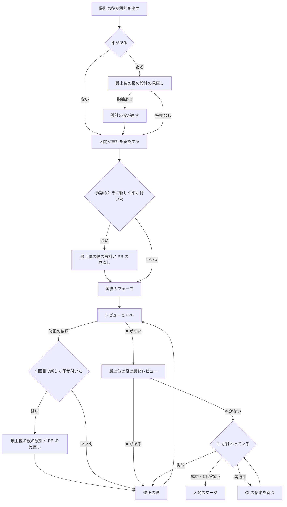

# 最上位の役の最終レビューと重要なタスクの見直し

すべてのタスクで、人間のマージの前に、最上位のモデルで動く役が最終レビューをする。リスクの高いタスクには印 `重要` を付け、最終レビューに加えて設計の見直しも頼み、レビューの観点をすべて回す。最上位の役は、Claude の Fable 5.2 と Codex の Astra の 2 体で、使うランタイムの分だけ必ず置く。

この文書は、役の置き方、印の意味と付け方、呼ぶところ、最上位の役の選び方、マージの前に CI を待つ決まりと、その理由を書く。今の役とフロー、レビューの 4 役、修正の役が直す決まりは置き換えない。現在のリーダーの手順は、squad-handoff の参照ファイル [leader-principal.md](../common/skills/squad-handoff/references/leader-principal.md) にある。指示の構成と移した理由は、[leader-principles.md の手順の移し先](leader-principles.md#手順の移し先)を参照する。改善の計画での位置は、[workflow.md の後続のタスクの候補](workflow.md#後続のタスクの候補)の候補 7 である。

## 目的と範囲

目的は、レビューの取りこぼしを人間が自分で見つける手間と、マージのあとの CI の失敗で人間が呼び直される手間を減らすことである。計画の記録では、実行時間の上位 10 件のうち印があるのは 3 件で、最上位の役が重いタスクに届いていなかった。そこで最終レビューを印から切り離し、すべてのタスクで行う。

印は「リスクが高い」を表すものにする。印のあるタスクでは、今のとおり設計の見直しを頼み、レビューの観点をすべて回す。最終レビューは印によらないので、人間が印を外したタスクでも行う。

次は対象にしない。

- 最上位の役に修正を引き受けさせること。最上位の役は、読んで指摘するだけにする
- 今の役のモデルを変えること。最上位の役のモデルと思考の深さも、ここでは変えない。候補 6 で扱う
- レビューの 4 役を最上位の役に置き換えること
- セットアップで最上位の役を外せるようにすること。どのプロジェクトでも同じ流れにするため
- 文書だけのタスクを最終レビューから外すこと。計画で要件の再合意が要る案に分けてあり、候補 9 の測り直しのあとに決める
- 観点の選び方と、返事がそろったあとの次の依頼のスクリプト化。使用率の閾値と、上限に近いときに待つ決まり。どれも候補 3 で扱う
- 実行の証拠を PR に置く決まりそのもの。候補 5 で扱う。最終レビューは、証拠があれば読む
- 1 体のエージェントが、タスクごとにモデルを切り替えること

## 役とモデル

最上位の役は、ランタイムごとに 1 体ずつ、別の役のキーで置く。実装・修正と同じく、系統をキーで分ければ、選んだ側をそのまま依頼先にできるため。

| 役のキー | エージェントの名前 | モデル | 思考の深さ | 置く条件 |
| --- | --- | --- | --- | --- |
| `claude-principal` | `<p>-claude-principal-<m>` | `claude-fable-5-2`（Fable 5.2） | high | 使うランタイムに Claude Code がある |
| `codex-principal` | `<p>-codex-principal-<m>` | `gpt-6-astra`（Astra） | high | 使うランタイムに Codex がある |

`<p>` はプロジェクトの区別、`<m>` はメンバーの区別である。両方のランタイムを使えば 2 体、片方だけなら、その片方の 1 体だけを置く。

役のファイルは `common/agents/claude-principal.md` と `common/agents/codex-principal.md` にする。front matter の `role` は「最上位のレビュー。すべてのタスクの PR の最終レビューと、重要なタスクの設計を見直す」にする。スキルは `squad-handoff, verify` で、同時実行数は既定のままにする。

### 置き方

最上位の役は、リーダーと同じく「外す役」の候補に出さず、常に入る役として表示する。外せるのは、使うランタイムにないときだけで、実装・修正の系統と同じく、選ばれていなくても無効にする。

ほかの役と違い、ない方のランタイムのモデルへ移さない。Claude の最上位を Codex のモデルで動かすと、2 体とも Astra になり、Fable 5.2 の役がなくなるだけだから。片方だけのときに 1 体にすることは、要件のとおりである。

セットアップで変えるのは、次の 3 か所である。登録の処理（モデルとランタイムの照合、エージェントの作成、スクワッドへの追加）は、今のままで新しい役を扱える。

1. 役の一覧（`lib/render.sh` の `template_roles`）に 2 つのキーを足す
2. 「外す役」の質問（`lib/questions.sh`）で、使うランタイムにない系統の実装・修正を外す処理に、同じ系統の最上位の役を加える。常に入る役の表示に、リーダーと並べて最上位の役を出す
3. 前回の答えの検査（`lib/answers.sh`）の、外してよい役の一覧には足さない。答えのファイルで最上位の役を外そうとしたら、今の未知の役と同じく直してもらう

### 役の指示

最上位の役は、読んで指摘するだけで、直さない。ブランチへの push、PR の本文の書き換え、タスクの状態の変更をしない。修正は修正の役、設計の直しは設計の役が行う。

頼まれる見直しは、次の 3 種類である。種類は、リーダーの依頼に書く。要件の「最終確認」は、この文書の最終レビューと同じものを指す。依頼の行の値を変えると、候補 3 のスクリプトと今の返事の読み方が合わなくなるため、名前は最終レビューのままにする。

| 種類 | 見るもの | 主な観点 |
| --- | --- | --- |
| 設計の見直し | タスクの要件と受け入れ条件、PR の設計文書の差分、フェーズの一覧 | 要件を満たすか、見落とした場合や互換性、戻しにくさ、フェーズの切り方 |
| 設計と PR の見直し | 上に加え、その時点の PR の実装の差分 | 設計と実装の食い違い、手戻りの原因、このまま進めてよいか |
| 最終レビュー | [見る範囲](#見る範囲)のとおり、初回は PR の差分全体とほかの役の結果、再確認は前の最終レビューからの差分 | 4 役が見ていない観点の取りこぼし、設計との一致、マージしてよいか |

結果は、ほかのレビューと同じく、squad-handoff の「PR にレビューやテストの結果を書く」の形で PR のコメントにする。先頭の行のマークと、重大度・場所・影響・直し方の書き方は変えない。設計と PR の見直しでは、指摘ごとに `設計` か `コード` の種類を添え、リーダーが直す役を選べるようにする。

タスクへの返事は、squad-handoff の「レビューと E2E の返事を返す」に従い、`squad-review-wait report` で返す。

## 重要の印

印 `重要` は、リスクが高いタスクを表す。印があると、最上位の役の設計の見直しと、すべての観点のレビューが加わる。最終レビューは印によらず行うので、印は最上位の役を呼ぶかどうかの印ではない。

タスクに印があるかは、ラベル `重要` だけで表す。コメントの記録や metadata は、判断の理由と経緯を残すためのもので、印の正にはしない。人間は、いつでもラベルを付け外しできる。

ラベルは原本のラベルの一覧（`common/labels`）の 1 行で作る。説明は `リスクが高いタスク。最上位の役に設計を見直してもらい、レビューの観点をすべて回す` に変える。色は今の赤系（`#dc2626`）のままにする。セットアップは、同じ名前のラベルがあれば色と説明を更新するので、流し直しで既存のワークスペースの説明も変わる。

### 基準

次のどれか 1 つに当てはまれば重要とする。共通の基準は、リーダーの指示に書く。

1. 外部の利用者やシステムとの契約を変える。公開の API・データの形式・利用者向けの手順など、変えるときに人間の承認が要るもの
2. 認証・権限・秘密の情報・関所など、安全の仕組みに触れる
3. 戻しにくい変更をする。データの移行や削除、すでに動いている環境の設定を書き換えるもの
4. 手戻りが続いている。実装を始めたあとに設計を変えた、または同じ PR の修正の依頼が 3 回を超えた

共通 4 は、手戻りが設計と要件の食い違いを表すリスクとして残す。手戻りが続くのは、設計か要件が実際の必要と合っていないことが多い。そのため、印を付けて設計と PR の見直しを頼み、食い違いを探してもらう。付く条件と、付いたときの動作は変えない。リーダーの指示にある共通 4 の説明だけを、この意味に書き直す。

プロジェクトの基準は、プロジェクトの説明の節「重要の基準」に番号付きで書く。リーダーは共通の基準のあとに読み、同じ扱いで当てはめる。節がないか空なら、共通の基準だけを使う。

プロジェクトの説明のひな形（`skeleton/project.md`）に、この節と記入欄を置く。節の前置きは、印のあるタスクで最上位の役に設計の見直しを頼み、観点をすべて回すことを書く。最終レビューはすべてのタスクで行うので、前置きに含めない。

### 判断する時機

リーダーは、次の 3 つの時機にだけ判断する。ほかの時機には判断せず、ラベルを付けない。この節と、次の印の記録、修正の依頼の数え方は変えない。

| 時機 | 当てはめる基準 | 新しく印を付けたとき |
| --- | --- | --- |
| 受け付けて最初に振り分けるとき | 共通の 1〜3 と、プロジェクトの基準 | そのまま振り分ける。設計の見直しは設計が出たあとに頼む |
| 設計が承認されたとき | 共通の 1〜4 と、プロジェクトの基準 | 実装のフェーズを頼まずに止め、設計と PR の見直しを頼む |
| 修正を振り分けるとき | 共通の 4 だけ | 修正を頼まずに止め、設計と PR の見直しを頼む |

最初の振り分けでは、まだ実装も修正もないので、基準の 4 は当てはまらない。修正のときに 4 だけを見るのは、実装が進んだあとで基準の 1〜3 を見直すと、要件の時点で判断できたことを毎回読み直すことになるため。

すでにラベルがあるタスクでは判断を飛ばし、記録だけを確認する（次の節）。

### 印の記録

リーダーは、印を付けるとき、`multica issue label add` でラベルを付け、その実行の最後のコメントに次の行を置く。当てはまった基準と理由を、人間があとから確認できるようにするため。

```text
重要の印: 付けた。基準: <共通 N | プロジェクト N>（<基準の短い名前>）。理由: <このタスクが当てはまる理由を 1 文>
```

人間が付けたラベルを判断の時機に初めて見たときは、`重要の印: 人間が付けた印を確認した。` の行を置く。どちらの行も、リーダーが印を見た記録になる。

リーダーは、自分からラベルを外さない。リーダーの `重要の印:` の行がタスクにあるのにラベルがなければ、人間が外したとみなし、以後そのタスクには付け直さない。設計の見直しと設計と PR の見直しも頼まない。最終レビューは、印のないタスクと同じく頼む。

行はリーダーの最後のコメントに入れ、行だけのコメントを足さない。1 回の実行で書くコメントは 1 つという決まりを保つため。

### 修正の依頼の数え方

修正の依頼は、レビューの指摘・コンフリクト・CI の失敗のどれで修正の役へ回すときも、1 回と数える。最終レビューの ❌ で回すときも同じに数える。1 タスクは 1 PR なので、タスクで数えれば同じ PR の数になる。

リーダーは、修正の依頼のコメントに `修正の依頼: <N> 回目` の行を置く。N は、そのタスクにあるリーダーのこの行の数に 1 を足したものにする。N が 4 になる依頼の前に、基準の 4 で印を付けて止める。

### 実装を始めたあとの設計の変更

実装のフェーズを 1 つでも頼んだあとに、設計の役へ設計の変更を頼むとき、リーダーは依頼に `設計の変更: 実装を始めたあと` の行を置く。変えた設計の承認と、次の修正の振り分けで、リーダーはこの行を見て基準の 4 に当てはめる。

## 最上位の役を呼ぶところ

最上位の役を呼ぶところは次の 3 つである。設計の見直しと、設計と PR の見直しは、印のあるタスクだけで行う。最終レビューは、印の有無によらず、すべてのタスクで行う。



### 設計の見直し

印のあるタスクでは、設計の役は設計を draft PR にしたあと、人間ではなくスクワッドへ返す。返すコメントは、承認を頼むコメントと同じ内容（ブランチ、PR の URL、フェーズの一覧）にし、先頭のメンションだけをスクワッドに替える。人間は、最上位の役の結果のあとに同じコメントを読んで承認できる。

リーダーは、最上位の役に設計の見直しを頼む。指摘がなければ（✅）、設計の役のコメントと最上位の役の結果を示して、人間に承認を頼み、`in_review` にする。

指摘があれば（❌ か ⚠️）、設計の役に直しを頼む。設計の役は直したあと、今のとおり人間に承認を頼む。直した設計を最上位の役にもう一度見せることはしない。見直しを繰り返すと枠を使い続けるため、直しの妥当さは人間の承認で確認する。

### 設計の承認より後に印が付いたとき

印があるのに、PR に最上位の役の結果がないタスクでは、リーダーは次の振り分けを止める。最上位の役に、設計とその時点の PR の見直しを頼む。判断の時機に新しく印を付けたときも、人間が承認のあとにラベルを付けたときも、同じに扱う。ここでいう結果は、設計の見直しと、設計と PR の見直しの結果である。最終レビューの結果は数えない。

結果の扱いは、次のとおりにする。そのあと、通常どおり最終レビューも行う。

- `設計` の指摘は、設計の役に直しを頼む。直した設計は、人間にもう一度承認してもらい、止めた振り分けはそのあとに再開する
- `コード` の指摘は、止めた修正の依頼に加えて修正の役へ回す。実装のフェーズの前なら、該当するフェーズの依頼に添える
- 指摘がなければ、止めた振り分けをそのまま再開する

### 最終レビュー

すべてのタスクで、レビューと E2E の返事がそろい、どれにも ❌ がなくなったあと、人間のマージへ回す前に最上位の役に最終レビューを頼む。文書だけのタスクも、印を人間が外したタスクも含める。確認するコミットを、ほかの役が確認したコミットと照合する。

❌ の指摘は、ほかのレビューと同じく修正の役へ回す。直したあとは、今の決まりで必要な観点のレビューを回し直し、最後に最上位の役に新しいコミットで最終レビューをもう一度頼む。人間に回すコミットを最上位の役が見たものにするため。

⚠️ だけなら、マージを止めずに人間へ回す。同じ指摘が 2 回続けて差し戻されたときに人間を呼ぶ決まりは、最上位の役にも当てはめる。

最上位の役がない構成はない。最上位の役は外せず、使うランタイムの系統の分だけ必ず置くため。プロジェクトが前のバージョンのままで役がないときは、リーダーの指示にも最上位の役がないので、今のとおり最終レビューを飛ばす。

### 見る範囲

初回の最終レビューは、PR の差分全体と、ほかの役の結果・実行の証拠を読む。直したあとの再確認は、前の最終レビューの `確認したコミット:` から、今の確認するコミットまでの差分だけを見る。初回で全体を見たので、再確認で同じ差分を読み直して枠を使わないため。

リーダーは、最終レビューの依頼に次の行を置く。最上位の役は、この行に合わせて読む範囲を変える。

```text
見る範囲: <PR の差分全体 | <前の SHA>..<今の SHA>>
```

再確認でも、次のときは `PR の差分全体` にする。範囲を狭めると、見ていない変更を見たことにしてしまうためである。

- 前の最終レビューの `確認したコミット:` が、今の確認するコミットの祖先でない。force push や base の取り込みで履歴が書き換わったとき
- 前の最終レビューの結果に `確認したコミット:` がないか、読めない

実行の証拠は、PR かタスクにあるものを読む。証拠の置き方は候補 5 で決める。ないときは、ないことを結果に書き、それだけで ❌ にはしない。

### 人間へ回す head の照合

人間へ回す直前に、PR の今の head の SHA と、最上位の役の最終レビューの `確認したコミット:` を照合する。今は印のあるタスクだけで行う照合を、すべてのタスクに広げる。

一致しなければ、コンフリクトの解消など理由を問わず、今の head で最終レビューをもう一度頼む。その結果を受けてから人間へ回す。この再依頼は、ほかのレビューを回し直すかとは別に行う。見る範囲は、前の最終レビューからの差分にする。

`leader-pr-checks.md` の「コンフリクトの規則の入れ直し」にある、解消の push のあとの最終レビューの頼み直しも、印の条件を外してすべてのタスクに当てはめる。

### 返事の待ち方

最上位の役への依頼も、ほかのレビューと同じく `squad-review-wait` で返事を待つ。依頼の前に `watch` を流し、依頼のコメントに `返事を待つ役:` の行と `確認するコミット:` の行を置く。最上位の役は 1 体だけを頼む。

最終レビューは、4 役と E2E の回とは別の回にする。4 役の結果を読んだうえで見るため、同じ回で並べて頼まない。

依頼のコメントには、`見直しの種類: <設計の見直し | 設計と PR の見直し | 最終レビュー>` の行を書く。最上位の役は、種類に合わせて見るものを変える。最終レビューでは、上の `見る範囲:` の行も置く。

## 最上位の役の選び方

最終レビューは、実装した系統と違う系統の最上位の役を優先する。同じ系統のモデルは、同じ書き方の癖を見落としやすいためである。設計の見直しと、設計と PR の見直しは、今のとおり空いている方を選ぶ。

どの依頼でも、最上位の役を呼ぶたびに、その場の使用率を読み直す。30 分より古い値は使わない。閾値は、実装・修正と同じにする。

### 実装した系統の決め方

実装した系統は、そのタスクで実装と修正の役が成功で終えた実行を、系統ごとに数えて決める。リーダーは `multica issue runs <タスク>` の実行の一覧を読み、エージェントの ID を指示の「このスクワッドの役」と照合する。状態が `completed` の実行だけを数え、失敗（`failed`）や取り消しで終わった実行は数えない。

失敗で終わった実行を除くのは、成果物を残さない試行で系統が逆転しないためである。たとえば Claude が 1 回で実装し、Codex が変更を残さず 2 回失敗したときも、実装した系統は Claude になる。

| 成功で終えた実行の数 | 実装した系統 |
| --- | --- |
| 片方の系統だけ | その系統 |
| 両方の系統で、数が違う | 多い方の系統 |
| 両方の系統で、数が同じ | 決めない |
| 実装と修正の実行がない | 設計の役の系統。文書だけのタスクでは、設計の役が PR の中身を書いたため |

設計の役の系統は、指示の「このスクワッドの役」にある設計の役のモデルで決める。`claude-` で始まれば Claude、それ以外は Codex とする。候補 3 の名簿の読み方と同じ決め方である。

実行の一覧を読めないときは、実装した系統を決めない。決めないときは、優先する系統がないので、今のとおり空いている方を選ぶ。

この数え方は、実際に書いた量の近似である。成功で終えたが変更を積まなかった実行（直す必要がないと返した、などの実行）も数えるので、そうした実行が多い系統を実装した系統と決めることがある。そのときは、実際に多く書いた系統と同じ系統の最上位の役が最終レビューをする。この逆転は、設計の承認で人間に判断してもらう例外である。コミットの作者で数える案を選ばない理由は、[検討した案](#検討した案)に書く。

### 両方のランタイムがあるとき

`squad-dispatch-pick principal` に、実装した系統を渡す引数を足す。最終レビューでは `squad-dispatch-pick principal <Claude | Codex>` で呼び、設計の見直しと、実装した系統を決めないときは、今のとおり引数なしで呼ぶ。

| 状態 | 選ぶ側 | `振り分け:` の行に足す理由 |
| --- | --- | --- |
| 優先する系統が上限の近くでない | 優先する系統 | なし |
| 優先する系統だけが上限の近く | 実装した系統 | `<優先する系統> は <除外の理由> のため、実装と同じ系統へ回した` |
| 両方が上限の近く | なし（終了コード 2） | 今のとおり |
| 使用率を読めない | 優先する系統 | 今の、読めなかった理由 |

優先する系統は、渡した系統と違う方である。上限の近くかの判定は今と同じで、週 80% 以上、Claude の 5 時間 80% 以上、Codex の利用不可である。優先する系統が空いていれば、使ってよい量の余りが少なくても、その系統を選ぶ。

優先する系統だけが上限の近くのときは、人間を呼ばない。`振り分け:` の行の理由が、要件の「依頼に理由の 1 行を残す」に当たる。リーダーは今のとおり、この行を依頼に添える。

使用率を読めないときに優先する系統を選ぶのは、読めない値で優先を崩さないためである。今の代わりの決まり（Codex を選ぶ）は、引数がないときにだけ使う。

出力の `役:` の値、`振り分け:` の行の形、終了コードの意味は変えない。

| 終了コード | リーダーがすること |
| --- | --- |
| 0 | `役:` の印に対応する最上位の役へ、`振り分け:` の行を添えて頼む |
| 2 | 両方とも上限の近くなので、最上位の役を飛ばさずに人間を呼び、`in_review` にする。候補 3 が入ったあとは、候補 3 の使用率の待ちに従う |
| 1 | 標準エラーの要約を添えて人間を呼ぶ |

引数なしのときの動きは今のままにする。使用率の空いている方を選び、読めないときは、読めた側が除外でなければその側、どちらも読めなければ Codex（Astra）を選ぶ。

### 片方のランタイムだけのとき

置いてある 1 体を使う。優先する系統は選べないので、実装した系統は決めない。呼ぶたびに `squad-usage-read` でその場の枠を読み、実装・修正と同じ閾値で上限の近くなら、人間を呼んで `in_review` にする。読めなければ、その 1 体に固定して選んだことと理由を依頼に書く。候補 3 が入ったあとは、上限の近くでは候補 3 の使用率の待ちに従う。

## マージの前に CI を待つ

最終レビューが通った時点で CI が終わっていなければ、マージの依頼を出さず、CI の結果を待つ。CI が成功してから、マージの依頼を 1 回だけ出す。マージのあとの CI の失敗で人間が呼び直されることと、途中の状態だけを伝える呼び出しを減らすためである。

CI の見張りがない構成と、CI のチェックがない PR では待たない。最終レビューが通ったら、今のとおりすぐにマージの依頼を出す。

### 待つ上限

待つ上限は、PR の head ごとに 2 時間とする。上限に達したら、それ以上は待たず、CI が実行中か未確認であることを書いてマージの依頼を 1 回出す。

2 時間にするのは、通常の CI の実行と順番待ちが収まり、止まった CI を待ち続けないためである。原本の CI のジョブは、どれも 15 分以内の時間切れを付けている。2 時間を超えて終わらない原因は、ランナーの順番待ちや止まったジョブが多い。どちらもエージェントでは直せない。そこで人間に判断を移す。上限は `squad-pr-watch` の定数に置き、設計の承認で確認する。

上限に達したときにマージの依頼を出すのは、人間を呼ぶ回数を 1 回に保つためである。人間を呼んで止まる案と比べても、人間が判断することは同じである。マージの依頼にまとめれば、CI が終わったあとにもう一度呼ぶ必要がない。

CI を読めないあいだも、成功を確認していないので待ち続ける。読めないまま上限に達したときだけ、CI が未確認であることを書いてマージの依頼を出す。上限で成功を待たずに依頼が来るのは、実行中と未確認のこの 2 つだけで、どちらも設計の承認で人間に判断してもらう例外である。

上限のあとで CI が失敗したときは、今の CI の見張りがリーダーに知らせる。タスクは `in_review` だが、今の CI の失敗の決まりのとおり修正へ回す。

### 待ち方

`squad-pr-watch` に、`ci-wait <タスク> <リーダー> <きっかけのコメント> [<起きた規則>]` と `ci-wait-clear <タスク>` を足す。`ci-wait` は PR の今の head の CI を読み、次の 1 行を標準出力に出す。行の形は、今の `ci-check` の `CI <SHA>:` の行に揃える。

| 出力の行 | 状態 | スクリプトがすること |
| --- | --- | --- |
| `CI <SHA>: 成功` | すべてのチェックが成功した | 待ちを終える |
| `CI <SHA>: チェックなし` | PR にチェックがない | 待ちを終える |
| `CI <SHA>: 失敗あり` | 確定した失敗がある | 失敗を受けた記録を書き、待ちを終える。続く行にチェックの名前を出す |
| `CI <SHA>: 実行中` | 失敗がなく、終わっていないチェックがある | 待ちの規則を作り直す |
| `CI <SHA>: 未確認`、`CI: 未確認` | PR か CI を読めなかった | 待ちの規則を作り直す |
| `CI <SHA>: 実行中（待つ上限の 2 時間を超えた）` | 上限を超えても実行中 | 待ちを終える |
| `CI <SHA>: 未確認（待つ上限の 2 時間を超えた）` | 上限を超えても読めない | 待ちを終える |
| `CI <SHA>: PR がマージ済みか閉じている` | PR が `MERGED` か `CLOSED` | 待ちを終える |
| `CI 待ち: タスクが終わっている` | タスクの状態の区分が `done` か `cancelled` | PR や CI を読まず、待ちを終える |
| `CI <SHA>: マージを依頼済み` | 同じ head のマージの依頼がすでにある | 待ちを終える |
| `CI 待ち: 終わった規則で起きた` | 起きた規則が、今の待ちの規則でない | 何もしない |

失敗の判定は、今の `ci-check` と `ci-held` と同じ関数を使う。取り消し（CANCELLED）は失敗に数えない。失敗のときは `ci-held` と同じ受けた記録を書く。CI の見張りが同じ失敗をもう一度リーダーへ知らせないためである。

「待ちを終える」は、待ちの規則を消し、待ちの記録の metadata を消すことである。`ci-wait-clear` も同じことをする。待ちを離れるどの分岐でも規則を残さないので、終わった待ちの規則があとからリーダーを起こさない。読み取りや削除に失敗したときは、終了コード 1 で止まる。

終了済みの PR とタスクでは、CI の結果と待つ上限にかかわらず待ちを終える。規則を登録した直後の再読で PR の終了が分かった場合も、作った規則を解除する。リーダーは依頼も状態変更も行わない。

#### 待ちの規則

待ちの規則は、リーダー自身を 1 回だけ起こす wakeup である。`--until-pr checks` を条件にし、`--on-timeout wake` を付ける。`--expires-in` は、上限までの残りと 30 分の短い方にする。作る前に、同じタスクの古い待ちの規則を消す。

時間切れでも起こすのは、`--until-pr checks` が起きない場合があるためである。この条件は、タスクに紐付いた PR と、サーバーが持つ GitHub の結果でしか判定されない。PR が紐付いていないときや CI を読めないときも、30 分ごとにリーダーが起きて読み直す。待ちは上限までに 4 回ほど起きる。

待ちの記録は、タスクの metadata の `ci_wait_head`、`ci_wait_since`、`ci_wait_rule` に残す。head が変わったら、時刻を数え直す。head を読めないときは、今の記録の時刻のまま数え、記録がなければその時刻から数え始める。上限を超えたかは、この時刻と今の時刻で決める。

規則を作ったあとで、CI をもう一度読む。`--until-pr checks` は作ったあとに終わった結果でしか起きないので、作る直前に CI が終わっていると起きないためである。終わっていれば規則を消し、その結果の行を出す。

#### 依頼を 1 回にする

マージの依頼は、同じ head で 1 回だけにする。そのため、次の 2 つで重ねて防ぐ。

1. 待ちの規則で起きた実行は、起きた規則の ID を `ci-wait` に渡す。ID が metadata の `ci_wait_rule` と違うか、待ちの記録がなければ、規則はもう終わっている。`ci-wait` は何もせず `CI 待ち: 終わった規則で起きた` を出す。消す前に起動が決まっていた規則の実行も、ここで止まる
2. リーダーは、マージの依頼のコメントに `マージの依頼: <head の完全な SHA>` の行を置く。`ci-wait` は、リーダーのコメントに今の head のこの行があれば、`マージを依頼済み` を出す。待ちの記録が消えていても、同じ head の依頼を出し直さない

1 は、規則の ID で終わった待ちを見分ける。2 は、別の経路で起きた実行が先に依頼を出した場合も含めて、コメントそのもので依頼の有無を見る。行は依頼と同じコメントに置くので、依頼を出さずに行だけが残ることはない。

### リーダーの手順

リーダーは、人間のマージへ回す前の確認を、次の順に流す。今の順（紐付け、コンフリクト）に、head の照合と CI の待ちを足す。

1. PR の紐付けの確認
2. [人間へ回す head の照合](#人間へ回す-head-の照合)
3. `squad-pr-watch conflicts-check`
4. CI の見張りがあれば `squad-pr-watch ci` を流し、続けて `squad-pr-watch ci-wait` を流す
5. コンフリクトの規則の入れ直し（`squad-pr-watch conflicts`）
6. マージの依頼。[依頼を 1 回にする](#依頼を-1-回にする)の `マージの依頼:` の行を置く

4 の `ci-wait` の行で、次の動きを決める。

| 行 | リーダーがすること |
| --- | --- |
| 成功、チェックなし | マージの依頼へ進み、行をそのまま添える |
| 実行中、未確認 | マージの依頼を出さない。人間を呼ばず、状態は `in_progress` のままにする。待っていることと行を、最後のコメントに書いて終わる |
| 実行中・未確認で上限を超えた | マージの依頼へ進み、行をそのまま添える。CI の結果を見てからマージしてよいかを人間に判断してもらう。「通った」とは書かない |
| 失敗あり | 今の CI の失敗の決まりで修正へ回す。修正の依頼の数え方も今のとおり。人間は呼ばない |
| PR がマージ済みか閉じている、タスクが終わっている、マージを依頼済み、終わった規則で起きた | 依頼も状態の変更もせず、行を書いて終わる |
| 終了コード 1 | 標準エラーの要約を添えて人間を呼び、`in_review` にする。CI の途中の状態を知らせる呼び出しではなく、スクリプトの誤りの報告である |

待ちの規則で起きても、ほかのコメントで起きても、待っているタスクでは 1 からもう一度流す。待つ間に head が変わっていれば、2 で最終レビューを頼み直す。

待っているタスク（metadata の `ci_wait_head` がある）で、CI の待ち以外の理由で修正、最終レビューの頼み直し、人間の呼び出しへ進むときは、その前に `ci-wait-clear` を流す。待ちを離れたあとに規則が残らないようにするためである。失敗で修正へ回すときの回数と、同じワークフローの失敗が 2 回続いたら人間へ返す決まりは変えない。

CI の見張りの実行（`ci-check`）は、今のとおり CI が終わるたびに起きる。成功では記録だけを書き、リーダーを起こさない。CI の成功でリーダーを起こすのは、マージの依頼を待っているときだけにするため、待ちの規則を別に作る。

## 候補 3 との合わせ方

候補 3（[PR #68](https://github.com/AnD00/multica-squad-kit/pull/68) の設計、`docs/review-next-step.md`）は、返事がそろったあとの次の依頼をスクリプト `squad-review-next decide` に移す。その中の最終レビューの依頼とマージの依頼を、この設計に合わせる。どちらが先にマージされても、あとに入る側の実装で合わせる。

| 候補 3 の箇所 | 今の候補 3 の設計 | 合わせたあと |
| --- | --- | --- |
| 「次の依頼の決め方」の表の 7 | 印があり、同じコミットの最終レビューがない | 同じコミットの最終レビューがない。印は見ない |
| 「最終レビューの依頼」の条件 | 印があり、❌ のない組 | ❌ のない組。最上位の役がないときだけ飛ばす |
| 「最終レビューの依頼」の行 | `見直しの種類:`、`確認するコミット:`、`返事を待つ役:`、`振り分け:`、`前の回:` | 加えて `見る範囲:` の行を置く |
| 最上位の役の選び方 | `squad-usage-wait pick <タスク> principal` | 実装した系統を決めて渡し、`squad-dispatch-pick principal <系統>` に渡す |
| 「マージの依頼」の 2 | 印のあるタスクでは head を照合する | すべてのタスクで照合する |
| 「マージの依頼」の 5 | CI の見張りがあれば `squad-pr-watch ci` | 続けて `squad-pr-watch ci-wait` を流す。成功とチェックなしで進む。実行中と未確認は、待ちの規則を残してリーダーを起こさずに終える。上限の超過は行を添えて進む。失敗はリーダーを起こす。依頼済みと終わった規則は何もしない |
| 「マージの依頼」の本文 | マージの依頼を書く | `マージの依頼: <head の完全な SHA>` の行を置く |
| 修正・最終レビュー・人間の呼び出しへ進む分岐 | 待ちの記録を見ない | 待っているタスクでは、先に `ci-wait-clear` を流す |
| 待ちの規則で起きたとき | なし | `decide` に起きた規則の ID を渡し、`ci-wait` へそのまま渡す |
| 「目的と範囲」の対象外 | 最終確認の拡大は候補 7 で扱う | この行を消す |

実装した系統は、`decide` もリーダーと同じ[実装した系統の決め方](#実装した系統の決め方)で決める。候補 3 の名簿から、実装と修正の役のエージェントの ID と、設計の役のモデルを読める。`squad-usage-wait pick` は、工程 `principal` のときだけ系統の引数を受け、`squad-dispatch-pick` へそのまま渡す。

あとに入る側は、次のように合わせる。

- 候補 3 が先にマージされたとき: この変更の実装で、`squad-review-next` と `squad-usage-wait` を上の表のとおりに変え、テストを足す。`docs/review-next-step.md` の該当する節も、同じ PR で直す
- この変更が先にマージされたとき: 候補 3 の実装を始める前に、候補 3 の設計を上の表のとおりに直し、承認をもらう。候補 3 の実装は、この変更が入った main に合わせる

どちらの順でも、次の場面を、あとに入る側のテストで確認する。

- 受け入れ条件 15: 候補 3 のスクリプトが入った main で、印のないタスクにも最終レビューが頼まれる
- `decide` が、CI の実行中と未確認ではマージの依頼を出さず、待ちの規則を残す
- 待ちの規則で起きた `decide` が、成功ならマージの依頼を 1 回出し、規則を消す。終わった規則の ID や依頼済みの head では、何も出さない
- 待っているタスクで `decide` が修正や最終レビューの依頼へ進むとき、規則を消す

## 文書と指示の変更

利用者向けの文書と、役の指示とリーダーの手順を次のように変える。どれも、この文書を正本として節の名前で案内し、決まりを写しすぎない。

| 変えるもの | 変えること |
| --- | --- |
| `common/skills/squad-handoff/references/leader-principal.md` | 冒頭と「印と最上位の役」を、印はリスク、最終レビューはすべてのタスクにする。「最上位の役を呼ぶところ」の最終レビューを全タスクにし、見る範囲と head の照合を書く。「最上位の役の選び方」に、実装した系統の決め方と引数を書く |
| `common/skills/squad-handoff/references/leader-pr-checks.md` | 「CI」に CI の待ちの手順を足し、「CI はその場で待たない」を、待ちの規則で待つと書き直す。マージの前の確認の順を、この文書のとおりにする。「コンフリクトの規則の入れ直し」の頼み直しから印の条件を外す |
| `common/agents/orchestrator.md` | 共通 4 の説明を、手戻りが設計と要件の食い違いを表すリスクだという意味に直す。最上位の役の説明を、印のあるタスクだけから、すべてのタスクの最終レビューに直す |
| `common/agents/claude-principal.md`、`common/agents/codex-principal.md` | `role` を変え、最終レビューの見る範囲（初回と再確認）と、実行の証拠を読むことを書く |
| `common/agents/designer.md` | 変えない。印のあるタスクでスクワッドへ返す決まりは今のまま |
| `common/labels` | ラベル `重要` の説明を変える |
| `common/squad.md` | 最上位の役の務めを、すべてのタスクの最終レビューと、印のあるタスクの設計の見直しに直す |
| `skeleton/project.md` | 節「重要の基準」の前置きを、印の新しい意味に直す |
| `common/monitor/squad-dispatch-pick` | `principal` に、実装した系統の引数を足す |
| `common/monitor/squad-pr-watch` | `ci-wait` を足す |
| `manual.md` の「重要なタスクと最上位の役」 | 節の名前と説明を、すべてのタスクの最終レビューと印の意味に直す。呼ぶところ、選び方、CI の待ちを短く書く。目次の行と、「外す役」の最上位の役の説明の文も直す |
| `docs/leader-principles.md` | 手順の移し先の表と、保つ記述の表にある最上位の役の行を、新しい置き方に合わせる |
| `CHANGELOG.md` の「次のバージョン」 | [CHANGELOG の知らせ](#changelog-の知らせ)のとおり |

`docs/workflow.md` は計画の記録なので、この変更では直さない。計画の時点の流れの図は、その時点の記録として残す。

## 互換性と影響を受ける利用者

この変更は、契約の文書の `manual.md` に触れるので、影響と互換性をここに書く。`EXTENSIONS.md` と `common/agents/FORMAT` は変えない。影響を受けるのは、導入したプロジェクトの担当と、原本を導入・更新する人である。

セットアップを流し直すと、リーダーの指示、最上位の役の指示、squad-handoff、見張りのスクリプト、ラベル `重要` の説明が入れ替わる。エージェントとオートパイロットの登録は変わらない。最上位の役は前のバージョンから置いてあり、増える役もないためである。回答ファイルの項目も変えないので、移し替えは要らない。

変わる動作は次の 4 つである。

1. 印のないタスクでも、人間のマージの前に最上位の役が最終レビューをする。最上位のモデルの使用が増える
2. 最終レビューは、実装した系統と違う系統の最上位の役を優先する
3. CI の見張りがある構成では、最終レビューが通っても CI が成功するまでマージの依頼が来ない。上限の 2 時間を超えたときは、実行中か未確認と書いたマージの依頼が来る
4. 印の意味が「リスクが高い」になる。印のあるタスクの流れ（設計の見直し、すべての観点、最終レビュー）は変わらない

流し直しの途中に動いているタスクがあると、古い指示で印がないとして最終レビューを飛ばした PR が、新しい指示のリーダーに届くことがある。新しいリーダーは、マージへ回す前の head の照合で最終レビューがないことを見て、最終レビューを頼む。流れは止まらないが、動いているタスクがないときに流し直す、という今の案内のままにする。

前のバージョンのリーダーが印のあるタスクで書いた最終レビューの依頼には、`見る範囲:` の行がない。最上位の役は、行がなければ初回として PR の差分全体を見る。

この原本のプロジェクト（SquadKit）の説明の節「重要の基準」は、そのまま使える。基準は変えず、印を付けたあとの動きだけが変わるため。

### CHANGELOG の知らせ

`CHANGELOG.md` の「次のバージョン」に、次の内容を段落で書く。先頭の段落を利用枠の知らせにし、更新する人が最初に読むようにする。

- 更新の前に、最上位の役の利用枠（Claude の Fable 5.2、Codex の Astra）を確認する。印のないタスクでも最終レビューで最上位のモデルを使うため、使用が増える。枠が足りないと、最終レビューの前で止まる回数が増える
- すべてのタスクで、レビューと E2E のあと、人間のマージの前に最上位の役が最終レビューをする。文書だけのタスクも含む。直したあとの再確認は、前の最終レビューからの差分だけを見る
- 最終レビューは、実装した系統と違う系統の最上位の役を優先する。その系統だけが上限に近いときは、同じ系統へ回し、依頼に理由を残す
- ラベル `重要` は、リスクが高いタスクを表す。印のあるタスクでは、今のとおり設計の見直しを頼み、レビューの観点をすべて回す
- CI の見張りがある構成では、CI が成功してからマージの依頼が来る。CI を読めないあいだも待つ。2 時間を超えて終わらないか読めないときは、CI が実行中か未確認であることを書いたマージの依頼が来る
- セットアップを流し直すと、指示とスクリプトとラベルの説明が入れ替わる。エージェントとオートパイロットの登録は変わらない。動いているタスクがないときに流し直す

## ほかの未マージの候補と重なるファイル

この変更の実装が変えるファイルが、ほかの未マージの候補と重なるかを次の表にまとめる。PR のある候補は PR の差分と設計、PR のない候補は計画の[後続のタスクの候補](workflow.md#後続のタスクの候補)の「主に変えるもの」から読んだ。

| ファイル | 候補 2（PR #67） | 候補 3（PR #68） | 候補 4 | 候補 5 | 候補 6 | 候補 8 |
| --- | --- | --- | --- | --- | --- | --- |
| `leader-principal.md` | 重ならない | 重なる（選び方） | 重ならない | 重ならない | 重なる見込み | 重なる見込み |
| `leader-pr-checks.md` | 重なる（紐付け） | 重なる（マージ前の確認） | 重ならない | 重ならない | 重なる見込み | 重なる見込み |
| `common/agents/orchestrator.md` | 重なる（場面と手順） | 重なる（待ちの起こし） | 重なる見込み（役を置かない段落） | 重なる見込み（役を置かない段落） | 重なる見込み | 重なる見込み |
| `claude-principal.md`、`codex-principal.md` | 重ならない | 重なる（結果の行） | 重なる見込み（役を置かない構成） | 重なる見込み（役を置かない構成） | 重なる（思考の深さ） | 重なる見込み |
| `common/labels`、`skeleton/project.md` | 重ならない | 重ならない | 重ならない | 重ならない | 重ならない | 重ならない |
| `common/squad.md` | 重ならない | 重ならない | 重なる見込み | 重なる見込み | 重ならない | 重ならない |
| `common/monitor/squad-dispatch-pick` | 重ならない | 重ならない（呼ぶだけ） | 重ならない | 重ならない | 重ならない | 重ならない |
| `common/monitor/squad-pr-watch` | 重なる（紐付け） | 重なる（`conflicts` の起こす宛先） | 重ならない | 重ならない | 重ならない | 重ならない |
| `manual.md` | 重ならない | 重ならない | 重なる見込み | 重なる見込み | 重なる見込み | 重ならない |
| `docs/leader-principles.md` | 重なる（手順の移し先） | 重なる（手順の移し先） | 重ならない | 重ならない | 重なる（原則 7） | 重ならない |
| `docs/principal-review.md` | 重ならない | 重ならない（リンクだけ） | 重なる見込み | 重なる見込み | 重なる見込み | 重ならない |
| `tests/agent-templates-test.sh`、`tests/leader-eval/` | 重なる | 重なる | 重なる見込み | 重なる見込み | 重なる | 重なる見込み |
| `MANIFEST`、`CHANGELOG.md` | 重なる | 重なる | 重なる | 重なる | 重なる | 重なる |

重なるのは、主にリーダーの手順の参照ファイルと、`squad-pr-watch` と、共通のファイル（`MANIFEST`、`CHANGELOG.md`、テスト）である。どの候補とも、同じ節の同じ文を別の意味に変えるところは、候補 3 の最終レビューとマージの依頼だけである。これは[候補 3 との合わせ方](#候補-3-との合わせ方)で扱う。

ほかの重なりは、同じファイルの別の節を変えるもので、あとに入る側がマージ済みの main に合わせて書き直せば足りる。候補 2 は `squad-pr-watch` の紐付けを変え、この変更は `ci-wait` を足すので、関数は重ならない。候補 6 が最上位の役のひな形を変えるときは、この変更の見る範囲の記述を残す。

## テスト

自動テストで、次を確認する。外部の CLI は今のテストと同じくスタブを使う。

- `squad-dispatch-pick principal Claude` が、Codex が空いていれば、余りが少なくても Codex を選ぶ。`Codex` を渡したときは逆になる
- 優先する系統だけが上限の近くなら、渡した系統を選び、`振り分け:` の行に理由がある。終了コードは 0
- 両方が上限の近くなら 2 を返す。使用率を読めないときは、優先する系統を選ぶ
- 引数なしの `principal` の動きが今と同じ。`principal` に 2 つ以上の引数や、Claude と Codex 以外の値を渡すと使い方の誤りになる
- `squad-pr-watch ci-wait` が、成功・チェックなし・実行中・失敗・読めないときに、それぞれの行を出す。失敗では受けた記録を書く
- 実行中と読めないときは、リーダーを起こす 1 回きりの規則を、上限までの残りと 30 分の短い方で作り、古い規則を消す。読めないときに、マージへ進む行を出さない
- 同じ head で 2 時間を超えたら、実行中か未確認の上限を超えた行を出す。head が変わったら時刻を数え直す
- 成功・チェックなし・失敗・上限の超過・PR とタスクの終了・依頼済みのどれでも、規則と待ちの記録を消す。`ci-wait-clear` も同じく消す
- 規則を作った直後に CI が終わっていたら、規則を消して結果の行を出す
- 別の経路から再開する場面: 待っているタスクで、ほかのコメントで起きた実行が成功を読むと、規則を消す。そのあと、消す前に起動が決まっていた規則の ID で `ci-wait` を流すと、終わった規則の行を出し、規則を作らない
- 今の head の `マージの依頼:` の行がリーダーのコメントにあれば、待ちの記録がなくても依頼済みの行を出す。head が違う行では、依頼済みにしない
- 展開したリーダーの指示と手順に、印のあるタスクだけで最終レビューをするという記述が残らない。最終レビューの依頼に `見る範囲:` の行の決まりがある
- 展開したラベルの一覧の `重要` の説明が新しいものになる
- 文書の用語と改行の検査が通る

リーダーの評価の場面（`tests/leader-eval`）に、次の場面を足す。印のないタスクと文書だけのタスクで最終レビューを頼む。人間が印を外したタスクで、設計の見直しは頼まず最終レビューは頼む。直したあとの依頼の見る範囲が前の最終レビューからの差分になる。CI が実行中か読めないときは、マージを頼まずに待つ。待ちの規則で起きて成功を読んだら、マージを 1 回頼む。ほかのコメントで先に成功を拾ってマージを頼んだあと、古い規則で起きたときは、何も頼まない。待っているタスクで修正へ回すときは、先に `ci-wait-clear` を流す。失敗で終わった実行の多い系統を、実装した系統にしない。

リーダーが実装した系統を数える判断と、CI の待ちの規則で起きたときの動きは、評価の場面と、リリース前の VM での確認で検証する。

## 残る危うさ

最上位のモデルの使用が増える。印のないタスクの数だけ最終レビューが増え、再確認も加わる。再確認は前の最終レビューからの差分だけを見るので、増え方を抑える。導入する人には、CHANGELOG で更新の前に利用枠を確認するよう知らせる。候補 3 の使用率の待ちが入るまでは、両方の枠が上限の近くで人間が呼ばれる回数が増えうる。

実装した系統の数え方は、成功で終えた実行の数で決めるので、変更を積まなかった実行も数える。その実行が多い系統では、[実装した系統の決め方](#実装した系統の決め方)の逆転が起きる。どちらの系統でも最上位の役は同じく見直すので、優先を外しても最終レビューの質は大きく変わらない。

CI の待ちの上限の 2 時間は、原本の CI の長さから決めた値で、プロジェクトの CI が長いと上限で依頼が来る。その場合も、CI が実行中と書いたマージの依頼が 1 回来るだけで、マージは人間が CI を見て判断できる。GitHub を 2 時間読めないときも、未確認と書いた依頼が同じく来る。長い CI のプロジェクトが出てきたら、上限をプロジェクトで変えられるようにするかを、別のタスクで決める。

PR を作った直後は、CI のチェックがまだ登録されていないことがある。`ci-wait` はチェックがないと待たないので、登録の前に読むと待たずに進む。最終レビューは最後の push から数分以上あとに終わるので、普通は起きない。

PR がタスクに紐付いていないときは、待ちの規則の条件が判定されず、30 分ごとの時間切れでだけ起きる。CI の成功からマージの依頼まで、最長で 30 分ほど遅れる。

待っているあいだ、リーダーは 30 分ごとに起きうる。CI が終われば条件で先に起きるので、普通は 1〜2 回で済む。

人間がラベルを付けて、リーダーが判断の時機に見る前に外したときは、記録が残らない。この場合、リーダーは外されたことを知らず、次の判断で基準に当てはまれば印を付ける。付けたあとで外したい人間は、リーダーの記録が残ってから外せば、付け直されない。

基準の 1〜3 とプロジェクトの基準は、リーダーの読みで当てはめるので、付け過ぎや付け漏れがありうる。理由をコメントに残すので、人間がラベルで正す。最終レビューは印によらず行うので、付け漏れでも最終レビューは抜けない。

## 検討した案

- 最終レビューを印のあるタスクだけで続ける案は選ばない。重いタスクの多くに印がなく、最上位の役が届いていなかったため
- 再確認でも PR の差分全体を見る案は選ばない。初回で全体を見ており、同じ差分を読み直すと枠を使うだけのため。履歴が書き換わったときだけ全体を見る
- 最終レビューを使用率だけで選ぶ案は選ばない。実装と同じ系統のモデルは、同じ書き方の癖を見落としやすいため
- 優先する系統が上限に近いときに人間を呼ぶか待つ案は選ばない。同じ系統の最上位の役でも、4 役のあとの取りこぼしを探す役は果たせるため。要件の合意のとおり、理由を残して回す
- 最上位の役を 1 つのキーにして、ランタイムでモデルを分ける案は選ばない。両方のランタイムで 2 体を置き、系統で選ぶには、実装・修正と同じく系統ごとのキーが要るため
- 最上位の役をレビューの 4 役と同じ回で並べて頼む案は選ばない。4 役の結果を読んでから取りこぼしを見るほうが、重なる指摘が減り、枠も節約できるため
- 直した設計をもう一度最上位の役に見せる案は選ばない。見直しが続くと枠を使い続け、人間の承認で直しの妥当さを確認すれば足りるため
- 印をタスクの metadata で表す案は選ばない。人間が画面で付け外ししやすく、一覧で絞り込めるラベルを正にするため
- 実装した系統をコミットの作者で数える案は選ばない。コミットは利用者の Git の設定で作られ、どちらの系統でも作者が同じになるため。失敗で終わった実行を除いた実行の数を、近似として使う
- 依頼の行の値を `最終確認` に変える案は選ばない。候補 3 のスクリプトと前のバージョンの返事の読み方が、`見直しの種類: 最終レビュー` を前提にしているため

### CI の待ち方の案

| 案 | 良い点 | 悪い点 |
| --- | --- | --- |
| 上限 2 時間で、超えたら実行中か未確認と書いてマージを依頼する（選ぶ） | 人間を呼ぶのは 1 回のまま。止まった CI を待ち続けない | 長い CI のプロジェクトでは、終わる前に依頼が来る |
| 上限 24 時間にする | 長い CI でも成功を待てる | 止まった CI で、マージの依頼が 1 日遅れる |
| 上限に達したら人間を呼んで止まる | 待ち切れなかったことがはっきりする | 人間の判断はマージの依頼と同じで、CI が終わったあとにもう一度依頼が要る |
| CI の見張りの実行に、成功でもリーダーを起こさせる | 規則を足さずに済む | マージを待っていない回でもリーダーが起き、実行が増える |
| リーダーがその場で CI を待つ | 仕組みを足さない | 実行の時間が延び、止まると最初からやり直しになる。今の「その場で待たない」に反する |
