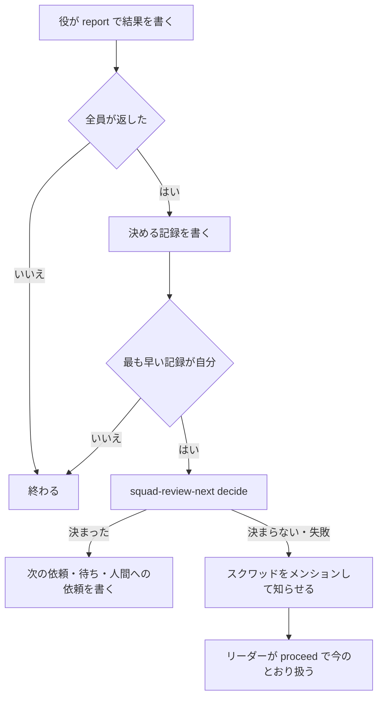

# 返事がそろったあとの次の依頼と、使用率が上限に近いときの待ち方

レビューと E2E の返事がそろったら、最後に返した役の `report` が、リーダーの手順と同じ決まりで次の依頼を決めて書く。決まりで決まらないときだけ、今のとおりスクワッドのメンションでリーダーを起こす。

あわせて、頼むレビューの観点を、変えたファイルの場所と観点の対応からスクリプトが決める。使用率が上限に近いときは、工程を飛ばさず、空いている系統へ回すか、空きが戻る時刻まで待つ。

この文書は、[workflow.md の後続のタスクの候補](workflow.md#後続のタスクの候補)の 3 の設計である。計画の考え方は、同じ文書の「E. 経路と配管をスクリプトへ」と[使用量が増えたとき](workflow.md#使用量が増えたとき)にある。返事を待つ回と `proceed` の仕組みは [review-wait.md](review-wait.md) にあり、この文書はその上に足す。

## 目的と範囲

返事がそろうたびにリーダーが起き、修正・最終レビュー・マージのどれを頼むかをその場で決めている。この判断は決まりで決まるので、リーダーの実行を使わずに通す。頼む観点の選び方と、使用率が上限に近いときの止まり方も、実行ごとに揺れない決まりにする。

対象は次の 3 つである。

1. 返事がそろったあとの次の依頼を、スクリプトが決めて書く
2. 印 `重要` のないタスクで頼むレビューの観点を、ファイルの場所と観点の対応から決める
3. 要件・設計・最終確認・実装・修正の工程で、使用率が上限に近いときに系統を移すか待つ

次は対象にしない。

- PR の紐付けと、`pr_url` を使う見張り。候補 2 で扱う
- 最終確認を、印によらずすべてのタスクに広げること。候補 7 で扱う。最終レビューを頼む条件は、今のとおり印のあるタスクにする
- 役のモデルを変えること。候補 4〜6 で扱う
- 同じ失敗の立て直しの工程そのもの。候補 6 で扱う。[使用率の待ち](#使用率の待ち)は、その工程にもそのまま使える形にする
- 返事がそろったあと以外の受け渡しで、リーダーを外すこと。判断の要る場面なので、今のとおりリーダーが起きる
- 最上位の役の設計の見直しと、設計と PR の見直しの回の返事。設計の承認や止めた振り分けの再開を含むので、[回の種類](#回の種類)のとおり今のままリーダーが扱う
- 使用率の閾値を変えること。`squad-dispatch-pick` と `squad-usage-read` の 80% のままにする

## 全体の流れ

返事がそろったあとは、最後に返した役の実行が、次の依頼を決める記録を書き、最も早い記録の実行だけが決める。決まれば次の依頼を書いて終わり、決まらなければリーダーを起こす。



新しく足すスクリプトは 2 つである。

| スクリプト | 使う人 | 役目 |
| --- | --- | --- |
| `squad-review-next` | `report`、リーダー | `request` でレビューの依頼を書き、`decide` で返事のあとの次の依頼を決めて書く |
| `squad-usage-wait` | `squad-review-next`、リーダー | 工程ごとに、回す系統を選ぶか、待つ時刻を決めて起こしを置く |

## 決める実行と一度だけ書く仕組み

次の依頼を決めるのは、`report` を流した役の実行のうち、決める記録を最も早く書いた実行だけにする。リーダーを起こさずに動ける実行は、返事を書いた役の実行しかないためである。

### report の流れ

`report` は、役の結果を投稿するとき、本文に `返事の回: <回のコメントの ID>` の行を足す。役はこの行を自分で書かない。[返事の組](#返事の組)で、回と役に紐付く結果を、ほかのコメントと読み分けるためである。

結果を書いたあと全員が返したと読めたら、今の知らせの代わりに、決める記録 `返事の待ち: 次の依頼を決めます` を `/note` で書く。読み直しで最も早い記録が自分のものなら、`squad-review-next decide <タスク> <回のコメント>` を流す。最も早さの決め方は、[proceed の流れ](review-wait.md#proceed-の流れ)と同じく、時刻と ID の順にする。

`decide` が決まらない（終了 3）か失敗した（終了 1）ときは、今の知らせを書いて、スクワッドのリーダーを起こす。知らせの 1 行目は今のとおりにし、2 行目に `次の依頼を決められません: <理由>` を置く。失敗のときの理由は、標準エラーの要約にする。`report` が途中で止まって知らせも書けなかったときは、下の status の判定で拾う。

`report` のコマンドの時間切れの案内は、60 秒から 600 秒にする。`decide` は使用率の読み取り（最大 90 秒）とコンフリクトの状態の確認（最大 120 秒）を流すためである。

### 一度だけ書く

`decide` が書くコメントには、すべて `前の回: <回のコメントの ID>` の行を置く。`decide` は書く前にこの行のあるコメントを探し、あれば `次の依頼: 書き済み` を出して何も書かない。同じ返事の組から 2 回流しても、書くのは 1 回だけで、中身は最初のものになる。

決める記録が複数の実行で書かれても、`decide` を流すのは最も早い記録の実行だけである。記録の読み直しと `前の回:` の確認の二重で、同じ回の依頼が 2 つ書かれることを防ぐ。

### status と proceed の判定

`squad-review-wait status` と `proceed` は、決める記録と `前の回:` の行を読むように変える。`status` の判定は、[status の判定](review-wait.md#status-の判定)の表に次を足す。

| 回の状態 | status の判定 |
| --- | --- |
| `前の回:` でこの回を指すコメントがある | 次へ回し済みなので何もしない |
| 決める記録があり、`前の回:` のコメントがなく、記録から 15 分未満 | 待つ（`返事の待ち: スクリプトが次の依頼を決めている`） |
| 決める記録があり、`前の回:` のコメントがなく、記録から 15 分以上 | `proceed` へ進む |

15 分は、`decide` の最長の時間（6 分ほど）より十分に長くした。決める実行が止まっても、待つ上限の見張りか人間の返事で起きたリーダーが拾う。

`proceed` の記録（`返事の待ち: この回を次へ回します`）は、決める記録と別の印にする。`proceed` は決める記録を自分の記録と数えない。決まらない知らせで起きたリーダーが、今のとおり `proceed` で次へ進めるようにするためである。

### スクワッドとリーダーの決め方

`decide` が書いた回の作者は、リーダーではなく返事を書いた役になる。そこで、回の作者をリーダーとするスクワッドがないときは、回の `前の回:` をたどり、リーダーが書いた回のスクワッドを使う。今の決め方（[メンションするスクワッドの決め方](review-wait.md#メンションするスクワッドの決め方)）は、リーダーが書いた回ではそのまま使う。

たどるのは同じタスクのコメントだけで、10 回までにする。それでも決まらなければ、今のとおり投稿の前に失敗する。

決めたスクワッドの `leader_id` を、起こしの宛先に使う。`decide` が置く返事の待ちの見張りと使用率の待ちの起こしは、`--agent-id` にこの ID を渡す。省くと、呼び出した役を起こすためである。

## 次の依頼の決め方

`decide` は、まず[回の種類](#回の種類)を読み、自分で決める回だけを先へ進める。そのうえで回の返事の組を読み、上から順に当てはめて最初に当たった行で決める。今のリーダーの手順（[leader-review-wait.md](../common/skills/squad-handoff/references/leader-review-wait.md)、[leader-principal.md](../common/skills/squad-handoff/references/leader-principal.md)、[leader-pr-checks.md](../common/skills/squad-handoff/references/leader-pr-checks.md)）と同じ決まりを、そのまま写す。

| 順 | 条件 | 次の依頼 |
| --- | --- | --- |
| 0 | 回の種類が、`decide` で決める回でない | リーダーを起こす |
| 1 | 返事の結果が読めない | リーダーを起こす |
| 2 | 保留した CI の失敗がある（`squad-pr-watch ci-held`）、または取得に失敗した | リーダーを起こす |
| 3 | `確認したコミット:` が合わない役がいて、その役が前の回でも合わなかった | リーダーを起こす |
| 4 | `確認したコミット:` が合わない役がいる | 合わない役だけを、同じコミットの新しい回で頼み直す |
| 5 | `設計への指摘: あり` の結果がある | リーダーを起こす |
| 6 | ❌ の結果がある | [修正の依頼](#修正の依頼)へ |
| 7 | 印があり、同じコミットの最終レビューがない | [最終レビューの依頼](#最終レビューの依頼)へ |
| 8 | 上のどれにも当たらない | [マージの依頼](#マージの依頼)へ |

同じ返事の組からは、いつも同じ行に当たる。使用率と PR の状態はその場で読むので、決めた依頼に添える `振り分け:` とコンフリクトの行は、読んだ時点の値になる。

### 回の種類

`decide` が決めるのは、マージの前のレビューと E2E の回と、最終レビューの回だけである。最上位の役の設計の見直しと、設計と PR の見直しの回は、✅ でも決めずにリーダーを起こす。どちらも、設計の承認、止めた振り分けの再開、コードの指摘をフェーズの依頼へ添えることを含み、principal-review.md の[設計の見直し](principal-review.md#設計の見直し)と[設計の承認より後に印が付いたとき](principal-review.md#設計の承認より後に印が付いたとき)のとおり、リーダーへ返す回だからである。

回の種類は、回のコメントの行で読む。

| 回のコメントの行 | 回の種類 | `decide` の動き |
| --- | --- | --- |
| `観点:` か `コミットが合わず頼み直す役:` があり、`見直しの種類:` がない | レビューと E2E の回 | 次の依頼を決める |
| `見直しの種類: 最終レビュー` | 最終レビューの回 | 次の依頼を決める |
| `見直しの種類: 設計の見直し` か `見直しの種類: 設計と PR の見直し` | 設計の見直しの回 | `次の依頼を決められません: 設計の見直しの回はリーダーが扱う` で終了 3 |
| 上のどれにも当たらない | 分からない | `次の依頼を決められません: 回の種類が分からない` で終了 3 |

リーダーを起こした回では、`report` が今の知らせを書き、リーダーは今のとおり [leader-principal.md](../common/skills/squad-handoff/references/leader-principal.md) の手順で扱う。この変更の前のリーダーが `request` を使わずに書いた回は `観点:` の行がないので、分からない回としてリーダーが扱う。

### 返事の組

返事の組は、回で待った役ごとに、その役が回より後に書いた結果のうち最新のものである。結果は、`返事の回:` の行がその回のコメントの ID と同じコメントとする。決める記録、`proceed` の記録、使用率の待ち、知らせ、次の依頼には `返事の回:` の行を置かないので、役の実行が結果のあとに書いても組に入らない。

組に入った結果が[結果が読めるとき](#結果が読めるとき)に当たらなければ、その回は返事の結果が読めないとする。同じ役の前の結果が読めても、それに戻らない。役が結果を書き直したなら、最新のものが役の今の結論だからである。待った役に `返事の回:` の行のある結果がないときも、読めないとする。

頼み直しの回では、`前の回:` をたどって、合っていた役の結果も組に入れる。合っていた役の結果は、その役を頼んだ前の回の ID の `返事の回:` で選ぶ。頼み直しの回の前の回で合っていた役の結果を、残すためである。

最終レビューの回は、その前の回（4 役と E2E の回）の組に、最上位の役の結果を足したものを組にする。最上位の役の結果は、最終レビューの回の ID の `返事の回:` で選ぶ。最終レビューの依頼にも `前の回:` を置くので、同じようにたどれる。

### 結果が読めるとき

結果は、次の 4 つがそろうときだけ読めるとする。どれかが欠けたら、返事の結果が読めないとしてリーダーを起こす。

1. `返事の回:` の行が、組を選んだ回の ID である
2. `確認したコミット:` の行がある
3. 先頭の行が、squad-handoff の「PR にレビューやテストの結果を書く」の `<マーク> <名前>: <結論>` の形で、マークが ❌・⚠️・✅ のどれかである。`/note`、`返事の回:`、`確認したコミット:`、`設計への指摘:` の行は、先頭の行を探すときに飛ばす
4. `設計への指摘: <あり | なし>` の行がある

`設計への指摘:` の行は、この変更で squad-handoff の「レビューと E2E の返事を返す」に足す。`あり` は、指摘が設計そのものに関わり、コードの修正では解決しないときに書く。最上位の役の `設計` の種類の指摘も `あり` にする。今は、設計への指摘をリーダーが本文から読み分けており、決まった行がないためである。

### コミットの照合

照合の決まりは、今の [確認したコミットの照合](../common/skills/squad-handoff/references/leader-review-wait.md#確認したコミットの照合)のとおりにする。7 文字以上の 16 進で、依頼の `確認するコミット:` の先頭と一致すればよい。行がない・`なし`・合わない役を、合わない役とする。

頼み直しの回は、[レビューの依頼を書く](#レビューの依頼を書く)と同じ形で書き、`観点:` の行の代わりに `コミットが合わず頼み直す役: <名前>` を置く。名前はメンションのリンクにしない。前の回でも `コミットが合わず頼み直す役:` に名前があった役が、また合わなければ、3 回目は頼まずにリーダーを起こす。

ZIP が成果物の回は、照合の値が名前と sha256 になる。決まりを足すと分岐が増えるので、`確認するコミット:` の行がない回は、スクリプトで決めずにリーダーを起こす。

### 修正の依頼

❌ の結果があるときは、次の順に確認してから修正の役へ頼む。止まるときは、どれもリーダーを起こし、リーダーが今の手順で扱う。

| 順 | 条件 | 次の依頼 |
| --- | --- | --- |
| 1 | `修正の依頼:` の行の数に 1 を足すと 4 になる | リーダーを起こす（共通 4） |
| 2 | タスクに `設計の変更: 実装を始めたあと` の行があり、印がなく、`重要の印:` の行もない | リーダーを起こす（共通 4 の判断） |
| 3 | 印があり、最上位の役の結果がタスクにない | リーダーを起こす（設計と PR の見直し） |
| 4 | 上のどれにも当たらない | 修正の役を選んで頼む |

3 の最上位の役の結果は、`見直しの種類:` の行がある回の ID を `返事の回:` に持つ、最上位の役のコメントで探す。設計の見直しも同じ PR への結果なので、それがあれば当たらない。当たったときに起きたリーダーは、今のとおり修正の依頼を止めて、設計と PR の見直しを頼む。その回の返事は、[回の種類](#回の種類)のとおりリーダーが扱う。

修正の役は、`squad-usage-wait pick <タスク> fix` で選ぶ。使用率で待つときは、[使用率の待ち](#使用率の待ち)の行を書いて終わる。選べたら、次の行を持つ依頼を書く。

```text
<修正の役のメンションのリンク> PR の ❌ の指摘を直してください。
前の回: <回のコメントの ID>
修正の依頼: <N> 回目
振り分け: <squad-usage-wait が出した行>
直す指摘: <❌ を返した役の名前>（結果は、この回の返事のコメントと PR のコメントにある）
対象の PR: <PR の URL>
```

直したあとの依頼の流れは今のとおりにする。修正の役がスクワッドへ返し、リーダーが必要な観点のレビューを `request` で頼み直す。

### 最終レビューの依頼

印があり、❌ のない組で、同じコミットの最終レビューがなければ、最上位の役に最終レビューを頼む。同じコミットの最終レビューは、`見直しの種類: 最終レビュー` の回のうち、`確認するコミット:` が組のコミットと同じもので探す。

最上位の役は、`squad-usage-wait pick <タスク> principal` で選ぶ。選べたら、`squad-review-wait watch` を流してから、`見直しの種類: 最終レビュー`、`確認するコミット:`、`返事を待つ役:`、`振り分け:`、`前の回:` の行を持つ依頼を書く。最上位の役が有効でないのに印があるときは、今のとおり飛ばしてマージの依頼へ進む。

### マージの依頼

❌ がなく、最終レビューが要らないか済んでいれば、人間のマージへ回す前の確認を、今の [leader-pr-checks.md](../common/skills/squad-handoff/references/leader-pr-checks.md) の順に流す。途中で止まる値が出たら、マージの依頼を書かずにリーダーを起こす。

1. PR の紐付けの確認。候補 2 のあとの決まりで止まる値なら、リーダーを起こす
2. 印のあるタスクでは、PR の今の head と、最上位の役の最終レビューの `確認したコミット:` を照合する。合わなければリーダーを起こす
3. `squad-pr-watch conflicts-check`。`CONFLICTING` ならリーダーを起こす。`MERGEABLE` と「未確認」は進む
4. `squad-pr-watch conflicts` で規則を入れ直す。起こす宛先には、スクワッドのリーダーを渡す
5. CI の見張りがあれば、`squad-pr-watch ci` を流す

確認がすべて通ったら、呼ぶ人間をメンションしてマージを頼むコメントを書き、タスクを `in_review` にする。コメントには `前の回:` の行、コンフリクトの行（`squad-pr-watch` の出力をそのまま）、各役の結論の 1 行を置く。

QA の役があり、[観点の選び方](#観点の選び方)で QA が選ばれる変更なのに、組に QA の結果がないときは、リーダーを起こす。画面に触れる変更を、E2E なしで人間へ回さないためである。

呼ぶ人間は、スクワッドの `creator_id` で読み、名前を `multica workspace member list` から引く。squad-handoff の「呼ぶ人間」と同じ決め方である。

### 状態の変更

`decide` がタスクの状態を変えるのは、マージを頼むときと、使用率の待ちが 24 時間を超えて人間を呼ぶときの 2 つだけで、どちらも `in_review` にする。リーダーを起こすときは状態を変えず、リーダーが今の手順で決める。

## 名簿の読み方

`decide` と `request` は、スクワッドの役とそのエージェントの ID を、スクワッドのメンバーとエージェントの名前から読む。リーダーの指示の「このスクワッドの役」は、返事を書いた役の実行からは読めないためである。

エージェントの名前は、セットアップが `<プロジェクトのキー>-<役>-<メンバーのキー>` に揃えている（`lib/project.sh`）。キーには `-` が入らないので、名前の先頭と末尾の区切りを外したものを役とする。スクワッドの名前のキーと合わないエージェントと、アーカイブ済みのエージェントは名簿に入れない。

読み取りは、[CLI の出力の欄](review-wait.md#cli-の出力の欄)の決まりで `squad-cli-lib` の欄の約束に足し、実物の見本で必須・条件付き・省略可能を決める。足すのは次のとおりである。

| 約束 | 足すもの | 使うところ |
| --- | --- | --- |
| `squad-member-list`（新しく足す） | `multica squad member list` のメンバーの種類と ID | 名簿 |
| `agent-get` | `model` の欄 | 要件・設計の役の系統 |
| `squad-list` | `creator_id` の欄 | 呼ぶ人間 |
| `gh-pr-files` | `filename` と `previous_filename` の欄 | 変えたファイル |
| `gh-file`（新しく足す） | base のブランチのファイルの内容の読み取り | プロジェクトの対応 |

## レビューの依頼を書く

リーダーはレビューと E2E を頼むとき、依頼のコメントを自分で書かず、`squad-review-next request <タスク> <きっかけのコメント> <確認するコミット>` を流す。観点を選び、`squad-review-wait watch` を流してから、依頼のコメントを書く。

依頼のコメントは、今の行（`確認するコミット:`、`返事を待つ役:`）に、選んだ観点と理由の 1 行を足す。

```text
確認するコミット: <完全な SHA>
返事を待つ役: <選んだ役のメンションのリンク>
観点: <役の名前>、<役の名前>（<理由>）
対象の PR: <PR の URL>
```

`観点:` の理由は、次のどれかにする。ファイルのパスは書かない。タスクのコメントのパスは Multica の WAF に拒まれることがあるためである。

| 場合 | 理由の書き方 |
| --- | --- |
| 印がある | `印「重要」があるため、有効な観点をすべて頼む` |
| 対応に当たらないファイルがある | `対応に当たらないファイルが N 件あるため、有効な観点をすべて頼む` |
| 対応を読めない | `対応を読めないため、有効な観点をすべて頼む: <短い理由>` |
| 対応で決まった | `変えたファイル N 件が対応に当たった（プロジェクト M 件・既定 K 件）` |

コマンドが失敗したときは、依頼を書かずに標準エラーの要約を出す。リーダーは今の手順で、出力を添えて人間へ返す。

## 観点の選び方

印のあるタスクでは、有効な観点をすべて頼む。印のないタスクでは、PR で変えたファイルを、ファイルの場所と観点の対応に当てて選ぶ。

有効な観点は、名簿にあるレビューと E2E の役（`code-reviewer`、`ux-reviewer`、`security-reviewer`、`performance-reviewer`、`qa`）である。

### 対応の書き方

対応は、1 行に 1 つ、`<場所の型> <役>[,<役>...]` で書く。`#` から行末はコメントで、空行は飛ばす。

場所の型は、リポジトリの根からのパスに当てる。`*` は `/` をまたがない任意の文字列、`**` は `/` をまたぐ任意の文字列、`?` は `/` 以外の 1 文字に当たる。末尾が `/` の型は、そのディレクトリの中のすべてに当たる。`/` を含まない型は、どの深さのファイル名にも当たる。

形の誤り（列が足りない、知らない役の名前、型の文字が不正）が 1 行でもあれば、対応を読めないとする。一部の行だけで選ぶと、意図しない観点の抜けが起きるためである。

### 上書きと追加

プロジェクトの対応は、作業先のリポジトリの `.agents/review-paths` に置く。読むのは PR の base のブランチの内容にする。PR の中で対応を書き換えて、その PR のレビューを減らせないようにするためである。

ファイルごとに、プロジェクトの対応に当たる行があれば、その行の役だけを使う（上書き）。当たらなければ、原本の既定の対応に当たる行の役を使う。プロジェクトの対応で既定にない場所を足せば、そのファイルも対応に当たるようになる（追加）。同じ側の複数の行に当たれば、その役をすべて使う。

`.agents/review-paths` が base にないときは、既定だけで選ぶ。ないことは誤りではない。読み取りが 404 以外で失敗したときは、対応を読めないとする。

### 原本の既定の対応

既定の対応は、`squad-review-next` の中に持つ。原本の更新で既定を直せば、セットアップの流し直しで導入先にも届く。

| 場所 | 観点 |
| --- | --- |
| 文書（`*.md`、`docs/`） | `code-reviewer` |
| 画面（`*.tsx`、`*.jsx`、`*.vue`、`*.svelte`、`*.css`、`*.scss`、`*.html`） | `code-reviewer`、`ux-reviewer`、`qa` |
| 認証と権限（`**/auth/**`、`**/*auth*`、`**/*permission*`） | `code-reviewer`、`security-reviewer` |
| 配布と依存（`.github/workflows/`、`Dockerfile`、`package.json`、ロックファイル、`go.mod`、`Gemfile`、`requirements*.txt`、`pyproject.toml`、`Cargo.toml`） | `code-reviewer`、`security-reviewer` |
| データベース（`**/migrations/**`、`*.sql`） | `code-reviewer`、`performance-reviewer`、`security-reviewer` |
| テスト（`**/test/**`、`**/tests/**`、`*_test.*`、`*.test.*`、`*.spec.*`） | `code-reviewer` |
| ソース（`*.sh`、`*.py`、`*.go`、`*.rb`、`*.js`、`*.ts`、`*.rs`、`*.java`、`*.kt`、`*.swift`、`*.php`、`*.c`、`*.cc`、`*.cpp`、`*.h`） | `code-reviewer` |

表の括弧の中は、実装では 1 型 1 行にする。表にない場所のファイルは、どの対応にも当たらない。

### 選んだ観点を決める

選んだ観点は、変えたファイルごとの役を合わせ、有効な観点と重なるものにする。次のどれかなら、有効な観点をすべて頼む。

1. 対応のどれにも当たらないファイルが 1 つでもある
2. 対応を読めない
3. 変えたファイルの一覧を読めない、または一覧が GitHub の上限で切れている
4. 選んだ観点と有効な観点の重なりが空になる

変えたファイルは `gh-pr-files` で読む。名前を変えたファイルは、前の名前と新しい名前の両方を当てる。消したファイルも当てる。

## 使用率の待ち

使用率が上限に近くても、モデルを下げたり、工程を飛ばしたりしない。系統を移せる工程は空いている系統の役へ回し、移せない工程は空きが戻る時刻まで待つ。この決まりは `squad-usage-wait` に置き、リーダーと `decide` が同じものを使う。

上限に近いかの判定は、今の `squad-dispatch-pick` と同じにする。Claude は週か 5 時間の使用率が 80% 以上、Codex は週の使用率が 80% 以上か利用不可のとき、その系統を上限に近いとする。

### 工程ごとの動き

`squad-usage-wait pick <タスク> <工程> [小さな|大きな]` の工程は、`planner`、`designer`、`implement`、`fix`、`principal` のどれかにする。両系統の構成かは、名簿にその工程の Claude と Codex の役が両方あるかで決める。

| 工程 | 両系統の構成 | 片系統の構成 |
| --- | --- | --- |
| `implement`、`fix`、`principal` | `squad-dispatch-pick` で空いている系統の役へ回す。両方が上限に近いときだけ待つ | その系統が上限に近ければ待つ |
| `planner`、`designer` | 該当しない。役は 1 体で、系統を移せない | 役のモデルの系統が上限に近ければ待つ |

`planner` と `designer` の系統は、名簿にあるその役の `model` から決める。`claude-` で始まれば Claude、それ以外は Codex とする。

使用率を読めないときの決まりは、今のとおりにする。両系統の構成では `squad-dispatch-pick` の代わりの決まりで選ぶ。片系統の構成ではその系統に固定し、選んだことと理由を `振り分け:` の行に書く。読めないことを理由に待たない。

### 再開の時刻

待つときの再開の時刻は、上限に近い枠のリセット時刻にする。複数の枠が上限に近ければ、遅い方のリセット時刻にする。両方の系統が上限に近ければ、系統ごとの再開の時刻のうち早い方にする。

Codex が利用不可で、週の使用率が 80% 未満のときは、リセット時刻を読めない。このときは、60 分後と週のリセット時刻の早い方にする。起きたときに読み直すので、早めに起きても待ち直すだけで済む。

### 待つときに残すもの

待つときは、`squad-usage-wait` が起こしを置き、呼んだ側がタスクのコメントに次の行を残す。行はスクリプトが出し、呼んだ側はそのまま写す。人間は呼ばない。

```text
使用率の待ち: <工程> を <再開の時刻（RFC3339）> まで待つ。待ち始め: <最初に待ち始めた時刻（RFC3339）>。<上限に近い枠と使用率>
```

起こしは、`multica issue wakeup create <タスク> --kind at --at <再開の時刻> --agent-id <リーダーの ID>` で置く。指示は `使用率の待ちの起こしで起きました。` で始め、工程と、`decide` から呼んだときは回のコメントの ID を書く。同じ工程の起こしがすでにあれば、置き直さずにそれを使う。

### 起きたとき

起こしで起きたリーダーは、止めた工程をもう一度頼む。工程の依頼の前に `squad-usage-wait pick` を流すので、空きが戻っていればモデルを下げずにその工程から続き、まだ上限に近ければもう一度待つ。`decide` から待った回は、`squad-review-next decide <タスク> <回のコメント>` を流し直す。

`decide` の一度だけの確認は、使用率の待ちの行だけを持つコメントを、書き済みの依頼と数えない。待ちのあとに流し直した `decide` が、次の依頼を書けるようにするためである。

### 24 時間を超えるとき

最初に待ち始めた時刻から再開の時刻までが 24 時間を超えるときだけ、待たずに人間を呼ぶ。`squad-usage-wait` は起こしを置かず、`使用率の待ち: <工程> の待ちが通算 24 時間を超える。待ち始め: <最初に待ち始めた時刻>` を出して終了 4 で終わる。呼んだ側は、待つか利用枠を足すかを決めてもらうよう人間を呼び、行をそのコメントに写して、タスクを `in_review` にする。

最初に待ち始めた時刻は、同じ工程の `使用率の待ち:` の行が続くあいだ引き継ぐ。続きを切って次の待ちから数え直すのは、次の 2 つのどちらかが後にあるときだけである。

1. 工程の再開。その工程の `振り分け:` の行のあるコメントがある。工程を頼めたので、待ちが終わっている
2. 人間の明示の延長。その工程の 24 時間を超えたコメントより後に、リーダーが書いた `使用率の待ちの延長: <工程>。決めた人: <名前>` の行がある

ほかのコメントでは続きを切らない。人間の質問や、ほかの工程の待ち、ほかの役の結果が間にあっても、最初に待ち始めた時刻を引き継ぐ。「進捗は？」のような質問で数え直すと、人間が決めないまま 24 時間を超えて待ち続けるためである。

延長の行は、24 時間を超えて人間を呼んだあとに、人間が待つと答えたときだけ、リーダーが書く。答えが質問や不明なら書かず、もう一度人間に決めてもらう。その工程の 24 時間を超えたコメントより前にある延長の行は数えないので、上限に達する前に延ばすことはできない。利用枠を足したときは、次の `pick` で役を選べて工程が再開するので、延長の行は要らない。

### 終了コード

| 終了コード | 意味 | 呼んだ側がすること |
| --- | --- | --- |
| 0 | 役を選んだ。`役:` と `振り分け:` の行を出す | その役へ、`振り分け:` の行を添えて頼む |
| 3 | 待つ。起こしを置き、`使用率の待ち:` の行を出す | 行をコメントに残して終わる |
| 4 | 通算 24 時間を超える。`使用率の待ち:` の行を出す | 行を写して人間を呼び、`in_review` にする |
| 1 | 使い方や読み取りの誤り | 標準エラーの要約を添えて、今のとおり人間へ返す |

使用率の読み取りは 90 秒で打ち切るので、コマンドの時間切れは 120 秒以上にする。

## リーダーの手順と指示の変更

リーダーが起きる場面は、決まりで決まらない返事と、使用率の待ちの起こしの 2 つが変わる。手順の正本は squad-handoff の参照ファイルなので、そこを書き換える。

| ファイル | 変えること |
| --- | --- |
| `leader-review-wait.md` | 依頼は `squad-review-next request` で書く。`返事がそろいました` で起きたら今のとおり `proceed` を流し、`次の依頼を決められません:` の理由に応じて今の手順で扱う。理由がない拾い直しでは、先に `decide` を流す |
| `leader-dispatch.md` | 実装・修正の役は `squad-usage-wait pick` で選ぶ。片系統で上限に近いとき、人間を呼ぶ代わりに待つ。使用率の待ちの起こしで起きたときの手順と、24 時間を超えたあとに人間が待つと答えたときだけ延長の行を書く手順を足す |
| `leader-principal.md` | 最上位の役の選び方を `squad-usage-wait pick principal` にする。上限に近いとき、人間を呼ぶ代わりに待つ |
| `leader-flow.md` | 要件を決める役と設計の役へ頼む前に、`squad-usage-wait pick` を流す |
| `leader-pr-checks.md` | マージへ回す前の確認を `decide` も流すことを書く。`squad-pr-watch conflicts` に起こす宛先を渡せることを書く |
| `orchestrator.md` | 「場面と手順」に、使用率の待ちの起こしで起きたときの行を足す |

役のひな形と共通スキルは、次を変える。

- squad-handoff の「レビューと E2E の返事を返す」に、`設計への指摘:` の行と、`report` の時間切れ 600 秒を書く。`返事の回:` の行は `report` が足すので、役は書かないことを書く。`report` が次の依頼を書いたり、状態を変えたりしても、役は自分でそれをしないことを書く
- レビューと E2E の役、最上位の役のひな形の `report` の行に、`report` で書かないと次の依頼も書かれないことを足す。設計そのものへの指摘で人間を呼ぶ決まりは、`設計への指摘: あり` を書いて `report` で返す決まりに替える

見張りのスクリプトは、次を変える。

- `squad-review-wait`: `report` が結果に足す `返事の回:` の行、`report` の決める記録と決まらない知らせ、`status` と `proceed` の判定、`前の回:` でたどるスクワッドの決め方、`watch` の起こす宛先の指定
- `squad-pr-watch`: `conflicts` に起こす宛先を渡せるようにする
- `squad-cli-lib`: [名簿の読み方](#名簿の読み方)の表の約束を足す

## 候補 2 と重なるファイル

候補 2（PR #67 の設計）の実装と、この変更の実装は、次のファイルで重なる。候補 2 が先にマージされ、この実装はマージ済みの main に合わせて始める。

| ファイル | 候補 2 で変えること | この変更で変えること |
| --- | --- | --- |
| `common/monitor/squad-pr-watch` | 紐付けの確認と、紐付かない PR の扱い | `conflicts` の起こす宛先 |
| `common/monitor/squad-cli-lib` | タスクの PR の一覧の読み取り | [名簿の読み方](#名簿の読み方)の表の約束 |
| `leader-pr-checks.md` | PR の紐付けの確認 | マージへ回す前の確認を `decide` も流す |
| `common/agents/orchestrator.md` | 場面と手順の紐付けの行 | 使用率の待ちの起こしの行 |
| `common/skills/squad-handoff/SKILL.md` | PR を作るときの紐付け | `設計への指摘:` の行と `report` の時間切れ |
| `docs/leader-principles.md` | 手順の移し先 | 手順の移し先 |
| `tests/agent-templates-test.sh`、`tests/leader-eval/` | 紐付けの場面 | 次の依頼と使用率の待ちの場面 |
| `MANIFEST`、`CHANGELOG.md` | 足したファイルと知らせ | 足したファイルと知らせ |

重ならないのは、`squad-review-wait`、`squad-dispatch-pick`、`squad-usage-read`、`leader-review-wait.md`、`leader-dispatch.md`、`leader-principal.md`、`leader-flow.md`、レビューと E2E の役のひな形、プロジェクトのひな形である。

[マージの依頼](#マージの依頼)の 1 の紐付けの確認は、候補 2 のあとの決まりをそのまま呼ぶ。この設計では紐付けの決まりを決めない。実装を始める時点で候補 2 の決まりを読み、止まる値の扱いが変わっていれば、設計を見直して承認をもらい直す。

## プロジェクトのひな形

`skeleton/` に、コメントだけの `.agents/review-paths` を足す。書き方と、上書き・追加の決まりを、コメントで書く。コメントだけのファイルは、対応の行がないので既定だけで選ぶ。

`skeleton/README.md` の置き場所の表に、`.agents/review-paths` の行を足す。置き場所は作業先のリポジトリの根からの `.agents/review-paths` で、用途はレビューの観点の対応の上書きと追加である。

## 互換性と影響を受ける利用者

影響を受けるのは、導入したプロジェクトの担当と、原本を導入・更新する人である。セットアップを流し直すと、リーダーの指示、squad-handoff、役のひな形、見張りのスクリプトが入れ替わる。エージェントとオートパイロットの登録は変わらない。

変わる動作は次の 4 つである。

1. 返事がそろったあと、決まりで決まるときはリーダーが起きない。次の依頼は、返事を書いた役の名前で書かれる
2. 印のないタスクで頼む観点が、変えたファイルで決まる。対応を置かなければ原本の既定で決まり、文書だけの変更では `code-reviewer` だけになる
3. 使用率が上限に近いとき、人間を呼ぶ代わりに、再開の時刻のコメントを残して待つ。人間が呼ばれるのは、通算 24 時間を超えるときだけになる
4. レビューと E2E の結果に `設計への指摘:` と `返事の回:` の行が要る。行がない結果は読めないとして、リーダーが今のとおり扱う

流し直しの途中に返事を待つ回があると、古い `report` が書いた結果には `設計への指摘:` と `返事の回:` の行がない。前のリーダーが書いた回には `観点:` の行もない。その回は 4 のとおりリーダーが扱うので、流れは止まらない。動いているタスクがないときに流し直す、という今の案内のままでよい。

回答ファイルの項目は変えないので、移し替えは要らない。`.agents/review-paths` は任意で、置かなくても動く。

## CHANGELOG の知らせ

`CHANGELOG.md` の「次のバージョン」に、次の内容を段落で書く。

- レビューと E2E の返事がそろったあと、決まりで決まるときは、最後に返した役のスクリプトが、頼み直し・修正・最終レビュー・マージのどれかの依頼まで書く。決まらないときだけリーダーが起きる
- 印 `重要` のないタスクでは、変えたファイルの場所から頼むレビューの観点が決まる。プロジェクトは `.agents/review-paths` で上書き・追加できる。置かなければ原本の既定で決まる
- 使用率が上限に近いとき、工程を飛ばさず、空いている系統へ回すか、空きが戻る時刻まで待つ。人間が呼ばれるのは、通算 24 時間を超えるときだけになる
- セットアップを流し直すと、リーダーの指示、squad-handoff、役のひな形、見張りのスクリプトが入れ替わる。エージェントとオートパイロットの登録は変わらない。動いているタスクがないときに流し直す

## テスト

スクリプトの決まりは、`tests/multica-fixture.py` の偽の CLI と、`tests/cli-fixture-lib.py` の見本で確認する。リーダーの手順は、`tests/leader-eval` の場面で確認する。

| テスト | 確認すること |
| --- | --- |
| `squad-review-next` の `decide` | [次の依頼の決め方](#次の依頼の決め方)の表の各行と、修正の依頼の各行。同じ組で 2 回流して 1 回だけ書くこと。`前の回:` のたどり方。[回の種類](#回の種類)の各行で、設計の見直しと設計と PR の見直しの回は、✅・コードの指摘・設計への指摘のどれでも書かずに終了 3 になること。結果のあとに同じ役の決める記録や知らせがあっても、`返事の回:` の結果を組に選ぶこと。最新の結果が読めなければ、前の読める結果に戻らず読めないとすること |
| `squad-review-next` の `request` | 印のあるとき、既定だけ、プロジェクトの上書き・追加、当たらないファイル、読めない対応、base にない対応、名前を変えたファイル |
| `squad-usage-wait` | 両系統・片系統・設計の役の各組み合わせ、再開の時刻の選び方、起こしの重複の防止、24 時間の数え方。人間の質問だけでは待ち始めを引き継ぐこと、工程の再開と 24 時間を超えたあとの延長の行で数え直すこと、24 時間を超える前の延長の行は数えないこと |
| `squad-review-wait` | 結果に `返事の回:` の行を足すこと、決める記録の早さの決め方、決まらない知らせ、`status` の 15 分の判定、`proceed` が決める記録を数えないこと、作者がリーダーでない回のスクワッド。結果、同じ役の決める記録、`decide` の順に流し、決める記録でなく結果で次の依頼が決まること。設計の見直しと設計と PR の見直しの回で、✅ でもコードの指摘でも、次の依頼を書かずに理由つきの知らせを書くこと |
| `squad-cli-lib` の約束 | 足した読み取りの欄を、実物の見本で照合すること |
| `tests/agent-templates-test.sh` | 役のひな形とリーダーの手順にある時間切れと行の名前 |
| `tests/leader-eval` | 決まらない知らせで起きたときと、使用率の待ちの起こしで起きたときの、リーダーの動き。24 時間を超えたあと、人間が待つと答えたときだけ延長の行を書き、質問には書かないこと |

次の依頼の決め方・観点の選び方・使用率の待ちの各決まりは、それぞれ少なくとも 1 つのケースで確認する。

## 残る危うさ

決める記録を最も早く書いた実行が、`decide` の途中で止まると、15 分のあいだ誰も進めない。待つ上限の見張り（60 分）か人間の返事で起きたリーダーが拾うので、止まったままにはならないが、遅れは出る。

返事を書いた役の実行は、リーダーより短い時間切れで動いていることがある。`decide` が時間切れで止まると、上の場合と同じになる。案内の時間切れを 600 秒にして避けるが、役の実行の設定によっては足りない。

既定の対応は、拡張子と場所の型で観点を決めるので、画面の変更が `.ts` だけで書かれたリポジトリでは `ux-reviewer` と `qa` が選ばれない。プロジェクトの対応で足してもらう。`skeleton/` のコメントにこの例を書く。

Codex の利用不可のリセット時刻は読めないので、60 分ごとに起きて読み直す。起きるたびにリーダーの実行が 1 回増える。

## 検討した案

### 決める実行の案

| 案 | 良い点 | 悪い点 |
| --- | --- | --- |
| 最後に返した役の `report` が決める（採用） | リーダーの実行を使わない。返事を書いた直後に決まる | 役の実行の時間が延びる。決める記録の仕組みが要る |
| リーダーを起こし、リーダーがスクリプトを流して決める | 今の流れに近く、変更が小さい | リーダーの実行が今と同じ数だけ起き、要件 2 を満たさない |
| オートパイロットの定期の見張りが決める | 役の実行の時間が延びない | 決まるまで定期の間隔だけ遅れる。見張りの登録が増え、導入先の登録が変わる |

### 設計の見直しの回の案

設計の見直しと設計と PR の見直しの回も `decide` で決める案は採らなかった。✅ のあとは設計の承認を人間に頼むか、止めた振り分けを再開する。コードの指摘はフェーズの依頼へ添えることもある。どれもマージの前の回の表とは違う判断で、表に足すと分岐が増えるので、今のとおりリーダーに任せる。

### 返事の組の選び方の案

回より後に役が書いた最新のコメントを結果とする案は採らなかった。役の実行は結果のあとに決める記録を書くので、最新のコメントが記録になり、そろうたびに読めないとしてリーダーが起きる。記録などの制御用のコメントを印で除く案も、印が増えるたびに除き忘れが起きる。結果の側に回の ID を置けば、足すコメントの種類によらず読み分けられる。

### 24 時間の数え直しの案

人間のコメントがあれば数え直す案は採らなかった。質問だけで待ち始めが新しくなり、人間が決めないまま 24 時間を超えて待つことがある。延長は、上限で人間を呼んだあとの答えだけにし、リーダーが行に残す。行に残せば、スクリプトは人間の文の意味を読まずに数え直せる。

### 設計への指摘の読み分けの案

結果の本文から「設計」の語で読み分ける案は、指摘の文脈で揺れるので採らなかった。決まった行を足すと、役のひな形と squad-handoff が変わるが、読めないときは安全側でリーダーを起こせる。

### 対応の置き場所の案

対応を、リーダーの指示や回答ファイルに置く案は、変えるたびにセットアップの流し直しが要るので採らなかった。作業先のリポジトリに置けば、PR で変えられ、リポジトリごとに違う構成に合わせられる。PR の base から読むので、その PR で自分のレビューを減らすこともできない。

### コンフリクトの扱いの案

マージの前に `CONFLICTING` のとき、`decide` が修正の役へ解消を頼む案は採らなかった。解消を頼む条件（[起きたときの確認](../common/skills/squad-handoff/references/leader-pr-checks.md#起きたときの確認)）は、動いている実行の有無を読む判断を含むためである。頻度が低いので、今のとおりリーダーに任せる。

### スクワッドの決め方の案

タスクの担当のスクワッドを使う案は、オートパイロットが作るタスクで担当がスクワッドとは限らないので採らなかった。`前の回:` をたどれば、今のリーダーが書いた回の決め方をそのまま使える。
