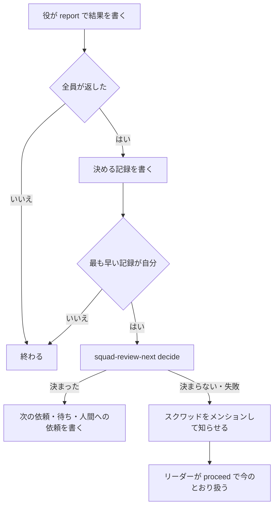

# 返事がそろったあとの次の依頼と、使用率が上限に近いときの待ち方

レビューと E2E の返事がそろったら、最後に返した役の `report` が、リーダーの手順と同じ決まりで次の依頼を決めて書く。決まりで決まらないときだけ、今のとおりスクワッドのメンションでリーダーを起こす。

あわせて、頼むレビューの観点を、変えたファイルの場所と観点の対応からスクリプトが決める。使用率が上限に近いときは、工程を飛ばさず、空いている系統へ回すか、空きが戻る時刻まで待つ。

この文書は、[workflow.md の後続のタスクの候補](workflow.md#後続のタスクの候補)の 3 の設計である。計画の考え方は、同じ文書の「E. 経路と配管をスクリプトへ」と[使用量が増えたとき](workflow.md#使用量が増えたとき)にある。返事を待つ回と `proceed` の仕組みは [review-wait.md](review-wait.md) にあり、この文書はその上に足す。

PR の紐付けと紐付いていない PR の扱いは [pr-unlinked.md](pr-unlinked.md) に、すべてのタスクの最終レビューとマージの前の CI の待ちは [principal-review.md](principal-review.md) にあり、どちらも main に入っている。この設計はそれらの決まりを呼び、決まりそのものは変えない。principal-review.md の[候補 3 との合わせ方](principal-review.md#候補-3-との合わせ方)の表は、この文書に反映した。

## 目的と範囲

返事がそろうたびにリーダーが起き、修正・最終レビュー・マージのどれを頼むかをその場で決めている。この判断は決まりで決まるので、リーダーの実行を使わずに通す。頼む観点の選び方と、使用率が上限に近いときの止まり方も、実行ごとに揺れない決まりにする。

対象は次の 3 つである。

1. 返事がそろったあとの次の依頼を、スクリプトが決めて書く
2. 印 `重要` のないタスクで頼むレビューの観点を、ファイルの場所と観点の対応から決める
3. 要件・設計・最終確認・実装・修正の工程で、使用率が上限に近いときに系統を移すか待つ

次は対象にしない。

- PR の紐付けの判定、紐付いていない PR の見張り、CI の待ちの決まりを変えること。`decide` は `squad-pr-watch` の今のサブコマンドを呼び、出力の行の扱いもリーダーの手順に合わせる
- 役のモデルを変えること。候補 4〜6 で扱う
- 同じ失敗の立て直しの工程そのもの。候補 6 で扱う。[使用率の待ち](#使用率の待ち)は、その工程にもそのまま使える形にする
- 返事がそろったあと以外の受け渡しで、リーダーを外すこと。判断の要る場面なので、今のとおりリーダーが起きる
- 最上位の役の設計の見直しと、設計と PR の見直しの回の返事。設計の承認や止めた振り分けの再開を含むので、[回の種類](#回の種類)のとおり今のままリーダーが扱う
- 使用率の閾値を変えること。`squad-dispatch-pick` と `squad-usage-read` の 80% のままにする

## 全体の流れ

返事がそろったあとは、最後に返した役の実行が、次の依頼を決める記録を書き、最も早い記録の実行だけが決める。決まれば次の依頼を書いて終わり、決まらなければリーダーを起こす。



新しく足すスクリプトは 2 つである。

| スクリプト | 使う人 | 役目 |
| --- | --- | --- |
| `squad-review-next` | `report`、リーダー | `request` でレビューの依頼を書き、`decide` で返事のあとの次の依頼を決めて書く |
| `squad-usage-wait` | `squad-review-next`、リーダー | 工程ごとに、回す系統を選ぶか、待つ時刻を決めて起こしを置く |

## 決める実行と一度だけ書く仕組み

次の依頼を決めるのは、`report` を流した役の実行のうち、決める記録を最も早く書いた実行だけにする。リーダーを起こさずに動ける実行は、返事を書いた役の実行しかないためである。

### report の流れ

`report` は、役の結果を投稿するとき、本文に `返事の回: <回のコメントの ID>` の行を足す。役はこの行を自分で書かない。[返事の組](#返事の組)で、回と役に紐付く結果を、ほかのコメントと読み分けるためである。

結果を書いたあと全員が返したと読めたら、今の知らせの代わりに、決める記録 `返事の待ち: 次の依頼を決めます` を `/note` で書く。読み直しで最も早い記録が自分のものなら、`squad-review-next decide <タスク> <回のコメント>` を流す。最も早さの決め方は、[proceed の流れ](review-wait.md#proceed-の流れ)と同じく、時刻と ID の順にする。

`decide` が決まらない（終了 3）か失敗した（終了 1）ときは、今の知らせを書いて、スクワッドのリーダーを起こす。知らせの 1 行目は今のとおりにし、2 行目に `次の依頼を決められません: <理由>` を置く。失敗のときの理由は、標準エラーの要約にする。`report` が途中で止まって知らせも書けなかったときは、下の status の判定で拾う。

`report` のコマンドの時間切れの案内は、60 秒から 600 秒にする。`decide` は使用率の読み取り（最大 90 秒）、PR の紐付けと CI の読み取り、コンフリクトの状態の確認（最大 120 秒）を流すためである。

### 制御記録の読み方

`前の回:` などの行は、本文にあるだけでは制御記録と読まない。役の結果や人間のコメントは、依頼を引用したり、同じ形の行を持ち込んだりできるためである。[一度だけ書く](#一度だけ書く)、[status と proceed の判定](#status-と-proceed-の判定)、`ci-wait` の依頼済みの確認（[CI の待ちの規則で起きたとき](#ci-の待ちの規則で起きたとき)）は、この節の条件がすべてそろうコメントだけを制御記録とする。

判定は `squad-cli-lib` に 1 つだけ置き、`squad-review-next`、`squad-review-wait`、`squad-pr-watch` で同じものを使う。[スクワッドを決める処理](review-wait.md#見張りのスクリプトの見直し)を `squad-cli-lib` に置いたのと同じ理由で、3 つのスクリプトの判定が食い違わないようにするためである。判定には、タスクのコメントの一覧と、リーダーの ID を渡す。リーダーの ID は、`squad-review-next` と `squad-review-wait` では[スクワッドとリーダーの決め方](#スクワッドとリーダーの決め方)で決め、`ci-wait` では今の引数の `<リーダーの ID>` を使う。判定は名簿を読まないので、読み取りの回数は増えない。

| 条件 | 制御記録とするとき |
| --- | --- |
| 行の置き方 | 種類を示す行と `前の回:` の行が、どちらも本文の 1 行そのもので、行頭に空白がない。`>` で始まる引用の行と、3 つの逆引用符か `~~~` の行で囲んだ部分の行は読まない |
| 結果でない | `返事の回:` の行がない。役の結果は `report` がこの行を足すので、結果に含まれる行を制御記録と読まない |
| 作者 | 作者の種類がエージェントで、指す回の決める実行の役か、リーダーである。メンバーと、そのほかのエージェントのコメントは読まない |
| 時刻 | 指す回のコメントより後に書かれている。作者が決める実行の役なら、その役の決める記録より後でもある |
| 指す回 | `前の回:` の ID が、同じタスクの[認める回](#認める回)で、回の種類がレビューと E2E の回か最終レビューの回である |
| 種類 | 下の表の種類のどれかで、種類を示す行と `前の回:` の行が同じコメントにある |

行は、今のとおり `/note` の行と行頭の `/note` を除き、行末の空白を落としてから読む。`前の回:` の行は、`前の回: <ID>` のとおりに完全に一致するものだけを読む。

回の決める実行の役は、その回の決める記録（`返事の待ち: 次の依頼を決めます`）のうち、時刻と ID の順で最も早いものを書いた役とする。決める記録は、回の `返事を待つ役:` にある役のエージェントが、回より後に、上の行の置き方と結果でない条件を満たして書いたものだけを数える。`decide` を流すのは、この役の実行か、[CI の待ちの規則で起きたとき](#ci-の待ちの規則で起きたとき)のリーダーだけなので、制御記録の作者もこの 2 つに限る。

| 種類 | 種類を示す行 | 一度だけ書くで書き済みと数える | status と proceed で次へ回し済みと数える |
| --- | --- | --- | --- |
| 頼み直し | `コミットが合わず頼み直す役:` | 数える | 数える |
| 修正の依頼 | `修正の依頼:` | 数える | 数える |
| 最終レビューの依頼 | `見直しの種類: 最終レビュー` | 数える | 数える |
| マージの依頼 | `マージの依頼:` | 数える | 数える |
| 24 時間を超えた人間の呼び出し | `使用率の待ち:` で始まり、`24 時間を超える` を含む | 数える | 数える |
| 使用率の待ち | 上に当たらない `使用率の待ち:` | 数えない | 数える |
| CI の待ちの記録 | `マージの前の CI の待ち:` | 数えない | 数える |

どの種類にも当たらないコメントは、`前の回:` の行があっても制御記録としない。`前の回:` の行だけを引用したコメントや、種類を示す行のないコメントで、書き済みや次へ回し済みにならないようにするためである。

#### 認める回

制御記録が指す回と、`status` と `proceed` が読む最新の回は、次の 2 つがそろう回のコメントだけにする。返事を待つ役の行を持つコメントを、作者を問わず回と読むと、結果に引用された依頼が最新の回になるためである。

1. `返事を待つ役:` の行が上の行の置き方を満たし、エージェントのメンションを 1 つ以上持つ。`返事の回:` の行がない
2. 作者がリーダーである。リーダーが書いた回は、回の種類を問わず今のとおり回として読む。または、作者が `前の回:` の指す回の決める実行の役で、頼み直しか最終レビューの依頼の制御記録であり、指す回も認める回である。たどるのは同じタスクのコメントだけで、[スクワッドとリーダーの決め方](#スクワッドとリーダーの決め方)と同じく 10 回までにする

認める回が 1 つもないときの `status` と `proceed` は、今の回がないときと同じに動く。`decide` は、渡された回が認める回でなければ、何も書かずに `次の依頼を決められません: 回を認められない（<当たらなかった条件>）` で終了 3 にする。最終レビューの回は、これに加えて[最終レビューの回と結果を認める条件](#最終レビューの回と結果を認める条件)を `decide` が確認する。

### 一度だけ書く

`decide` が書くコメントには、すべて `前の回: <回のコメントの ID>` の行を置く。`decide` は書く前に、この回を指す[制御記録](#制御記録の読み方)のうち、書き済みと数える種類のものを探す。あれば `次の依頼: 書き済み` を出して何も書かない。同じ返事の組から 2 回流しても、書くのは 1 回だけで、中身は最初のものになる。

`前の回:` の行があっても、制御記録の条件に当たらないコメントは書き済みと数えない。役の結果や人間のコメントにある引用で、次の依頼が書かれないまま止まることを防ぐためである。数えなかったコメントは、`decide` の出力に残さず、そのまま次の依頼を決める。

決める記録が複数の実行で書かれても、`decide` を流すのは最も早い記録の実行だけである。記録の読み直しと制御記録の確認の二重で、同じ回の依頼が 2 つ書かれることを防ぐ。

### status と proceed の判定

`squad-review-wait status` と `proceed` は、決める記録と[制御記録](#制御記録の読み方)を読むように変える。最新の回は、[認める回](#認める回)のうち最も新しいものにする。`status` の判定は、[status の判定](review-wait.md#status-の判定)の表に次を足す。

| 回の状態 | status の判定 |
| --- | --- |
| この回を指す制御記録がある | 次へ回し済みなので何もしない |
| 決める記録があり、この回を指す制御記録がなく、記録から 15 分未満 | 待つ（`返事の待ち: スクリプトが次の依頼を決めている`） |
| 決める記録があり、この回を指す制御記録がなく、記録から 15 分以上 | `proceed` へ進む |

`proceed` も、この回を指す制御記録があるときだけ `返事の待ち: 回ごと済み` を返す。`前の回:` の行があっても制御記録の条件に当たらないコメントは、`status` でも `proceed` でも数えない。引用で済み扱いになると、返事の待ちの見張りが回の止まりを拾えなくなるためである。

決める記録と `proceed` の記録（`返事の待ち: この回を次へ回します`）も、制御記録と同じ行の置き方と結果でない条件を満たすものだけを数える。決める記録は、さらに[制御記録の読み方](#制御記録の読み方)のとおり、回の返事を待つ役が書いたものだけにする。`proceed` の記録の作者は、今のとおり実行の種類を問わない。

15 分は、`decide` の最長の時間（6 分ほど）より十分に長くした。決める実行が止まっても、待つ上限の見張りか人間の返事で起きたリーダーが拾う。

`proceed` の記録（`返事の待ち: この回を次へ回します`）は、決める記録と別の印にする。`proceed` は決める記録を自分の記録と数えない。決まらない知らせで起きたリーダーが、今のとおり `proceed` で次へ進めるようにするためである。

### スクワッドとリーダーの決め方

`decide` が書いた回の作者は、リーダーではなく返事を書いた役になる。そこで、回の作者をリーダーとするスクワッドがないときは、回の `前の回:` をたどり、リーダーが書いた回のスクワッドを使う。今の決め方（[メンションするスクワッドの決め方](review-wait.md#メンションするスクワッドの決め方)）は、リーダーが書いた回ではそのまま使う。

たどるのは同じタスクのコメントだけで、10 回までにする。それでも決まらなければ、今のとおり投稿の前に失敗する。

たどった先のリーダーが書いた回でスクワッドを決めたあと、途中の回が[認める回](#認める回)かを、そのスクワッドのリーダーで確認する。途中に認めない回があれば、`decide` は何も書かずに `次の依頼を決められません: 回を認められない（<当たらなかった条件>）` で終了 3 にする。スクワッドを決める前は作者の役を読めないので、先にリーダーの回まで行き、そこから認め直す。

決めたスクワッドの `leader_id` を、起こしの宛先に使う。`decide` は役の実行で動くので、宛先を省くか `MULTICA_AGENT_ID` から読む規則は、返事を書いた役を起こしてしまう。そこで、`decide` が置く規則と見張りには、すべてこの ID を渡す。

| 規則・見張り | 渡し方 |
| --- | --- |
| 返事の待ちの見張り（`squad-review-wait watch`） | `--agent-id` に渡す |
| 使用率の待ちの起こし（`squad-usage-wait`） | `--agent-id` に渡す |
| コンフリクトの規則（`squad-pr-watch conflicts`） | この変更で足す `--leader <ID>` に渡す。今は `--agent-id` を省き、呼び出した実行を起こす |
| 紐付いていない PR の見張り（`squad-pr-watch unlinked`） | この変更で足す `--leader <ID>` に渡す。今は `MULTICA_AGENT_ID` をリーダーとして読む |
| CI の待ちの規則（`squad-pr-watch ci-wait`）と、その場の CI の確認（`ci-now`） | 今の引数の `<リーダーの ID>` に渡す |

`--leader` を渡さないときは今のとおりに動くので、リーダーの呼び方は変わらない。見張り役を渡す `unlinked` は、今のとおり見張り役を起こし、`--leader` は `unlinked-check` に渡すリーダーの ID だけを決める。

## 次の依頼の決め方

`decide` は、まず[回の種類](#回の種類)を読み、自分で決める回だけを先へ進める。そのうえで回の返事の組を読み、上から順に当てはめて最初に当たった行で決める。今のリーダーの手順（[leader-review-wait.md](../common/skills/squad-handoff/references/leader-review-wait.md)、[leader-principal.md](../common/skills/squad-handoff/references/leader-principal.md)、[leader-pr-checks.md](../common/skills/squad-handoff/references/leader-pr-checks.md)）と同じ決まりを、そのまま写す。

| 順 | 条件 | 次の依頼 |
| --- | --- | --- |
| 0 | 回の種類が、`decide` で決める回でない。または[認める回](#認める回)でない | リーダーを起こす |
| 1 | 返事の結果が読めない | リーダーを起こす |
| 2 | PR の紐付けの判定が、進む値でない（[返事がそろったときの PR の確認](#返事がそろったときの-pr-の確認)） | リーダーを起こす |
| 3 | 保留した CI の失敗がある（`squad-pr-watch ci-held`）、または取得に失敗した | リーダーを起こす |
| 4 | 紐付いていない PR のその場の確認で、止まる値が出た | リーダーを起こす |
| 5 | `確認したコミット:` が合わない役がいて、その役が前の回でも合わなかった | リーダーを起こす |
| 6 | `確認したコミット:` が合わない役がいる | 合わない役だけを、同じコミットの新しい回で頼み直す |
| 7 | `設計への指摘: あり` の結果がある | リーダーを起こす |
| 8 | ❌ の結果がある | [修正の依頼](#修正の依頼)へ |
| 9 | 同じコミットの済んだ最終レビューがない | [最終レビューの依頼](#最終レビューの依頼)へ |
| 10 | 上のどれにも当たらない | [マージの依頼](#マージの依頼)へ |

2〜4 は PR をその場で読む確認で、5〜10 は返事の組だけで決まる。`decide` は 5〜10 の行き先を先に組から決め、その行き先を使って 2〜4 を流す。2〜4 で止まる値が出たら、行き先の依頼を書かずにリーダーを起こす。9 は印を見ず、最上位の役がない構成では当たらない（[最終レビューの依頼](#最終レビューの依頼)）。

同じ返事の組からは、いつも同じ行き先になる。使用率と PR の状態はその場で読むので、決めた依頼に添える `振り分け:`、コンフリクト、CI の行は、読んだ時点の値になる。

### 返事がそろったときの PR の確認

リーダーの手順は、返事がそろったときに PR の紐付けを確認し、紐付いていなければその場で CI とコンフリクトを読む（[PR の紐付けの確認](../common/skills/squad-handoff/references/leader-pr-checks.md#pr-の紐付けの確認)、[紐付いていない PR のその場の確認](../common/skills/squad-handoff/references/leader-pr-checks.md#紐付いていない-pr-のその場の確認)）。`decide` も同じ区切りで同じ確認を流し、表の 2〜4 とする。止まる値は、どれも人間を呼ばずにリーダーを起こす。人間を呼ぶか、修正へ回すかは、リーダーが今の手順で決める。

表の 2 は、`squad-pr-watch link-check <タスク>` の `紐付け:` の行で次のように分ける。

| 判定 | `decide` の動き |
| --- | --- |
| 紐付いている | 進む。以降の確認は紐付いているものとして流し、マージの依頼でも `unlinked` を登録しない |
| 紐付いていない | 進む。表の 4 のその場の確認を流し、マージの依頼では `unlinked` を登録する |
| 食い違い、作業先と違う、不正な `pr_url`、`pr_url` なし | 止まる。何も書かず、`次の依頼を決められません: <紐付け: の行>` で終了 3 |
| 未確認 | 同じ実行で 1 回だけ流し直す。まだ未確認なら止まり、`次の依頼を決められません: <紐付け: の行>` で終了 3 |

`link-check` が使い方の誤り（終了コード 2）か見つからない（127）とき、行が出ないときも未確認とする。2 か 127 で止まるときは、理由に「ホストのスクリプトが古い」ことを足す。リーダーは、知らせの理由の `紐付け:` の行を、`link-check` を流し直して今の手順で扱う。止まる値の扱いを `decide` に写さないのは、どれも人間を呼ぶか役に補ってもらう判断で、状態の変更が増えるためである。

表の 3 は、CI の見張り役があるか、紐付いていないときに `squad-pr-watch ci-held <タスク> <回のコメントの ID>` を流す。出たチェック名か取得の失敗で止まる。ただし行き先がマージで、次のどちらかに当たるときは流さない。マージの依頼の `ci-wait` が CI を読むためで、リーダーの手順の「CI」の例外と同じである。

1. CI を待っているタスク。metadata に `ci_wait_head` がある
2. 見張り役がある構成の、最終レビューの回

表の 4 は、紐付いていないときだけ流す。順と読み方はリーダーの手順と同じにする。

1. CI の見張り役があれば、`squad-pr-watch ci <タスク> <見張り役の ID> <回のコメントの ID>` を流す
2. `squad-pr-watch ci-now <タスク> <leader_id> <回のコメントの ID> [<見張り役の ID>]` を流す。ただし行き先がマージで見張り役があるときは流さず、マージの依頼の `ci-wait` で読む
3. `squad-pr-watch conflicts-check <タスク>` を流す

止まる値は、`ci-now` の `失敗あり` で保留でない行、`紐付け:` で始まる行、0 以外の終了と、`コンフリクト: CONFLICTING` である。保留の行、知らせ済みの行、失敗なし、チェックなし、マージ済みか閉じている、`MERGEABLE` と未確認のコンフリクトは進む。理由は、止まった行をそのまま `次の依頼を決められません:` に写す。

行き先がマージのとき、[マージの依頼](#マージの依頼)はここで読んだ `ci-now` とコンフリクトの行を使い、同じ区切りで流し直さない。リーダーの手順の、マージへ回す前の `conflicts-check` がその場の確認の 3 を兼ねる決まりと同じである。

### 回の種類

`decide` が決めるのは、マージの前のレビューと E2E の回と、最終レビューの回だけである。最上位の役の設計の見直しと、設計と PR の見直しの回は、✅ でも決めずにリーダーを起こす。どちらも、設計の承認、止めた振り分けの再開、コードの指摘をフェーズの依頼へ添えることを含み、principal-review.md の[設計の見直し](principal-review.md#設計の見直し)と[設計の承認より後に印が付いたとき](principal-review.md#設計の承認より後に印が付いたとき)のとおり、リーダーへ返す回だからである。

回の種類は、回のコメントの行で読む。

| 回のコメントの行 | 回の種類 | `decide` の動き |
| --- | --- | --- |
| `観点:` か `コミットが合わず頼み直す役:` があり、`見直しの種類:` がない | レビューと E2E の回 | 次の依頼を決める |
| `見直しの種類: 最終レビュー` | 最終レビューの回 | 次の依頼を決める |
| `見直しの種類: 設計の見直し` か `見直しの種類: 設計と PR の見直し` | 設計の見直しの回 | `次の依頼を決められません: 設計の見直しの回はリーダーが扱う` で終了 3 |
| 上のどれにも当たらない | 分からない | `次の依頼を決められません: 回の種類が分からない` で終了 3 |

リーダーを起こした回では、`report` が今の知らせを書き、リーダーは今のとおり [leader-principal.md](../common/skills/squad-handoff/references/leader-principal.md) の手順で扱う。この変更の前のリーダーが `request` を使わずに書いた回は `観点:` の行がないので、分からない回としてリーダーが扱う。

### 返事の組

返事の組は、回で待った役ごとに、その役が回より後に書いた結果のうち最新のものである。結果は、`返事の回:` の行がその回のコメントの ID と同じコメントとする。決める記録、`proceed` の記録、使用率の待ち、知らせ、次の依頼には `返事の回:` の行を置かないので、役の実行が結果のあとに書いても組に入らない。

組に入った結果が[結果が読めるとき](#結果が読めるとき)に当たらなければ、その回は返事の結果が読めないとする。同じ役の前の結果が読めても、それに戻らない。役が結果を書き直したなら、最新のものが役の今の結論だからである。待った役に `返事の回:` の行のある結果がないときも、読めないとする。

頼み直しの回では、`前の回:` をたどって、合っていた役の結果も組に入れる。合っていた役の結果は、その役を頼んだ前の回の ID の `返事の回:` で選ぶ。頼み直しの回の前の回で合っていた役の結果を、残すためである。

最終レビューの回は、その前の回（4 役と E2E の回）の組に、最上位の役の結果を足したものを組にする。最上位の役の結果は、最終レビューの回の ID の `返事の回:` で選ぶ。最終レビューの依頼にも `前の回:` を置くので、同じようにたどれる。回と結果は、[最終レビューの回と結果を認める条件](#最終レビューの回と結果を認める条件)を満たすものだけを使う。

### 結果が読めるとき

結果は、次の 4 つがそろうときだけ読めるとする。どれかが欠けたら、返事の結果が読めないとしてリーダーを起こす。

1. `返事の回:` の行が、組を選んだ回の ID である
2. `確認したコミット:` の行がある
3. 先頭の行が、squad-handoff の「PR にレビューやテストの結果を書く」の `<マーク> <名前>: <結論>` の形で、マークが ❌・⚠️・✅ のどれかである。`/note`、`返事の回:`、`確認したコミット:`、`設計への指摘:` の行は、先頭の行を探すときに飛ばす
4. `設計への指摘: <あり | なし>` の行がある

`設計への指摘:` の行は、この変更で squad-handoff の「レビューと E2E の返事を返す」に足す。`あり` は、指摘が設計そのものに関わり、コードの修正では解決しないときに書く。最上位の役の `設計` の種類の指摘も `あり` にする。今は、設計への指摘をリーダーが本文から読み分けており、決まった行がないためである。

### コミットの照合

照合の決まりは、今の [確認したコミットの照合](../common/skills/squad-handoff/references/leader-review-wait.md#確認したコミットの照合)のとおりにする。7 文字以上の 16 進で、依頼の `確認するコミット:` の先頭と一致すればよい。行がない・`なし`・合わない役を、合わない役とする。

頼み直しの回は、[レビューの依頼を書く](#レビューの依頼を書く)と同じ形で書き、`観点:` の行の代わりに `コミットが合わず頼み直す役: <名前>` を置く。名前はメンションのリンクにしない。前の回でも `コミットが合わず頼み直す役:` に名前があった役が、また合わなければ、3 回目は頼まずにリーダーを起こす。

ZIP が成果物の回は、照合の値が名前と sha256 になる。決まりを足すと分岐が増えるので、`確認するコミット:` の行がない回は、スクリプトで決めずにリーダーを起こす。

### 修正の依頼

❌ の結果があるときは、次の順に確認してから修正の役へ頼む。止まるときは、どれもリーダーを起こし、リーダーが今の手順で扱う。

| 順 | 条件 | 次の依頼 |
| --- | --- | --- |
| 1 | `修正の依頼:` の行の数に 1 を足すと 4 になる | リーダーを起こす（共通 4） |
| 2 | タスクに `設計の変更: 実装を始めたあと` の行があり、印がなく、`重要の印:` の行もない | リーダーを起こす（共通 4 の判断） |
| 3 | 印があり、最上位の役の結果がタスクにない | リーダーを起こす（設計と PR の見直し） |
| 4 | 上のどれにも当たらない | 修正の役を選んで頼む |

3 の最上位の役の結果は、`見直しの種類:` の行がある回の ID を `返事の回:` に持つ、最上位の役のコメントで探す。作者と回は、[最終レビューの回と結果を認める条件](#最終レビューの回と結果を認める条件)の表のとおりに限る。設計の見直しも同じ PR への結果なので、それがあれば当たらない。当たったときに起きたリーダーは、今のとおり修正の依頼を止めて、設計と PR の見直しを頼む。その回の返事は、[回の種類](#回の種類)のとおりリーダーが扱う。

修正の役は、`squad-usage-wait pick <タスク> fix` で選ぶ。使用率で待つときは、[使用率の待ち](#使用率の待ち)の行を書いて終わる。選べたら、次の行を持つ依頼を書く。

```text
<修正の役のメンションのリンク> PR の ❌ の指摘を直してください。
前の回: <回のコメントの ID>
修正の依頼: <N> 回目
振り分け: <squad-usage-wait が出した行>
直す指摘: <❌ を返した役の名前>（結果は、この回の返事のコメントと PR のコメントにある）
対象の PR: <PR の URL>
```

直したあとの依頼の流れは今のとおりにする。修正の役がスクワッドへ返し、リーダーが必要な観点のレビューを `request` で頼み直す。

### 最終レビューの依頼

❌ のない組で、同じコミットの済んだ最終レビューがなければ、印によらず最上位の役に最終レビューを頼む。principal-review.md の[最終レビュー](principal-review.md#最終レビュー)のとおり、すべてのタスクで行うためである。最上位の役が名簿にない構成だけ、飛ばしてマージの依頼へ進む。同じコミットの最終レビューは、`見直しの種類: 最終レビュー` の回のうち、`確認するコミット:` が組のコミットと同じもので探す。済んだとするのは、[最終レビューの回と結果を認める条件](#最終レビューの回と結果を認める条件)を満たす回と、その回の最上位の役の結果がそろうときだけである。

最上位の役は、次の順で選ぶ。

1. principal-review.md の[実装した系統の決め方](principal-review.md#実装した系統の決め方)で系統を決める。実装と修正の役のエージェントの ID と、設計の役のモデルは、[名簿](#名簿の読み方)から読む。実行は `issue-runs` で読む
2. `squad-usage-wait pick <タスク> principal [<系統>]` を流す。系統を決められたときだけ渡し、`squad-usage-wait` はそのまま `squad-dispatch-pick principal <系統>` へ渡す。決められないときは引数なしで、空いている方を選ぶ

選べたら、`squad-review-wait watch` を流してから、`見直しの種類: 最終レビュー`、`確認するコミット:`、`見る範囲:`、`返事を待つ役:`、`振り分け:`、`前の回:` の行を持つ依頼を書く。

`見る範囲:` は、principal-review.md の[見る範囲](principal-review.md#見る範囲)のとおりに決める。前の最終レビューの結果がなければ `PR の差分全体` にする。あれば、その `確認したコミット:` が組のコミットの祖先かを `gh-compare` で読み、祖先なら `<前の SHA>..<組のコミット>` にする。結果に `確認したコミット:` がないか読めないとき、祖先でないとき、比較を読めないときは、`PR の差分全体` にする。範囲を狭める側に誤らないためである。

### 最終レビューの回と結果を認める条件

最終レビューの回と結果は、作者と回の連鎖がそろうときだけ認める。最上位の役以外が書いた回と結果で、最上位の役の返事がないままマージの依頼へ進むことを防ぐためである。

最終レビューの回は、次のすべてを満たすときだけ認める。

1. `見直しの種類: 最終レビュー` の行が、[制御記録の読み方](#制御記録の読み方)の行の置き方を満たし、`返事の回:` の行がない
2. 作者が、リーダーか、`前の回:` が指す回の決める実行の役である。決める実行の役が書いた回は、指す回より後で、その役の決める記録より後に書かれている
3. `前の回:` の行があり、指す回が同じタスクの[認める回](#認める回)のうち、レビューと E2E の回である。リーダーが書いた回も、`前の回:` がなければ組をたどれないので認めない
4. `返事を待つ役:` の行のメンションがちょうど 1 つで、その ID が名簿の `claude-principal` か `codex-principal` の役のエージェントである。名簿はアーカイブ済みのエージェントとスクワッドのキーに合わないエージェントを入れないので、名簿にあることを有効とする
5. `確認するコミット:` の行が、指す回の `確認するコミット:` と同じである

最終レビューの結果は、作者が回の `返事を待つ役:` の最上位の役で、`返事の回:` がその回の ID のコメントだけにする。同じ `返事の回:` を持つほかの作者のコメントは、組に入れず、済みにも数えない。結果が[結果が読めるとき](#結果が読めるとき)に当たることは、ほかの役と同じに求める。

条件に当たらないときは、`decide` は次の依頼を決めずに、`次の依頼を決められません: 最終レビューを認められない（<当たらなかった条件>）` で終了 3 にする。どこで当たらなかったかによらず、扱いはリーダーへ戻す。

| 使うところ | 認める回と結果の使い方 | 認めないものがあるとき |
| --- | --- | --- |
| 最終レビューの回で `decide` を流したとき | その回が認める回で、最上位の役の結果があるときだけ組を作る | 終了 3 |
| 表の 9 で、同じコミットの最終レビューを探すとき | 認める回と、その回の最上位の役の結果がそろうときだけ、最終レビューが済んだとする | 同じ `確認するコミット:` で、エージェントが書いた最終レビューの回の候補が認める条件に当たらなければ、終了 3 |
| マージの依頼の確認の 2 の照合と、見る範囲の前の結果 | 認める回の最上位の役の結果の `確認したコミット:` だけを使う | 終了 3 |
| 修正の依頼の 3 の最上位の役の結果 | 作者が名簿の最上位の役で、`返事の回:` が認める回のうち `見直しの種類:` の行がある回のものだけを数える | 数えない。結果がタスクにないとして扱う |

最終レビューの回の候補は、`見直しの種類: 最終レビュー` の行を行の置き方のとおりに持ち、`返事の回:` の行がない、エージェントのコメントとする。メンバーのコメントと、結果に引用された行は候補にしない。候補が認める条件に当たらないときに済みとも未済とも決めないのは、別の最終レビューを重ねて頼むか、マージへ進むかを、作者の確認を含めてリーダーが決めるためである。

### マージの依頼

❌ がなく、最終レビューが要らないか済んでいれば、人間のマージへ回す前の確認を、今の [マージの前の確認](../common/skills/squad-handoff/references/leader-pr-checks.md#マージの前の確認)の順に流す。止まる値が出たら、マージの依頼を書かずにリーダーを起こす。CI の待ちだけは、リーダーを起こさずに待ちの記録を書いて終わる。

QA の役があり、[観点の選び方](#観点の選び方)で QA が選ばれる変更なのに、組に QA の結果がないときは、下の確認を流さずにリーダーを起こす。画面に触れる変更を、E2E なしで人間へ回さないためである。

| 順 | 確認 | 進む値 | 止まってリーダーを起こす値 |
| --- | --- | --- | --- |
| 1 | PR の紐付け。表の 2 の `link-check` の結果を使う | 紐付いている、紐付いていない | 表の 2 で止まっている |
| 2 | 最上位の役があれば、すべてのタスクで、PR の今の head と最終レビューの `確認したコミット:` を照合する。head は 1 の行の `pr:` の正規形の PR で読む | 一致する | 一致しない。リーダーが今の head で最終レビューを頼み直す |
| 3 | `squad-pr-watch conflicts-check <タスク>`。紐付いていないときは表の 4 の行を使う | `MERGEABLE`、未確認 | `CONFLICTING` |
| 4 | CI。下の [マージの前の CI](#マージの前の-ci) | 成功、チェックなし、上限の超過 | 失敗あり、`ci-now` の止まる値、0 以外の終了 |
| 5 | 規則の登録。下の [マージ待ちの規則の登録](#マージ待ちの規則の登録) | 登録できた。`unlinked` が 0 以外で終わった | `conflicts` が 0 以外で終わった。`unlinked` が `紐付け:` の行を出した |

確認がすべて通ったら、[マージを頼むコメント](#マージを頼むコメント)を書き、タスクを `in_review` にする。

#### マージの前の CI

CI の見張り役があれば、紐付けの有無によらず、`squad-pr-watch ci <タスク> <見張り役の ID> <回のコメントの ID>` に続けて `squad-pr-watch ci-wait <タスク> <leader_id> <回のコメントの ID> [<起きた規則>]` を流す。`ci-now` は流さない。`<起きた規則>` は、`decide` が[CI の待ちの規則で起きたとき](#ci-の待ちの規則で起きたとき)に受けた規則の ID で、受けていなければ渡さない。

`ci-wait` の行で、次のように分ける。

| 行 | `decide` の動き |
| --- | --- |
| 成功、チェックなし | 進む。行をマージを頼むコメントに添える |
| 実行中・未確認で、待つ上限の 2 時間を超えた | 進む。行を添え、「通った」とは書かない |
| 実行中、未確認 | マージを頼まず、人間も呼ばない。[CI の待ちの記録](#ci-の待ちの記録)を書き、状態を変えずに終了 0 |
| 失敗あり | 止まる。`次の依頼を決められません: <CI の行>` で終了 3。リーダーが今の CI の失敗の決まりで修正へ回す |
| PR がマージ済みか閉じている、タスクが終わっている、マージを依頼済み、終わった規則で起きた | 何も書かず、`次の依頼: 書かない（<CI の行>）` を出して終了 0 |
| 終了コード 1 | `decide` の失敗として終了 1 |

見張り役がないときは、紐付いていなければ表の 4 の `ci-now` の行を使い、紐付いていれば CI を読まない。チェックなしは待たない。

#### CI の待ちの記録

CI の待ちのときは、`前の回:` の行と、`ci-wait` の行をそのまま写した `マージの前の CI の待ち: <CI の行>` の行だけのコメントを書く。メンションはしない。待ちの規則が CI の終わりか 30 分後にリーダーを起こすので、誰かを呼ぶ必要がないためである。

待ちの記録は、同じ回と同じ head で 1 回だけ書く。同じ回を指す CI の待ちの記録の[制御記録](#制御記録の読み方)に、同じ head の `マージの前の CI の待ち:` の行があれば、書かずに終了 0 にする。待ちは上限までに 4 回ほど起きるので、起きるたびに同じ記録が並ばないようにするためである。

このコメントは、[一度だけ書く](#一度だけ書く)の確認で書き済みの依頼と数えない。使用率の待ちの行と同じ扱いで、規則で起きたあとに流し直した `decide` がマージの依頼を書けるようにするためである。`status` は、このコメントを[制御記録](#制御記録の読み方)として読み、次へ回し済みとする。待ちの規則が残っているので、返事の待ちの見張りでリーダーを起こす必要はない。

#### マージ待ちの規則の登録

CI まで通ったときだけ、規則を登録する。CI を待つ間は登録しない。`unlinked-check` はタスクが `in_review` のときだけ働き、待つ間は `in_progress` のままだからである。

1. `squad-pr-watch conflicts <タスク> --leader <leader_id>` で、コンフリクトの規則を入れ直す。出力は規則の登録の結果なので、コメントに写さない
2. 紐付いていないときだけ、続けて `squad-pr-watch unlinked <タスク> <回のコメントの ID> [<見張り役の ID>] --leader <leader_id>` を流す。紐付いているときは流さない

`unlinked` の出力は、次のように扱う。

| 出力 | `decide` の動き |
| --- | --- |
| `{id}` と `見張り: 1 時間おき、<期限> まで` の行 | 進む。`見張り:` の行を、マージを頼むコメントにそのまま写す |
| `紐付け:` で始まる行 | 止まる。`次の依頼を決められません: <紐付け: の行>` で終了 3。マージを頼まない |
| 0 以外の終了 | 進む。見張りなしでマージを頼み、登録できなかったことと、ホストでセットアップを流し直してほしいことを書く |

#### マージを頼むコメント

呼ぶ人間をメンションし、次の行を順に置く。行の形と添える文は、リーダーの手順の [人間を呼ぶコメントに添える行](../common/skills/squad-handoff/references/leader-pr-checks.md#人間を呼ぶコメントに添える行)と同じにする。

1. マージを頼む 1 行
2. `マージの依頼: <head の完全な SHA>`。head は、マージの依頼の確認の 2 で照合した PR の今の head にする
3. `前の回: <回のコメントの ID>`
4. コンフリクトの行と CI の行。`squad-pr-watch` の出力をそのまま写す
5. 各役の結論の 1 行
6. 紐付いていないときだけ、次の行を続ける

紐付いていないときに続ける行は、次のとおりである。

- 「紐付いていないので、マージのあとにタスクを `done` にしてほしい（または先に紐付けてほしい）。PR: `<正規形>`」。`<正規形>` は `link-check` の行の `pr:` の値を写し、metadata の `pr_url` を読み直さない
- `unlinked` の `見張り:` の行。登録できなかったときは、その旨とセットアップの流し直しの依頼
- PR を作った役の引き継ぎにある `紐付けの失敗:` の段落を、空行の前までそのまま。段落がなければ置かない
- その段落に連携の案内があれば、ワークスペースの設定のコードの画面で、作業先のリポジトリが GitHub 連携につながっていることの確認の依頼

`紐付けの失敗:` の段落は、タスクのコメントのうち、PR を作った役が書いたもので探す。PR を作った役は、`pr_url` の PR と同じ URL を持つ、最も早い役のコメントの作者とする。見つからなければ置かない。紐付けの依頼だけのために人間を呼ばない決まりは変えない。

呼ぶ人間は、スクワッドの `creator_id` で読み、名前を `multica workspace member list` から引く。squad-handoff の「呼ぶ人間」と同じ決め方である。

#### CI の待ちの規則で起きたとき

`decide` は、3 つ目の引数に起きた規則の ID を受けられるようにする（`squad-review-next decide <タスク> <回のコメント> [<起きた規則>]`）。CI の待ちの規則はリーダーを起こすので、規則で起きたあとの流し直しはリーダーが行う。

リーダーは、CI の待ちの規則で起きたとき、タスクの最新の `マージの前の CI の待ち:` のコメントに `前の回:` の行があれば、`squad-review-next decide <タスク> <その前の回> <起きた規則の ID>` を流す。`decide` は返事の組から行き先を決め直し、表の 2〜4 とマージの依頼の確認を 1 から流す。待つ間に head が変わっていれば、マージの依頼の確認の 2 の照合で止まり、リーダーが最終レビューを頼み直す。`前の回:` の行がなければ、リーダーが待ちを始めたので、今のとおりリーダーの手順を 1 から流す。

`ci-wait` は、同じ head の `マージの依頼:` の行を、今はリーダーのコメントだけで探す。`decide` が書くマージの依頼の作者は返事を書いた役なので、探す対象を次の 2 つにする。どちらにも当たらないコメントは、`マージの依頼: <head>` の行があっても依頼済みと読まない。

| 対象 | 依頼済みと読むとき |
| --- | --- |
| リーダーのコメント | 作者が引数のリーダーで、`マージの依頼: <head>` の行が[制御記録の読み方](#制御記録の読み方)の行の置き方を満たし、`返事の回:` の行がない。今のリーダーの手順で書いた依頼は `前の回:` を持たないので、`前の回:` は求めない |
| `decide` が書いたコメント | 種類がマージの依頼の[制御記録](#制御記録の読み方)で、`マージの依頼: <head>` の行の head が一致する。作者は指す回の決める実行の役かリーダーで、指す回は同じタスクの[認める回](#認める回)である |

`ci-wait` は、引数のリーダーの ID を判定に渡す。指す回は引数の回に限らない。同じ head のマージの依頼が前の回から書かれていれば、依頼済みとする。

#### 待ちを離れるとき

`decide` は、CI を待っているタスク（metadata に `ci_wait_head` がある）で、頼み直し、修正、最終レビューの依頼か、24 時間を超えた人間の呼び出しを書く前に、`squad-pr-watch ci-wait-clear <タスク>` を流す。principal-review.md の[リーダーの手順](principal-review.md#リーダーの手順)の、待ちを離れるときの決まりと同じで、待ちを離れたあとに規則を残さないためである。`ci-wait-clear` が 0 以外で終わったら、依頼を書かずに `decide` の失敗として終了 1 にする。

リーダーを起こすときは `ci-wait-clear` を流さない。起きたリーダーが、今の手順で待ちを離れるかを決めるためである。

### 状態の変更

`decide` がタスクの状態を変えるのは、マージを頼むときと、使用率の待ちが 24 時間を超えて人間を呼ぶときの 2 つだけで、どちらも `in_review` にする。リーダーを起こすときは状態を変えず、リーダーが今の手順で決める。

CI の待ちの記録を書くときも、状態を変えない。タスクは `in_progress` のままで、principal-review.md の[リーダーの手順](principal-review.md#リーダーの手順)の、CI を待つ間の状態と同じである。

## 名簿の読み方

`decide` と `request` は、スクワッドの役とそのエージェントの ID を、スクワッドのメンバーとエージェントの名前から読む。リーダーの指示の「このスクワッドの役」は、返事を書いた役の実行からは読めないためである。

エージェントの名前は、セットアップが `<プロジェクトのキー>-<役>-<メンバーのキー>` に揃えている（`lib/project.sh`）。キーには `-` が入らないので、名前の先頭と末尾の区切りを外したものを役とする。スクワッドの名前のキーと合わないエージェントと、アーカイブ済みのエージェントは名簿に入れない。

読み取りは、[CLI の出力の欄](review-wait.md#cli-の出力の欄)の決まりで `squad-cli-lib` の欄の約束に足し、実物の見本で必須・条件付き・省略可能を決める。足すのは次のとおりである。

| 約束 | 足すもの | 使うところ |
| --- | --- | --- |
| `squad-member-list`（新しく足す） | `multica squad member list` のメンバーの種類と ID | 名簿 |
| `agent-get` | `model` の欄 | 要件・設計の役の系統 |
| `squad-list` | `creator_id` の欄 | 呼ぶ人間 |
| `gh-pr-files` | `filename` と `previous_filename` の欄 | 変えたファイル |
| `gh-file`（新しく足す） | base のブランチのファイルの内容の読み取り | プロジェクトの対応 |
| `gh-compare`（新しく足す） | GitHub の 2 つのコミットの比較の `status`。`ahead` か `identical` なら、前のコミットを祖先とする | 最終レビューの見る範囲 |
| `issue-runs` | 今の約束の `agent_id` と `status` の欄を、そのまま使う | 実装した系統 |

## レビューの依頼を書く

リーダーはレビューと E2E を頼むとき、依頼のコメントを自分で書かず、`squad-review-next request <タスク> <きっかけのコメント> <確認するコミット>` を流す。観点を選び、`squad-review-wait watch` を流してから、依頼のコメントを書く。

依頼のコメントは、今の行（`確認するコミット:`、`返事を待つ役:`）に、選んだ観点と理由の 1 行を足す。

```text
確認するコミット: <完全な SHA>
返事を待つ役: <選んだ役のメンションのリンク>
観点: <役の名前>、<役の名前>（<理由>）
対象の PR: <PR の URL>
```

`観点:` の理由は、次のどれかにする。ファイルのパスは書かない。タスクのコメントのパスは Multica の WAF に拒まれることがあるためである。

| 場合 | 理由の書き方 |
| --- | --- |
| 印がある | `印「重要」があるため、有効な観点をすべて頼む` |
| 対応に当たらないファイルがある | `対応に当たらないファイルが N 件あるため、有効な観点をすべて頼む` |
| 対応を読めない | `対応を読めないため、有効な観点をすべて頼む: <短い理由>` |
| 対応で決まった | `変えたファイル N 件が対応に当たった（プロジェクト M 件・既定 K 件）` |

コマンドが失敗したときは、依頼を書かずに標準エラーの要約を出す。リーダーは今の手順で、出力を添えて人間へ返す。

## 観点の選び方

印のあるタスクでは、有効な観点をすべて頼む。印のないタスクでは、PR で変えたファイルを、ファイルの場所と観点の対応に当てて選ぶ。

有効な観点は、名簿にあるレビューと E2E の役（`code-reviewer`、`ux-reviewer`、`security-reviewer`、`performance-reviewer`、`qa`）である。

### 対応の書き方

対応は、1 行に 1 つ、`<場所の型> <役>[,<役>...]` で書く。`#` から行末はコメントで、空行は飛ばす。

場所の型は、リポジトリの根からのパスに当てる。`*` は `/` をまたがない任意の文字列、`**` は `/` をまたぐ任意の文字列、`?` は `/` 以外の 1 文字に当たる。末尾が `/` の型は、そのディレクトリの中のすべてに当たる。`/` を含まない型は、どの深さのファイル名にも当たる。

形の誤り（列が足りない、知らない役の名前、型の文字が不正）が 1 行でもあれば、対応を読めないとする。一部の行だけで選ぶと、意図しない観点の抜けが起きるためである。

### 上書きと追加

プロジェクトの対応は、作業先のリポジトリの `.agents/review-paths` に置く。読むのは PR の base のブランチの内容にする。PR の中で対応を書き換えて、その PR のレビューを減らせないようにするためである。

ファイルごとに、プロジェクトの対応に当たる行があれば、その行の役だけを使う（上書き）。当たらなければ、原本の既定の対応に当たる行の役を使う。プロジェクトの対応で既定にない場所を足せば、そのファイルも対応に当たるようになる（追加）。同じ側の複数の行に当たれば、その役をすべて使う。

`.agents/review-paths` が base にないときは、既定だけで選ぶ。ないことは誤りではない。読み取りが 404 以外で失敗したときは、対応を読めないとする。

### 原本の既定の対応

既定の対応は、`squad-review-next` の中に持つ。原本の更新で既定を直せば、セットアップの流し直しで導入先にも届く。

| 場所 | 観点 |
| --- | --- |
| 文書（`*.md`、`docs/`） | `code-reviewer` |
| 画面（`*.tsx`、`*.jsx`、`*.vue`、`*.svelte`、`*.css`、`*.scss`、`*.html`） | `code-reviewer`、`ux-reviewer`、`qa` |
| 認証と権限（`**/auth/**`、`**/*auth*`、`**/*permission*`） | `code-reviewer`、`security-reviewer` |
| 配布と依存（`.github/workflows/`、`Dockerfile`、`package.json`、ロックファイル、`go.mod`、`Gemfile`、`requirements*.txt`、`pyproject.toml`、`Cargo.toml`） | `code-reviewer`、`security-reviewer` |
| データベース（`**/migrations/**`、`*.sql`） | `code-reviewer`、`performance-reviewer`、`security-reviewer` |
| テスト（`**/test/**`、`**/tests/**`、`*_test.*`、`*.test.*`、`*.spec.*`） | `code-reviewer` |
| ソース（`*.sh`、`*.py`、`*.go`、`*.rb`、`*.js`、`*.ts`、`*.rs`、`*.java`、`*.kt`、`*.swift`、`*.php`、`*.c`、`*.cc`、`*.cpp`、`*.h`） | `code-reviewer` |

表の括弧の中は、実装では 1 型 1 行にする。表にない場所のファイルは、どの対応にも当たらない。

### 選んだ観点を決める

選んだ観点は、変えたファイルごとの役を合わせ、有効な観点と重なるものにする。次のどれかなら、有効な観点をすべて頼む。

1. 対応のどれにも当たらないファイルが 1 つでもある
2. 対応を読めない
3. 変えたファイルの一覧を読めない、または一覧が GitHub の上限で切れている
4. 選んだ観点と有効な観点の重なりが空になる

変えたファイルは `gh-pr-files` で読む。名前を変えたファイルは、前の名前と新しい名前の両方を当てる。消したファイルも当てる。

## 使用率の待ち

使用率が上限に近くても、モデルを下げたり、工程を飛ばしたりしない。系統を移せる工程は空いている系統の役へ回し、移せない工程は空きが戻る時刻まで待つ。この決まりは `squad-usage-wait` に置き、リーダーと `decide` が同じものを使う。

上限に近いかの判定は、今の `squad-dispatch-pick` と同じにする。Claude は週か 5 時間の使用率が 80% 以上、Codex は週の使用率が 80% 以上か利用不可のとき、その系統を上限に近いとする。

### 工程ごとの動き

`squad-usage-wait pick <タスク> <工程> [小さな|大きな]` の工程は、`planner`、`designer`、`implement`、`fix`、`principal` のどれかにする。両系統の構成かは、名簿にその工程の Claude と Codex の役が両方あるかで決める。

| 工程 | 両系統の構成 | 片系統の構成 |
| --- | --- | --- |
| `implement`、`fix`、`principal` | `squad-dispatch-pick` で空いている系統の役へ回す。両方が上限に近いときだけ待つ | その系統が上限に近ければ待つ |
| `planner`、`designer` | 該当しない。役は 1 体で、系統を移せない | 役のモデルの系統が上限に近ければ待つ |

`planner` と `designer` の系統は、名簿にあるその役の `model` から決める。`claude-` で始まれば Claude、それ以外は Codex とする。

使用率を読めないときの決まりは、今のとおりにする。両系統の構成では `squad-dispatch-pick` の代わりの決まりで選ぶ。片系統の構成ではその系統に固定し、選んだことと理由を `振り分け:` の行に書く。読めないことを理由に待たない。

### 再開の時刻

待つときの再開の時刻は、上限に近い枠のリセット時刻にする。複数の枠が上限に近ければ、遅い方のリセット時刻にする。両方の系統が上限に近ければ、系統ごとの再開の時刻のうち早い方にする。

Codex が利用不可で、週の使用率が 80% 未満のときは、リセット時刻を読めない。このときは、60 分後と週のリセット時刻の早い方にする。起きたときに読み直すので、早めに起きても待ち直すだけで済む。

### 待つときに残すもの

待つときは、`squad-usage-wait` が起こしを置き、呼んだ側がタスクのコメントに次の行を残す。行はスクリプトが出し、呼んだ側はそのまま写す。人間は呼ばない。

```text
使用率の待ち: <工程> を <再開の時刻（RFC3339）> まで待つ。待ち始め: <最初に待ち始めた時刻（RFC3339）>。<上限に近い枠と使用率>
```

起こしは、`multica issue wakeup create <タスク> --kind at --at <再開の時刻> --agent-id <リーダーの ID>` で置く。指示は `使用率の待ちの起こしで起きました。` で始め、工程と、`decide` から呼んだときは回のコメントの ID を書く。同じ工程の起こしがすでにあれば、置き直さずにそれを使う。

### 起きたとき

起こしで起きたリーダーは、止めた工程をもう一度頼む。工程の依頼の前に `squad-usage-wait pick` を流すので、空きが戻っていればモデルを下げずにその工程から続き、まだ上限に近ければもう一度待つ。`decide` から待った回は、`squad-review-next decide <タスク> <回のコメント>` を流し直す。

`decide` の一度だけの確認は、使用率の待ちの行だけを持つコメントを、書き済みの依頼と数えない。待ちのあとに流し直した `decide` が、次の依頼を書けるようにするためである。

### 24 時間を超えるとき

最初に待ち始めた時刻から再開の時刻までが 24 時間を超えるときだけ、待たずに人間を呼ぶ。`squad-usage-wait` は起こしを置かず、`使用率の待ち: <工程> の待ちが通算 24 時間を超える。待ち始め: <最初に待ち始めた時刻>` を出して終了 4 で終わる。呼んだ側は、待つか利用枠を足すかを決めてもらうよう人間を呼び、行をそのコメントに写して、タスクを `in_review` にする。

`decide` がこの呼び出しを書くときは、表の 2 で紐付いていなければ、リーダーの手順の[人間を呼ぶコメントに添える行](../common/skills/squad-handoff/references/leader-pr-checks.md#人間を呼ぶコメントに添える行)のうち、マージの依頼でないときの行を添える。紐付けの依頼の 1 行、`紐付けの失敗:` の段落、連携の確認の依頼で、置き方は[マージを頼むコメント](#マージを頼むコメント)と同じである。人間を呼ぶ機会に、紐付けの依頼もまとめて届けるためである。

最初に待ち始めた時刻は、同じ工程の `使用率の待ち:` の行が続くあいだ引き継ぐ。続きを切って次の待ちから数え直すのは、次の 2 つのどちらかが後にあるときだけである。

1. 工程の再開。その工程の `振り分け:` の行のあるコメントがある。工程を頼めたので、待ちが終わっている
2. 人間の明示の延長。その工程の 24 時間を超えたコメントより後に、リーダーが書いた `使用率の待ちの延長: <工程>。決めた人: <名前>` の行がある

ほかのコメントでは続きを切らない。人間の質問や、ほかの工程の待ち、ほかの役の結果が間にあっても、最初に待ち始めた時刻を引き継ぐ。「進捗は？」のような質問で数え直すと、人間が決めないまま 24 時間を超えて待ち続けるためである。

延長の行は、24 時間を超えて人間を呼んだあとに、人間が待つと答えたときだけ、リーダーが書く。答えが質問や不明なら書かず、もう一度人間に決めてもらう。その工程の 24 時間を超えたコメントより前にある延長の行は数えないので、上限に達する前に延ばすことはできない。利用枠を足したときは、次の `pick` で役を選べて工程が再開するので、延長の行は要らない。

### 終了コード

| 終了コード | 意味 | 呼んだ側がすること |
| --- | --- | --- |
| 0 | 役を選んだ。`役:` と `振り分け:` の行を出す | その役へ、`振り分け:` の行を添えて頼む |
| 3 | 待つ。起こしを置き、`使用率の待ち:` の行を出す | 行をコメントに残して終わる |
| 4 | 通算 24 時間を超える。`使用率の待ち:` の行を出す | 行を写して人間を呼び、`in_review` にする |
| 1 | 使い方や読み取りの誤り | 標準エラーの要約を添えて、今のとおり人間へ返す |

使用率の読み取りは 90 秒で打ち切るので、コマンドの時間切れは 120 秒以上にする。

## リーダーの手順と指示の変更

リーダーが起きる場面は、決まりで決まらない返事と、使用率の待ちの起こしの 2 つが変わる。手順の正本は squad-handoff の参照ファイルなので、そこを書き換える。

| ファイル | 変えること |
| --- | --- |
| `leader-review-wait.md` | 依頼は `squad-review-next request` で書く。`返事がそろいました` で起きたら今のとおり `proceed` を流し、`次の依頼を決められません:` の理由に応じて今の手順で扱う。理由がない拾い直しでは、先に `decide` を流す。理由が `紐付け:`、CI、コンフリクトの行なら、今の [leader-pr-checks.md](../common/skills/squad-handoff/references/leader-pr-checks.md) の手順を流し直して扱う |
| `leader-dispatch.md` | 実装・修正の役は `squad-usage-wait pick` で選ぶ。片系統で上限に近いとき、人間を呼ぶ代わりに待つ。使用率の待ちの起こしで起きたときの手順と、24 時間を超えたあとに人間が待つと答えたときだけ延長の行を書く手順を足す |
| `leader-principal.md` | 最上位の役の選び方を `squad-usage-wait pick <タスク> principal [<系統>]` にする。系統の決め方は今のまま。上限に近いとき、人間を呼ぶ代わりに待つ |
| `leader-flow.md` | 要件を決める役と設計の役へ頼む前に、`squad-usage-wait pick` を流す |
| `leader-pr-checks.md` | マージの前の確認を `decide` も流すことを書く。`conflicts` と `unlinked` に `--leader` で起こす宛先を渡せることを書く。CI の待ちの規則で起き、最新の `マージの前の CI の待ち:` のコメントに `前の回:` があれば、規則の ID を添えて `decide` を流すことを書く |
| `orchestrator.md` | 「場面と手順」に、使用率の待ちの起こしで起きたときの行を足す |

役のひな形と共通スキルは、次を変える。

- squad-handoff の「レビューと E2E の返事を返す」に、`設計への指摘:` の行と、`report` の時間切れ 600 秒を書く。`返事の回:` の行は `report` が足すので、役は書かないことを書く。`report` が次の依頼を書いたり、状態を変えたりしても、役は自分でそれをしないことを書く
- レビューと E2E の役、最上位の役のひな形の `report` の行に、`report` で書かないと次の依頼も書かれないことを足す。設計そのものへの指摘で人間を呼ぶ決まりは、`設計への指摘: あり` を書いて `report` で返す決まりに替える

見張りのスクリプトは、次を変える。

- `squad-review-wait`: `report` が結果に足す `返事の回:` の行、`report` の決める記録と決まらない知らせ、`status` と `proceed` の判定、`前の回:` でたどるスクワッドの決め方、`watch` の起こす宛先の指定
- `squad-pr-watch`: `conflicts` と `unlinked` に `--leader <ID>` を足す。`ci-wait` の依頼済みの確認で、`前の回:` の行を持つエージェントのコメントも探す
- `squad-usage-wait`: `principal` に系統の引数を渡せるようにし、`squad-dispatch-pick` へそのまま渡す
- `squad-cli-lib`: [名簿の読み方](#名簿の読み方)の表の約束を足す

## 候補 2・候補 7 で main に入った変更との関係

候補 2（PR #67）と候補 7 は main にマージ済みで、この設計はマージ後の main に合わせてある。この変更の実装は、次のファイルで main の変更の上に積む。

| ファイル | main で変わったこと | この変更で変えること |
| --- | --- | --- |
| `common/monitor/squad-pr-watch` | `link-check`、`unlinked` と `unlinked-check`、`ci-now`、`ci-wait` と `ci-wait-clear` を足した | `conflicts` と `unlinked` の `--leader`、`ci-wait` の依頼済みの作者の確認 |
| `common/monitor/squad-cli-lib` | タスクの PR の一覧の読み取りを足した | [名簿の読み方](#名簿の読み方)の表の約束 |
| `common/monitor/squad-dispatch-pick` | `principal` に系統の引数を足し、違う系統を優先する | 変えない。`squad-usage-wait` から呼ぶ |
| `leader-pr-checks.md` | `link-check` の判定、紐付いていない PR のその場の確認、マージの前の確認の順、添える行、CI の待ち | マージの前の確認を `decide` も流す。`--leader` と、CI の待ちの規則で起きたときの `decide` |
| `leader-principal.md` | すべてのタスクの最終レビュー、見る範囲、実装した系統の決め方、すべてのタスクの head の照合 | 最上位の役の選び方を `squad-usage-wait` にする |
| `common/agents/orchestrator.md` | 場面と手順の紐付けの行と、最終レビューの行 | 使用率の待ちの起こしの行 |
| `common/skills/squad-handoff/SKILL.md` | 紐付けに失敗したときの `紐付けの失敗:` の段落 | `設計への指摘:` の行と `report` の時間切れ |
| `docs/leader-principles.md` | 手順の移し先と、最終レビューと CI の待ちの行 | 手順の移し先 |
| `tests/agent-templates-test.sh`、`tests/leader-eval/` | 紐付け、最終レビュー、CI の待ちの場面 | 次の依頼と使用率の待ちの場面 |
| `MANIFEST`、`CHANGELOG.md` | 足したファイルと知らせ | 足したファイルと知らせ |

main で変わったが、この変更では変えないファイルもある。最上位の役と CI の見張り役のひな形、`common/labels`、`common/squad.md`、`leader-run-status.md`、`docs/ci.md`、`docs/pr-link.md`、`manual.md`、`skeleton/project.md` である。

main で変わっていないことを確認したのは、`squad-review-wait`、`squad-usage-read`、`leader-review-wait.md`、`leader-dispatch.md`、`leader-flow.md`、レビューと E2E の役のひな形、`skeleton/project.md` を除くプロジェクトのひな形、[review-wait.md](review-wait.md) である。

この設計は、紐付けの判定、紐付いていない PR の見張り、CI の待ちの決まりを変えない。`decide` は main のサブコマンドを呼び、出力の行をリーダーの手順と同じに扱う。

## プロジェクトのひな形

`skeleton/` に、コメントだけの `.agents/review-paths` を足す。書き方と、上書き・追加の決まりを、コメントで書く。コメントだけのファイルは、対応の行がないので既定だけで選ぶ。

`skeleton/README.md` の置き場所の表に、`.agents/review-paths` の行を足す。置き場所は作業先のリポジトリの根からの `.agents/review-paths` で、用途はレビューの観点の対応の上書きと追加である。

## 互換性と影響を受ける利用者

影響を受けるのは、導入したプロジェクトの担当と、原本を導入・更新する人である。セットアップを流し直すと、リーダーの指示、squad-handoff、役のひな形、見張りのスクリプトが入れ替わる。エージェントとオートパイロットの登録は変わらない。

変わる動作は次の 6 つである。

1. 返事がそろったあと、決まりで決まるときはリーダーが起きない。次の依頼は、返事を書いた役の名前で書かれる
2. 印のないタスクで頼む観点が、変えたファイルで決まる。対応を置かなければ原本の既定で決まり、文書だけの変更では `code-reviewer` だけになる
3. 使用率が上限に近いとき、人間を呼ぶ代わりに、再開の時刻のコメントを残して待つ。人間が呼ばれるのは、通算 24 時間を超えるときだけになる
4. レビューと E2E の結果に `設計への指摘:` と `返事の回:` の行が要る。行がない結果は読めないとして、リーダーが今のとおり扱う
5. マージの前の確認も、決まりで決まるときは `decide` が流す。CI を待つときは待ちの記録を書いて規則で起き、紐付いていない PR では見張りを登録して `見張り:` の行を写す。止まる値が出たときだけリーダーが起きる
6. `前の回:` やマージの依頼の行は、作者・時刻・種類・指す回がそろうときだけ記録と読む。最終レビューは、名簿の最上位の役を待つ回にその役が返したときだけ済みになる。リーダーが `前の回:` を持たずに書いた最終レビューの回は、`decide` が決めずにリーダーへ戻す

流し直しの途中に返事を待つ回があると、古い `report` が書いた結果には `設計への指摘:` と `返事の回:` の行がない。前のリーダーが書いた回には `観点:` の行もない。その回は 4 のとおりリーダーが扱うので、流れは止まらない。動いているタスクがないときに流し直す、という今の案内のままでよい。

回答ファイルの項目は変えないので、移し替えは要らない。`.agents/review-paths` は任意で、置かなくても動く。

## CHANGELOG の知らせ

`CHANGELOG.md` の「次のバージョン」に、次の内容を段落で書く。

- レビューと E2E の返事がそろったあと、決まりで決まるときは、最後に返した役のスクリプトが、頼み直し・修正・最終レビュー・マージのどれかの依頼まで書く。マージの前の紐付け、CI の待ち、コンフリクトの確認も同じスクリプトが流す。決まらないときだけリーダーが起きる。役の結果や引用にある `前の回:` などの行では、依頼を書き済みにも、最終レビューを済みにもしない
- 印 `重要` のないタスクでは、変えたファイルの場所から頼むレビューの観点が決まる。プロジェクトは `.agents/review-paths` で上書き・追加できる。置かなければ原本の既定で決まる
- 使用率が上限に近いとき、工程を飛ばさず、空いている系統へ回すか、空きが戻る時刻まで待つ。人間が呼ばれるのは、通算 24 時間を超えるときだけになる
- セットアップを流し直すと、リーダーの指示、squad-handoff、役のひな形、見張りのスクリプトが入れ替わる。エージェントとオートパイロットの登録は変わらない。動いているタスクがないときに流し直す

## テスト

スクリプトの決まりは、`tests/multica-fixture.py` の偽の CLI と、`tests/cli-fixture-lib.py` の見本で確認する。リーダーの手順は、`tests/leader-eval` の場面で確認する。

| テスト | 確認すること |
| --- | --- |
| `squad-review-next` の `decide` | [次の依頼の決め方](#次の依頼の決め方)の表の各行と、修正の依頼の各行。同じ組で 2 回流して 1 回だけ書くこと。`前の回:` のたどり方。[回の種類](#回の種類)の各行で、設計の見直しと設計と PR の見直しの回は、✅・コードの指摘・設計への指摘のどれでも書かずに終了 3 になること。結果のあとに同じ役の決める記録や知らせがあっても、`返事の回:` の結果を組に選ぶこと。最新の結果が読めなければ、前の読める結果に戻らず読めないとすること |
| `decide` の PR の確認 | `link-check` の判定ごとに、紐付いている・紐付いていないで進み、食い違い・作業先と違う・不正な `pr_url`・`pr_url` なしで書かずに終了 3 になること。未確認で 1 回だけ流し直すこと、終了 2 と 127 で理由に古いスクリプトを足すこと。紐付いていないときのその場の確認で、止まる値と進む値を分けること。`ci-held` を飛ばす 2 つの場合 |
| `decide` のマージの依頼 | 紐付いていないときに `unlinked` を `--leader` 付きで登録し、`見張り:` の行と添える行を写すこと。`unlinked` が `紐付け:` を出したら止まり、0 以外で終わったら見張りなしで頼むこと。紐付いているときは `unlinked` を流さないこと。すべてのタスクの head の照合 |
| `decide` の CI の待ち | CI が実行中か未確認のときマージを頼まず、待ちの記録を 1 回だけ書いて規則が残ること。規則で起きて成功したら、マージの依頼が 1 回だけ書かれ、規則が消えること。終わった規則の ID と依頼済みの head では何も書かないこと。修正と最終レビューへ進むときに規則が消えること。紐付いていないときも同じに動くこと |
| `decide` の最終レビュー | 印のないタスクでも最終レビューを頼むこと。最上位の役がない構成では飛ばすこと。系統を決めて `pick` に渡すこと。見る範囲が初回、祖先、祖先でない、読めないで分かれること |
| `decide` の制御記録 | この回を指す次のコメントがあっても書き済みとせず、次の依頼を 1 回だけ書くこと。役の結果（`返事の回:` あり）の中の `前の回:`、`>` の引用と逆引用符の囲みの中の `前の回:` と種類の行、`前の回:` だけで種類の行のないエージェントのコメント、人間のコメント、決める実行の役でもリーダーでもないエージェントのコメント、回より前か決める記録より前の時刻のコメント、存在しない回か認めない回を指すコメント。決める実行の役とリーダーが書いた各種類の記録では書き済みとし、使用率の待ちと CI の待ちの記録だけは書き済みとしないこと |
| `decide` の認める回 | リーダーが書いた回、決める実行の役が書いた頼み直しと最終レビューの回を認めること。リーダーでも決める実行の役でもない作者の回、返事を待つ役の行が引用の中にある回、`返事の回:` のある回、たどった途中に認めない回がある回で、何も書かずに理由つきで終了 3 になること |
| `decide` の最終レビューの認め方 | 最上位の役でない役を待つ最終レビューの回、リーダーでも決める実行の役でもない作者の最終レビューの回、`前の回:` がないかレビューと E2E の回を指さない回、待つ役が 2 つ以上の回、`確認するコミット:` が指す回と違う回で、マージを頼まず `in_review` にもせず、理由つきで終了 3 になること。最上位の役でない作者の `返事の回:` の結果を組と済みに数えないこと。元の回で `decide` を流したとき、同じコミットの認めない候補があれば終了 3 になり、認める回に最上位の役の結果がなければ済みとしないこと。修正の依頼の 3 で、認めない回への最上位の役の結果を数えないこと |
| `squad-pr-watch` | `conflicts` と `unlinked` の `--leader` で宛先が変わり、省くと今のとおりに動くこと。`ci-wait` が、リーダーのコメントと、マージの依頼の制御記録の `マージの依頼:` を依頼済みと読むこと。`前の回:` があっても、役の結果、引用や囲みの中の行、決める実行の役でもリーダーでもない作者、認めない回を指すコメントの `マージの依頼:` は依頼済みと読まないこと。リーダーの書いた `前の回:` のない依頼は今のとおり依頼済みと読むこと |
| `squad-review-next` の `request` | 印のあるとき、既定だけ、プロジェクトの上書き・追加、当たらないファイル、読めない対応、base にない対応、名前を変えたファイル |
| `squad-usage-wait` | 両系統・片系統・設計の役の各組み合わせ、`principal` の系統の引数を `squad-dispatch-pick` へ渡すこと、再開の時刻の選び方、起こしの重複の防止、24 時間の数え方。人間の質問だけでは待ち始めを引き継ぐこと、工程の再開と 24 時間を超えたあとの延長の行で数え直すこと、24 時間を超える前の延長の行は数えないこと |
| `squad-review-wait` | 結果に `返事の回:` の行を足すこと、決める記録の早さの決め方、決まらない知らせ、`status` の 15 分の判定、`proceed` が決める記録を数えないこと、作者がリーダーでない回のスクワッド。引用の `前の回:`、役の結果の `前の回:`、人間のコメントの `前の回:` だけがあるとき、`status` が次へ回し済みとせず、`proceed` が `回ごと済み` を返さないこと。返事を待つ役の行を引用した結果や、作者がリーダーでも決める実行の役でもない回の形のコメントを、最新の回として読まないこと。返事を待つ役でない役の決める記録を、15 分の判定に使わないこと。結果、同じ役の決める記録、`decide` の順に流し、決める記録でなく結果で次の依頼が決まること。設計の見直しと設計と PR の見直しの回で、✅ でもコードの指摘でも、次の依頼を書かずに理由つきの知らせを書くこと |
| `squad-cli-lib` の約束 | 足した読み取りの欄を、実物の見本で照合すること。制御記録の判定が、3 つのスクリプトから同じ入力で同じ結果を返すこと |
| `tests/agent-templates-test.sh` | 役のひな形とリーダーの手順にある時間切れと行の名前 |
| `tests/leader-eval` | 決まらない知らせで起きたとき（理由が `紐付け:`、CI、コンフリクトの行のときを含む）、CI の待ちの規則で起きて `decide` を流すときと、使用率の待ちの起こしで起きたときの、リーダーの動き。24 時間を超えたあと、人間が待つと答えたときだけ延長の行を書き、質問には書かないこと |

次の依頼の決め方・観点の選び方・使用率の待ちの各決まりは、それぞれ少なくとも 1 つのケースで確認する。

## 残る危うさ

決める記録を最も早く書いた実行が、`decide` の途中で止まると、15 分のあいだ誰も進めない。待つ上限の見張り（60 分）か人間の返事で起きたリーダーが拾うので、止まったままにはならないが、遅れは出る。

返事を書いた役の実行は、リーダーより短い時間切れで動いていることがある。`decide` が時間切れで止まると、上の場合と同じになる。案内の時間切れを 600 秒にして避けるが、役の実行の設定によっては足りない。

既定の対応は、拡張子と場所の型で観点を決めるので、画面の変更が `.ts` だけで書かれたリポジトリでは `ux-reviewer` と `qa` が選ばれない。プロジェクトの対応で足してもらう。`skeleton/` のコメントにこの例を書く。

`decide` は、マージの依頼のときに紐付け、CI、コンフリクトを読み、規則を登録するので、役の実行の時間が延びる。読み取りはそれぞれ時間切れがあり、案内の 600 秒に収まる見込みだが、GitHub の応答が遅いと 15 分の判定まで遅れることがある。

Codex の利用不可のリセット時刻は読めないので、60 分ごとに起きて読み直す。起きるたびにリーダーの実行が 1 回増える。

[制御記録の読み方](#制御記録の読み方)は、回の決める実行の役とリーダーが書いたコメントを信じる。この 2 つが、種類を示す行と `前の回:` の行を持つコメントを自分で書けば、制御記録として読む。どちらも `decide` を流す実行そのものなので、判定では見分けない。ほかの役、メンバー、引用からは書き済みにも済みにもできない。

## 検討した案

### 決める実行の案

| 案 | 良い点 | 悪い点 |
| --- | --- | --- |
| 最後に返した役の `report` が決める（採用） | リーダーの実行を使わない。返事を書いた直後に決まる | 役の実行の時間が延びる。決める記録の仕組みが要る |
| リーダーを起こし、リーダーがスクリプトを流して決める | 今の流れに近く、変更が小さい | リーダーの実行が今と同じ数だけ起き、要件 2 を満たさない |
| オートパイロットの定期の見張りが決める | 役の実行の時間が延びない | 決まるまで定期の間隔だけ遅れる。見張りの登録が増え、導入先の登録が変わる |

### 設計の見直しの回の案

設計の見直しと設計と PR の見直しの回も `decide` で決める案は採らなかった。✅ のあとは設計の承認を人間に頼むか、止めた振り分けを再開する。コードの指摘はフェーズの依頼へ添えることもある。どれもマージの前の回の表とは違う判断で、表に足すと分岐が増えるので、今のとおりリーダーに任せる。

### 返事の組の選び方の案

回より後に役が書いた最新のコメントを結果とする案は採らなかった。役の実行は結果のあとに決める記録を書くので、最新のコメントが記録になり、そろうたびに読めないとしてリーダーが起きる。記録などの制御用のコメントを印で除く案も、印が増えるたびに除き忘れが起きる。結果の側に回の ID を置けば、足すコメントの種類によらず読み分けられる。

### 24 時間の数え直しの案

人間のコメントがあれば数え直す案は採らなかった。質問だけで待ち始めが新しくなり、人間が決めないまま 24 時間を超えて待つことがある。延長は、上限で人間を呼んだあとの答えだけにし、リーダーが行に残す。行に残せば、スクリプトは人間の文の意味を読まずに数え直せる。

### 設計への指摘の読み分けの案

結果の本文から「設計」の語で読み分ける案は、指摘の文脈で揺れるので採らなかった。決まった行を足すと、役のひな形と squad-handoff が変わるが、読めないときは安全側でリーダーを起こせる。

### 対応の置き場所の案

対応を、リーダーの指示や回答ファイルに置く案は、変えるたびにセットアップの流し直しが要るので採らなかった。作業先のリポジトリに置けば、PR で変えられ、リポジトリごとに違う構成に合わせられる。PR の base から読むので、その PR で自分のレビューを減らすこともできない。

### コンフリクトの扱いの案

マージの前に `CONFLICTING` のとき、`decide` が修正の役へ解消を頼む案は採らなかった。解消を頼む条件（[起きたときの確認](../common/skills/squad-handoff/references/leader-pr-checks.md#起きたときの確認)）は、動いている実行の有無を読む判断を含むためである。頻度が低いので、今のとおりリーダーに任せる。

### 止まる値の扱いの案

紐付けの止まる値、CI の失敗、コンフリクトで、`decide` が人間を呼ぶか修正へ回す案は採らなかった。リーダーの手順では、どれも人間を呼ぶか役に補ってもらう判断で、修正の依頼の数え方や同じワークフローの失敗の決まりも絡む。`decide` は止まった行を理由に写してリーダーを起こし、扱いをリーダーの手順の 1 か所に保つ。

### 依頼済みの確認の作者の案

`ci-wait` の依頼済みの確認は、今はリーダーのコメントだけを読む。`decide` が書いたマージの依頼を読ませるため、作者を名簿のどの役でもよいとする案と、`前の回:` の行を持つエージェントのコメントに広げる案を比べた。どちらも、役の結果や引用に同じ形の行があれば依頼済みと読み、マージの依頼を抜かす。そこで、[制御記録の読み方](#制御記録の読み方)の条件を満たすマージの依頼だけを読む形にした。リーダーのコメントは、今の依頼が `前の回:` を持たないので、作者と行の置き方だけで読む。

### 制御記録の見分け方の案

制御記録を見分ける方法として、次の案を比べた。

| 案 | 良い点 | 悪い点 |
| --- | --- | --- |
| 作者、時刻、種類、指す回をそろえて読む（採用） | 今のコメントの形のまま読める。役の結果は `返事の回:` で、引用は行の置き方で外せる | 判定が長くなる。3 つのスクリプトで食い違わないよう、`squad-cli-lib` に 1 つにまとめる必要がある |
| 記録をタスクの metadata に置く | 引用や結果と混ざらない | 役の実行が metadata を書き合い、最も早いものを決める仕組みが別に要る。今のコメントの読み方と二重になる |
| 記録の作者をリーダーだけにする | 判定が短い | `decide` は返事を書いた役の実行で動くので、要件 2 のリーダーを起こさずに決める流れが成り立たない |
| 秘密の印を行に足す | 作者を問わずに見分けられる | 印を役の実行に渡す置き場がなく、コメントを読めるエージェントには印も見える |

### 最終レビューの作者の案

最終レビューの回と結果を、`見直しの種類: 最終レビュー` の行と `返事の回:` だけで読む案は採らなかった。タスクにコメントできる役が、自分を待つ回と自分の ✅ を書けば、最上位の役の返事がないままマージの依頼へ進むためである。待つ役と結果の作者を名簿の最上位の役に限り、回を決める実行の役かリーダーが書いたものに限れば、最上位の役が返したときだけ済みになる。条件に当たらないときに `decide` が書き直さずリーダーへ戻すのは、重ねて頼むか、作者を確認してマージへ進むかを、リーダーの手順で決めるためである。

### スクワッドの決め方の案

タスクの担当のスクワッドを使う案は、オートパイロットが作るタスクで担当がスクワッドとは限らないので採らなかった。`前の回:` をたどれば、今のリーダーが書いた回の決め方をそのまま使える。
