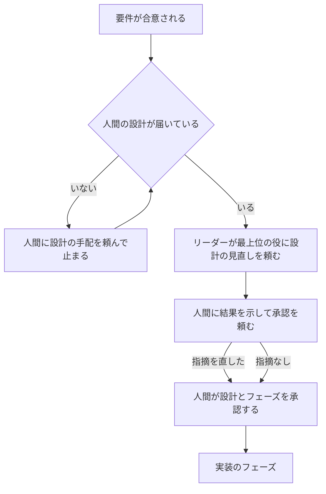

# 設計の役を最上位のモデルにし、成功の条件と確認の方法を書く

設計の役のモデルを最上位のモデルにし、設計に受け入れ条件ごとの成功の条件と確認の方法を書く。実装の役と修正の役は、その方法で確認した結果を PR に置いてからレビューへ回す。コードレビューと QA は、その条件と結果に照らして見る。設計の役を置かない構成では、人間が用意した設計を、承認の前に最上位の役が見直す。

この文書は、[workflow.md](workflow.md) の計画の候補 5（解決策 B と F の前半）の設計である。計画の全体と順番は workflow.md、最上位の役の今の置き方と呼ぶところは [principal-review.md](principal-review.md) にある。

## 目的と範囲

目的は、設計のあとの実装・修正・レビューの往復を減らすことである。何をもって「確認した」とするかを設計の時点で決めておけば、実装の役は手元で同じ方法を流してからレビューに回せる。レビューは、その結果と条件に照らして見るので、観点のずれによる差し戻しが減る。

変えるのは次の 5 つである。

- 設計の役のモデル（[設計の役のモデル](#設計の役のモデル)）
- 設計の役が書く成功の条件と確認の方法（[成功の条件と確認の方法](#成功の条件と確認の方法)）
- 実装の役と修正の役が、確認の結果を PR に置くこと（[確認の結果を PR に置く](#確認の結果を-pr-に置く)）
- コードレビューと QA が照らして見るもの（[レビューと QA が照らして見るもの](#レビューと-qa-が照らして見るもの)）
- 設計の役を置かない構成でのリーダーと最上位の役の動き（[設計の役を置かない構成](#設計の役を置かない構成)）

次は対象にしない。

- 要件を決める役の変更。候補 4 で行う
- 同じ失敗の繰り返しの診断、リーダーの原則 7、最上位の役の思考の深さ。候補 6 で行う
- 最終確認をすべてのタスクに広げることと、`重要` の意味を変えること。候補 7 で行う。設計の役を置く構成で `重要` のタスクの設計を最上位の役が見直す今の流れは変えない
- 使用率が上限に近いときの待ち方。候補 3 で決める（[使用率が上限に近いとき](#使用率が上限に近いとき)）
- レビューの往復の上限（解決策 F の後半）。候補 6 に回す。候補 6 がマージされるまでは、今の修正の依頼の数え方（[principal-review.md の修正の依頼の数え方](principal-review.md#修正の依頼の数え方)）のままにする
- 実装・修正・レビューの役のモデルと思考の深さ
- 設計の役を外せない役にすること（[検討した案](#検討した案)）
- バージョンを上げる PR、タグと Release の公開

## 設計の役のモデル

設計の役のモデルを、最上位の役と同じモデルにする。思考の深さは high のまま変えない。

| ランタイム | 今のモデル | 変えたあとのモデル | 思考の深さ |
| --- | --- | --- | --- |
| Claude Code があるとき | `claude-opus-5-5`（Opus 5.5） | `claude-fable-5-2`（Fable 5.2） | high |
| Codex だけのとき | `gpt-6.1-sol`（Sol） | `gpt-6-astra`（Astra） | high |

置き先の決め方（`IF runtime-claude` で Claude のモデル、`ELSE` で Codex のモデル）と、両方のランタイムがあるときに Claude に置くことは変えない。変えるのは `common/agents/designer.md` の front matter のモデルの値である。

ただし、今の決まりでは、Claude のモデルの役は、Claude Code がなければ Codex の実装の役と同じモデル（Sol）に移す（[common/agents/FORMAT](../common/agents/FORMAT)、`manual.md` の「片方だけのランタイムで動かす」）。設計の役を Codex だけで Astra にするのは、この決まりの例外になる。FORMAT と `manual.md` に、設計の役は Codex だけのときに実装の役ではなく最上位のモデル（Astra）へ移すことを書く。最上位のモデルを使う理由は、ランタイムによらず同じだからである。FORMAT は拡張との契約の文書だが、拡張の役の front matter の書き方と読み方は変わらないので、拡張の作者がすることはない。

セットアップは front matter の値をそのまま登録に使う。モデルとランタイムの照合（`lib/project.sh`）は名前の先頭（`claude-` と `gpt-`）だけを見るので、新しいモデルの名前のために変える処理はない。

## 成功の条件と確認の方法

設計の役は、受け入れ条件ごとに、「確認した」と言える条件と、確認の方法を書く。すべての受け入れ条件に 1 行以上を書く。

### 表の形

成功の条件は、設計の承認を頼むタスクのコメントに、実装の一覧（フェーズの表）とは別の表で書く。1 つの条件を 1 行にする。

```text
| 番号 | 受け入れ条件 | 成功の条件 | 確認の方法 | 確認する人 | フェーズ |
| --- | --- | --- | --- | --- | --- |
| 1-1 | 1 | Claude を含む導入で設計の役が Fable 5.2 の high になる | `bash tests/run.sh tests/agent-templates-test.sh` が 0 で終わる | 実装の役 | 1 |
| 6-1 | 6 | 設計の役を外した回答ファイルで流し直せる | VM で前のバージョンの回答ファイルを使って流し直し、登録の一覧を見る | 人間 | 4 |
```

列の決まりは次のとおりにする。

| 列 | 書くこと |
| --- | --- |
| 番号 | `<受け入れ条件の番号>-<連番>`。実装の役と修正の役が、結果でこの番号を使う |
| 受け入れ条件 | タスクの本文の受け入れ条件の番号 |
| 成功の条件 | 満たしたと言える状態を 1 文で書く。「動く」「正しい」だけにしない |
| 確認の方法 | コマンドにできるものは、コマンドと、満たしたと読む結果（終了コード、出力の行など）を書く。できないものは、短い手順を書く |
| 確認する人 | `実装の役`、`QA`、`人間` のどれか（下の表） |
| フェーズ | その条件を満たすフェーズの番号。複数あれば「、」で区切る |

| 確認する人 | 当てはまるもの | 確認する時機 |
| --- | --- | --- |
| `実装の役` | リポジトリのコマンドで確認できるもの | そのフェーズを積んだとき。修正の役も同じ方法で流し直す |
| `QA` | 起動したアプリを操作して確認するもの | レビューが通ったあとの E2E |
| `人間` | VM の実機確認、外部のサービスの画面、エージェントが動かせない環境での確認 | マージの前。人間の判断で行う |

確認の方法のコマンドは、設計の役が作業先のリポジトリで実在を確認してから書く。新しいテストを足すフェーズでは、そのテストのファイルを流すコマンドを書いてよい。そのときは、足すフェーズの番号をフェーズの列に書く。

### 書く場所

表は、設計の承認を頼むタスクのコメントに置く。`docs/` と PR の本文には書かない。成功の条件は実装の進め方であり、フェーズの一覧と同じく、システムの設計ではないためである。

設計を直して承認を頼み直したときは、新しいコメントに表を書き直す。実装の役と修正の役は、承認された最新のコメントの表を正とする。

設計の承認を頼むコメントの 1,000 字の目安には、フェーズの表と成功の条件の表を数えない。表を削って字数に収めると、条件が欠けるためである。表の外の文は、今のとおり 1,000 字以内にする。

## 確認の結果を PR に置く

実装の役と修正の役は、頼まれた範囲に関わる成功の条件を、書かれた確認の方法で確認する。結果を PR のコメントに置いてから、タスクに引き継ぎを返し、レビューへ回してもらう。

| 役 | 確認する条件 |
| --- | --- |
| 実装の役 | フェーズの列に、頼まれたフェーズの番号がある行のうち、確認する人が `実装の役` のもの |
| 修正の役 | すでに積まれたフェーズの番号がある行のうち、確認する人が `実装の役` のもの |

修正の役が積まれたフェーズの行をすべて流し直すのは、修正が別のフェーズの条件を壊すことがあるためである。リーダーの依頼の書き方は変えない。

結果は、次の形で PR のコメントに書く。1 行目のマークと書き方は、squad-handoff の「PR にレビューやテストの結果を書く」に合わせる。

```text
成功の条件の確認: <フェーズ N | 修正の依頼 N 回目>
確認したコミット: <完全な SHA>
- 1-1: `<流したコマンド>` → 満たす
- 2-1: `<流したコマンド>` → 満たさない。<出力の要約を 1 文>
結論: <すべて満たす | 満たさない条件がある>
```

- 確認したコミットは、push したコミットにする。push のあとにコミットを足したら、流し直して新しいコメントにする
- 満たさない条件があるときは、そのフェーズか依頼の中で直してから流し直す。直せないときは、結論に「満たさない条件がある」と書き、引き継ぎの「残っていること」に番号と理由を書く。満たさないまま、満たしたと書かない
- タスクへの引き継ぎの「確認したこと」には、`成功の条件の確認: PR のコメントに置いた（<結論>）` の行を置く
- 表がないタスク（バグの修正で設計がないなど）では、この行を `成功の条件の確認: 表なし` にし、今のとおり確認したことを書く

## レビューと QA が照らして見るもの

コードレビューと QA は、成功の条件の表と、実装の役・修正の役の結果に照らして見る。

コードレビューは、今の 4 つの観点に、次の確認を足す。

- 確認する人が `実装の役` の行のうち、PR に積まれたフェーズの行に、`確認したコミット:` が依頼の `確認するコミット:` と同じ結果があるか。ないときと、違うコミットの結果しかないときは、自分でその方法を流して確認する
- 満たさない条件があれば ❌ にする。結果がなかったことは、自分で流して満たしていても ⚠️ で書く
- 成功の条件の文と実装が合っているか。コマンドが通っても条件の文を満たしていなければ、正しさの指摘にする

QA は、テストケースを受け入れ条件と、確認する人が `QA` の行から作る。テストケースの表に、対応する成功の条件の番号を添える。確認する人が `人間` の行は実行せず、結果の最後に「人間が確認する条件」として番号を並べ、リーダーがマージを頼むときに人間へ示せるようにする。

## 設計の役を置かない構成

セットアップで設計の役を外した構成では、今のとおり人間が設計を用意する。新しく、リーダーはその設計を実装へ回す前に、最上位の役に見直しを頼む。最上位の役は系統ごとに必ず置かれ、外せないので、この構成でも見直しの経路がある。



- 人間の設計が届いたら、リーダーは実装を頼まず、最上位の役に設計の見直しを頼む。頼み方と選び方（`squad-dispatch-pick principal` か `squad-usage-read`、`squad-review-wait`、`見直しの種類: 設計の見直し`）は、今の `重要` のタスクの設計の見直しと同じにする
- 依頼には、`設計を用意した人: 人間` の行を置く。最上位の役が、直しを設計の役ではなく人間に頼む前提で書けるようにするため
- 最上位の役は、今の設計の見直しの観点に加え、受け入れ条件ごとに成功の条件と確認の方法がそろっているかを見る。そろっていなければ、欠けている受け入れ条件の番号を指摘にする
- 結果を受けたら、リーダーは人間をメンションし、最上位の役の結果を示して、指摘を直したうえで設計とフェーズを承認するよう頼み、`in_review` にする。直した設計を最上位の役に見せ直さない。今の `重要` の設計の見直しと同じく、直しの妥当さは人間の承認で確認する
- 最上位の役の結果より前に人間が承認と書いていても、見直しの結果のあとにもう一度承認を頼む。承認は、見直しの結果を読んだうえでしてもらうため
- リーダーは、今のとおり自分で設計や draft PR を作らない。最上位の役も、設計を直さない
- ラベル `重要` があるタスクでも、この見直しを 1 回だけにする。`重要` の設計の見直しと同じ種類なので、重ねて頼まない

最上位の役の設計の見直しで、成功の条件と確認の方法がそろっているかを見ることは、設計の役を置く構成の `重要` のタスクでも同じにする。設計の役は条件を書く決まりなので、見る観点を構成で分ける理由がないためである。設計の役を置く構成で、`重要` のないタスクに最上位の役の見直しを足すことはしない。

リーダーの指示のうち、設計の役を置かない段落（`common/agents/orchestrator.md` の `<!-- ELSE -->` と、`leader-flow.md` の「要件と設計を進める」）を、この流れに替える。呼ぶところの一覧（`leader-principal.md` の「最上位の役を呼ぶところ」）には、「設計の役がない構成の設計の見直し」を足す。今の「最上位の役は重要なタスクにだけ呼ぶ」という前置きは、この 1 つを例外として書く。

## 使用率が上限に近いとき

使用率が上限に近くても、設計の役のモデルを下げず、設計の工程も飛ばさない。設計の役は 1 体で、系統を移せないので、待つ。待ち方と人間を呼ぶ時機は、候補 3 の決まりに従う。候補 3 がマージされるまでは、今のとおり人間を呼んで止まる。

設計の役を置かない構成の見直しは、最上位の役の今の選び方のとおり、空いている系統の最上位の役へ回す。両方の系統が上限に近いときも、候補 3 の決まりに従う。

## 前後で測る値

変更の前と後で、次の 3 つを測り、使用の増え方と待ちの長さを確認する。

| 値 | 測り方 |
| --- | --- |
| 系統ごとの週の使用率 | 使用率の見張りが読む値（`squad-usage-read` の `week.used_percent`） |
| 設計の役の実行回数、1 回あたりのトークン数、実行時間 | [metrics.md](metrics.md) の手順（`scripts/metrics.py`）で、設計の役の実行を数える |
| 使用率で待った時間 | 候補 3 のあとは、再開の時刻のコメントから待った時間を合計する。候補 3 の前は、使用率で人間を呼んだ回数を数える |

前の値は、この変更のマージの直前に測り、このタスクのコメントに添付する。後の値は、マージのあとに新しいモデルで設計したタスク 5 件で測り、同じく添付する。後の値を測るタスクは、マージのときにリーダーが 1 件起こす。測った結果とスナップショットは、[metrics.md の置き場所と公開の範囲](metrics.md#置き場所と公開の範囲)のとおり、リポジトリにコミットしない。

## 文書と指示の変更

変えるものは次のとおりである。どれも、この文書を正本として節の名前で案内し、決まりを写しすぎない。

| 変えるもの | 変えること |
| --- | --- |
| `common/agents/FORMAT` | Claude のモデルの役を Codex へ移す決まりに、設計の役は Astra へ移す例外を足す |
| `common/agents/designer.md` | front matter のモデル。「実装のフェーズ」に、成功の条件の表の形と書く場所を足す。「結果の出し方」の 1,000 字に表を数えないことを書く |
| `common/agents/claude-implementer.md`、`codex-implementer.md` | 「結果の出し方」に、確認の結果を PR に置いてから引き継ぐことと、その形を足す |
| `common/agents/claude-fixer.md`、`codex-fixer.md` | 同上。確認する条件の範囲は、積まれたフェーズの行にする |
| `common/agents/code-reviewer.md` | 「受け取ったら最初に確認すること」と観点に、成功の条件の表と確認の結果を足す |
| `common/agents/qa.md` | テストケースを、確認する人が `QA` の行からも作ることと、人間が確認する条件を並べることを足す |
| `common/agents/claude-principal.md`、`codex-principal.md` | 冒頭の「重要なタスクだけで呼ばれる」に設計の役がない構成を足す。設計の見直しに、成功の条件のそろい方と、`設計を用意した人: 人間` のときの書き方を足す |
| `common/agents/orchestrator.md` | 設計の役を置かない段落を、最上位の役の見直しを挟む流れに替える |
| `common/skills/squad-handoff/references/leader-flow.md` | 「要件と設計を進める」の設計の役がないときの段落を同じく替える |
| `common/skills/squad-handoff/references/leader-principal.md` | 呼ぶところに、設計の役がない構成の設計の見直しを足し、冒頭の前置きを合わせる |
| `common/squad.md` | 「不足している要件や設計は人間に補ってもらう」に、設計は最上位の役が見直すことを足す |
| `lib/questions.sh` | 外す役の設計の行の「ほかに変わること」を「設計は人間に補ってもらい、最上位の役が見直す」にする |
| `manual.md` | 外す役の表の設計の行を `lib/questions.sh` と合わせる。「片方だけのランタイムで動かす」の役の表と移し方の文に、設計の役は Codex だけのときに Astra になることを足す |
| `docs/principal-review.md` | 「最上位の役を呼ぶところ」に、設計の役がない構成の見直しを足し、この文書へ案内する |
| `tests/leader-eval/` | 場面に外す役を指定できるようにし、設計の役を外した場面を 1 つ足す（[テスト](#テスト)） |
| `CHANGELOG.md` | 次のバージョンの節に知らせを書く（[CHANGELOG.md の知らせ](#changelogmd-の知らせ)） |

`EXTENSIONS.md` は変えない。front matter の形と、拡張の役の扱いは変わらないためである。

## ほかの未マージの候補との重なり

この設計を書いた時点（2026-11-13）で、計画の候補 2〜8 はどれもマージされていない。変えるファイルが重なるかを次の表にまとめる。PR のある候補は PR の差分と設計から、PR のない候補は [workflow.md の後続のタスクの候補](workflow.md#後続のタスクの候補)の「主に変えるもの」から読んだ。

| 変えるファイル | 候補 2（#67） | 候補 3（#68） | 候補 4 | 候補 6（#70） | 候補 7 | 候補 8 |
| --- | --- | --- | --- | --- | --- | --- |
| `common/agents/FORMAT`、`manual.md` の片方だけのランタイムの節 | | | | | | |
| `designer.md` | | | | | | 見込み |
| `claude-implementer.md`、`codex-implementer.md` | | | | | | 見込み |
| `claude-fixer.md`、`codex-fixer.md` | | | | | | 見込み |
| `code-reviewer.md`、`qa.md` | | | | | | 見込み |
| `claude-principal.md`、`codex-principal.md` | | | | 重なる | 見込み | |
| `orchestrator.md` | 重なる | 重なる | 重なる | 重なる | 見込み | |
| `leader-flow.md` | | 重なる | 重なる | 重なる | | |
| `leader-principal.md` | | 重なる | | 重なる | 見込み | |
| `common/squad.md`、`lib/questions.sh`、`manual.md` の外す役 | | | 重なる | | | |
| `docs/principal-review.md` | | | | 重なる | 見込み | |
| `tests/leader-eval/` の流す仕組み | | 重なる | | 重なる | | |
| `tests/agent-templates-test.sh` | 重なる | 重なる | 見込み | 重なる | | |
| `tests/project-runtimes-test.sh`、`tests/project-runtimes-first-test.sh`、`tests/setup-runtimes-test-lib.sh` | | | | 重なる | | |
| `CHANGELOG.md` の次のバージョンの節 | 重なる | 重なる | 重なる | 重なる | 重なる | 重なる |

「重なる」は PR か設計で同じファイルを変えると書いてあるもの、「見込み」は計画の「主に変えるもの」から変えると読めるものである。PR #69 は CI の作業で、この表のファイルを変えない。候補 8 は「役の指示」とだけあり、どの役かは候補 8 の設計で決まる。

候補 4 と候補 6 は、同じ段落や節を書き換えるので、文の衝突が起きやすい。候補 4 は `orchestrator.md` と `leader-flow.md` の要件を決める役がない段落、この候補はその次の設計の役がない段落を変える。候補 6 は最上位の役の指示と `leader-principal.md` の見直しの種類を変え、この候補は同じ節に設計の役がない構成を足す。モデルのテストは、候補 6 が最上位の役の行を、この候補が設計の役の行を変えるので、行は別でも同じ式に触れる。`CHANGELOG.md` は追記だけなので、マージの順に足せば済む。

重なるファイルを変える実装は、そのファイルに触れる先の候補がマージされたあとに、main を取り込んでから始める。重ならないファイルの実装は、ほかの候補を待たずに進めてよい。実装のフェーズの分け方は、この重なりに沿ってタスクのコメントで示す。

## 互換性と影響を受ける利用者

影響を受けるのは、原本を導入・更新する人と、導入したプロジェクトの担当である。回答ファイルの形、`excluded_roles` の値、役のキーは変えない。前のバージョンの回答ファイルは、移し替えなしにそのまま使える。

導入済みのプロジェクトでセットアップを流し直すと、次の登録が変わる。

- 設計の役のモデルが、Opus 5.5 から Fable 5.2 に、Codex だけの導入では Sol から Astra に替わる。思考の深さは high のまま
- 設計の役、実装の役と修正の役（両系統）、コードレビュー、QA、最上位の役（両系統）の指示が替わる
- 設計の役を外した導入先では、リーダーの指示の設計の役を置かない段落が替わる。人間が用意した設計ごとに、最上位の役の見直しが 1 回増える

最上位のモデルの使用は増える。設計の役の実行は、計画の見積り（[workflow.md の使用量の見積り](workflow.md#使用量の見積り)）で 39 回・1 回あたり 3.04M トークンだった。更新の前に、最上位のモデルの利用枠を確認してもらう。

流し直す前に始まったタスクでは、承認済みの設計に成功の条件の表がない。実装の役と修正の役は、その場合 `成功の条件の確認: 表なし` と書いて今のとおり進める。レビューは表がないことを指摘にしない。

### CHANGELOG.md の知らせ

次のバージョンの節に、次の 4 つを書く。

1. 設計の役のモデルを、Claude は Fable 5.2、Codex だけの導入では Astra に替えたこと。思考の深さは変わらないこと
2. 最上位のモデルの利用枠を使う量が増えるので、更新の前に利用枠を確認してほしいこと
3. 設計の役が成功の条件と確認の方法を書き、実装・修正の役が結果を PR に置き、レビューと QA がそれに照らして見るようになったこと
4. 設計の役を外した構成では、人間が用意した設計を、承認の前に最上位の役が見直すようになったこと。回答ファイルの移し替えは要らないこと

## テスト

自動テストで、次を確認する。

| 確認すること | テスト |
| --- | --- |
| Claude を含む導入で設計の役が `claude-fable-5-2`・high、Codex だけで `gpt-6-astra`・high になる。要件を決める役とほかの役のモデルは変わらない | `tests/agent-templates-test.sh`、`tests/project-runtimes-test.sh`、`tests/project-runtimes-first-test.sh`、`tests/setup-runtimes-test-lib.sh` の期待するモデルを替える |
| 設計の役、実装・修正の役（両系統）、コードレビュー、QA、最上位の役の指示に、この設計の決まりの文が残る | `tests/agent-templates-test.sh` |
| `excluded_roles` に `designer` を含む前のバージョンの回答ファイルで、移し替えなしに流し直せる | 今の回答ファイルのテストに、`designer` を外した見本を足す |
| 文書の用語と改行 | `tests/terms-test.sh`、`tests/doc-lines-test.sh` |

リーダーの評価の場面（`tests/leader-eval`）に、設計の役を外した場面を 1 つ足す。今の見本の値はすべての役が有効なので、場面の `scene.md` に `- 外す役: <役のキー…>` の行を置けるようにし、流す仕組みがその役を外して指示を展開する。行のない場面は、今のとおりすべての役を有効にする。

| 場面 | 入力 | 合格の基準の要点 |
| --- | --- | --- |
| 設計の役を外し、人間の設計が届く（外す役: `designer`） | 人間が、設計の PR とフェーズの一覧を書いたコメントを置く。印はない | [記録] 実装の役をメンションせず、`squad-dispatch-pick principal` と `squad-review-wait watch` を流し、最上位の役をメンションしている。依頼に `見直しの種類: 設計の見直し` と `設計を用意した人: 人間` の行がある。[採点] 成功の条件と確認の方法がそろっているかを見るよう頼み、見直しのあとに人間へ承認を頼むと書いている |

設計の役を置く構成で、印のないタスクの設計に最上位の役の見直しを足さないことは、今の keep-2 で確認する。keep-2 は、設計の役が印のないタスクの設計の draft PR を返す場面で、どの役もメンションしないことを基準に持つ。この変更のあとも、keep-2 が 3 回とも合格することを確認する。

指示の文の読み方で決まる動き（成功の条件の表の書き方、確認の結果の形、レビューの照らし方）は、自動テストでは確認しない。マージのあとの 5 件のタスクで、表と結果がそろっているかを後の値と一緒に確認する。

## 残る危うさ

成功の条件の表が長くなると、設計の承認を頼むコメントが読みにくくなる。条件は受け入れ条件ごとに 1 行を基本とし、同じコマンドで確認できる条件は 1 行にまとめる。

確認の方法のコマンドが弱いと、満たすと書かれても条件を満たさないことがある。コードレビューが条件の文と実装を照らすことで補う。

候補 3 がマージされるまでは、設計の役の使用率が上限に近いときに人間を呼ぶ回数が増えるおそれがある。前後の値で、使用率で人間を呼んだ回数を見る。

## 検討した案

- 成功の条件をフェーズの表に列として足す案は選ばない。受け入れ条件とフェーズは 1 対 1 ではなく、列にすると同じ条件を複数のフェーズの行に写すことになるためである。要件の「列か表を足す」のうち、表を選んだ
- 成功の条件を `docs/` の設計文書に書く案は選ばない。要件で書く場所をタスクのコメントに決めたためである。成功の条件は実装の進め方で、フェーズの一覧と同じく、承認のあとに設計を変えずに直せるほうがよい
- 修正の役が、指摘に関わる条件だけを流し直す案は選ばない。どの条件が関わるかを決める手順がリーダーに要り、修正が別のフェーズの条件を壊したときに気づけないためである
- 設計の役を置かない構成の見直しに、新しい見直しの種類を作る案は選ばない。見るものは今の設計の見直しと同じで、違うのは直す人だけなので、`設計を用意した人:` の行で足りる。候補 6 が見直しの種類を足すので、種類の一覧の衝突も避けられる
- 設計の役を外せない役にする案は選ばない。要件で、今の外す役の選択を保つと決めたためである。外した構成でも、最上位の役の見直しで設計の工程を最上位のモデルが担う
- 使用率が上限に近いときに、設計の役のモデルを下げる案は選ばない。設計の誤りは、実装と修正の往復で、下げて節約した以上の使用を生むためである
