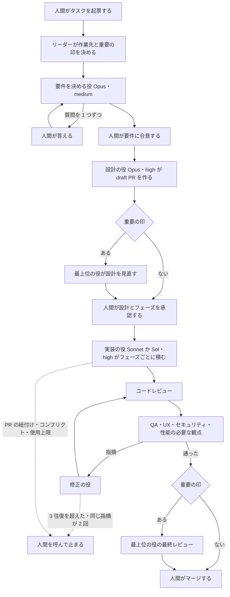
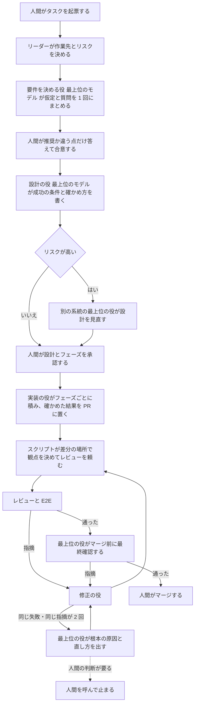

# スクワッドの作業の流れを、人間の手間を減らす形に組み直す

スクワッドの作業の流れを、これまでの記録から見直し、人間の手間を減らす形に組み直す計画である。要件・設計・同じ失敗の繰り返しからの立て直し・マージ前の最終確認の 4 か所は、ラベル `重要` の有無によらず、最上位のモデルで動く役が担う。経路と配管は、エージェントの判断からスクリプトへ移す。

この文書は計画であり、この文書を足すだけでは動作は変わらない。変更は、[後続のタスクの候補](#後続のタスクの候補)の順に、それぞれのタスクで設計と承認を経て入れる。最上位の役の今の置き方は [principal-review.md](principal-review.md)、リーダーの原則は [leader-principles.md](leader-principles.md) にある。

## 目的と範囲

目的は、人間がタスク 1 件に使う手間を半分にすることである。手間は、人間のコメントの数と、エージェントが人間を呼んだ数で測る。実行時間と差し戻しの数は歯止めとし、今より悪くしない。

対象は、原本の役のひな形、共通スキル、セットアップである。次は対象にしない。

- ワークスペースの設定と、Multica の機能。たとえば、GitHub の連携が PR を見つけられない問題は、原本の側では止まり方だけを変える
- マージ、タグと Release の公開、VM の実機確認。今のとおり人間が行う
- この計画のタスクでの、役の指示・スキル・セットアップの変更。変更は後続のタスクで行う

## 記録の読み方

数字は、2026-11-13 00:38（UTC）の時点のプロジェクトのタスク 41 件から数えた。この計画を作り始めたあとに作られたタスクは除く。読んだのは、タスクのコメント、状態の変化、実行の記録である。

指標の数え方は次のとおりにする。後続のタスクで測り直すときも、同じ数え方を使う。

| 指標 | 数え方 |
| --- | --- |
| 人間のコメント | 書き手がメンバーのコメントの数 |
| 人間の呼び出し | エージェントのコメントのうち、呼ぶ人間のメンションを含むものの数 |
| 実行時間 | 実行の開始から終了までの分の合計。実行中のものは数えた時点まで |
| 差し戻し | 修正の役（Claude と Codex）の実行の数 |

コメントの分類は、本文の語で分けた目安である。分類ごとの数は、前後 1 割ほどずれうる。問題ごとの根拠のタスクの一覧は、この計画のタスクのコメントに添付で残し、公開のリポジトリには置かない。

## 指標の現状と目標

主な指標は、人間のコメントと人間の呼び出しである。どちらも、1 タスクあたりで今の半分以下を目標にする。実行時間と差し戻しは、1 タスクあたりで今を超えないことを歯止めにする。

| 指標 | 種類 | 現状（41 件の合計） | 1 タスクあたり | 目標 |
| --- | --- | --- | --- | --- |
| 人間のコメント | 主 | 337 件 | 8.2 件 | 4 件以下 |
| 人間の呼び出し | 主 | 285 回 | 7.0 回 | 3.5 回以下 |
| 実行時間 | 歯止め | 5,853 分（実行 1,158 回） | 143 分 | 143 分以下 |
| 差し戻し | 歯止め | 修正の実行 74 回 | 1.8 回 | 1.8 回以下 |

参考に、`in_review` へ移った数は 238 回（1 タスクあたり 5.8 回）である。目標は、後続の候補 2〜7 を入れたあとの 20 件で測り、届かなければ候補 9 で原因を見直す。

## 今の流れ

今の流れは、要件・設計・実装・レビュー・マージの順で、受け渡しのたびにリーダーが起きる。最上位の役は、`重要` のタスクの設計の見直しと最終レビューでだけ呼ぶ。流れの正本は [common/squad.md](../common/squad.md) と、リーダーの手順の参照ファイルにある。

図の矢印の多くは、リーダーの実行を 1 回挟む。リーダーは 667 回起きており、全実行の 58% にあたる。1 回の平均は 0.4 分で、合計は 281 分である。

## 問題

記録から、人間の手間を増やしている問題を 7 つに分けた。どれも、下の数字と、添付したタスクの一覧を根拠にしている。

| 問題 | 根拠の数字 |
| --- | --- |
| 1. 要件の質問が 1 つずつ人間に来る | 呼び出しの 109 回が要件か選択の質問。人間のコメントの 169 件が選択の答え・承認・続行で、185 件が 10 字以下 |
| 2. 配管の失敗で流れが止まる | 呼び出しの 39 回が PR の紐付け。紐付けの修正が入ったあとも、1 日で 9 件のタスクが手での紐付けを頼み、リーダーがそこで止まった |
| 3. 同じ失敗を繰り返し、根本を人間が問う | 「根本」「なんで」などの指摘が 56 件。止まった・失敗したことでの呼び出しが 22 回 |
| 4. 最上位の役が重いタスクに届かない | 印のあるタスクは 5 件で、最上位の役の実行は 10 回。実行時間の上位 10 件のうち、印があるのは 3 件。要件には一度も使っていない |
| 5. 判断のない受け渡しにもリーダーが起きる | リーダーの実行が 667 回（58%）、平均 0.4 分。最も重いタスクでは 149 回の実行のうち 78 回 |
| 6. 実装と修正の実行が長く、途中で止まる | 45 分を超えた実装の実行が 11 回、最長 262 分。修正の役の実行 54 回のうち 9 回が取り消しか失敗 |
| 7. 手順が増え続け、手順の直しに手間を取られる | 41 件のうち 18 件が、スクワッド自身の手順を直すタスク。重い確かめの手順で使用上限に届いた例がある |

問題 1 が最も大きい。最も重いタスクでは、要件を決める役が 22 回起き、人間のコメントが 41 件、呼び出しが 31 回あった。人間が「1」とだけ答えるやりとりが続いており、質問をまとめれば減らせる。

問題 2 の原因は、Multica の GitHub の連携が 120 秒以内に PR を見つけられないことで、原本の範囲外である。ただし、紐付いていない PR でリーダーが止まり、人間が「紐付けなしで進めてよい」と返すまで待つのは原本の動作である。原本では、止まらずに進む形に変えられる。

問題 3 は、今の原則 7 が、同じことが 2 回続いたら人間を呼ぶ形であることから来る。人間は原因と直し方の診断を求めており、それは最上位のモデルが代われる。問題 4 は、最上位の役を呼ぶかを `重要` の印だけで決めていることから来る。

すでに入った変更で減った問題もある。コンフリクトの解消を人間が頼んだコメントは、解消の手順を変える前が 17 件、変えたあとが 2 件だった。テストが遅いという指摘は、手元の検証を関連テストに絞る前が 4 件、絞ったあとが 1 件だった。この 2 つは、この計画では新しく手を入れない。

## 解決策

解決策は 8 つで、どれも上の問題のどれかに効く。最上位のモデルは判断の要る 4 か所に集め、判断の要らない経路と配管はスクリプトに移す。

| 解決策 | 効く問題 | 主な参考資料 |
| --- | --- | --- |
| A. 要件は最上位のモデルで作り、質問を 1 回にまとめる | 1、4 | soniacuts、thedelost |
| B. 設計は最上位のモデルで作り、成功の条件と確かめ方を先に書く | 4、6 | addyosmani（批判的思考）、soniacuts |
| C. 同じ失敗が 2 回続いたら、人間の前に最上位の役が診断する | 3、4 | thedelost |
| D. マージ前の最終確認を、すべてのタスクで最上位の役が行う | 4 | addyosmani（レビュー）、angeldot_（グラフ） |
| E. 経路と配管をスクリプトへ移し、紐付けで止まらない | 2、5 | angeldot_（グラフ）、thedelost |
| F. PR に実行の証拠を置き、レビューの往復に上限を置く | 6 | addyosmani（レビュー） |
| G. 手順は、記録した失敗があるときだけ足し、定期的に削る | 7 | Zenn ISUCON |
| H. 人間の呼び出しを、決めることがあるときにまとめる | 1、2 | addyosmani（レビュー） |

### A. 要件をまとめて聞く

要件を決める役のモデルを、最上位のモデルにする。要件を決める役は、仮定と、推す答えを添えた質問を、1 回のコメントにまとめて人間に出す。人間は「推奨で」か、違うものだけを答えれば済む。

質問の往復は 2 回までを目安にする。3 回目が要るときは、決まらない点を 1 つにしぼって理由を書く。

### B. 設計に成功の条件を先に書く

設計の役のモデルを、最上位のモデルにする。設計には、受け入れ条件ごとに「確かめた」と言える条件と、確かめるコマンドを書く。実装の役と修正の役は、その条件で手元を確かめ、レビューはその条件に照らして見る。

設計とフェーズの承認は、今のとおり人間が行う。人間の承認が、最上位のモデルの判断を確かめる最後の場所になるため。

### C. 繰り返しを最上位の役が立て直す

リーダーの原則 7 を変え、同じ失敗や同じ指摘が 2 回続いたら、まず最上位の役に診断を頼む。最上位の役は、根本の原因、直し方、どの役が直すかを返し、直すのは今のとおり修正の役か設計の役である。最上位の役が決められないこと（要件の変更、人間の判断が要るもの）があるときだけ、人間を呼ぶ。

対象は、同じテストの失敗、同じレビューの指摘、同じ理由での実行の失敗である。使用上限や認証のように、エージェントでは直せない止まり方は、今のとおり人間を呼ぶ。

### D. 最終確認をすべてのタスクで行う

最上位の役の最終レビューを、`重要` の印によらず、すべてのタスクのマージ前に行う。依頼は、実装に使った系統と違うランタイムの最上位の役を優先する。自分と同じモデルの出力を自分で採点させないためで、使用率で選べないときは今の選び方に戻す。

`重要` の印は残し、意味を「リスクが高い」に寄せる。印のあるタスクでは、今のとおり設計の見直しを最上位の役に頼み、レビューの観点をすべて回す。印のないタスクでは、変えたファイルの場所で、頼む観点をスクリプトが決める。

### E. 経路と配管をスクリプトへ

データを運ばない受け渡しから、リーダーの実行を外す。今の `squad-review-wait` と同じく、返事がそろったか、次に誰を呼ぶかが決まりで決まるものは、スクリプトが判断して呼ぶ。リーダーが起きるのは、判断の要る場面（振り分けの最初、承認のあと、止まったとき）にする。

PR がタスクに紐付かないことでは止まらない。見張りは、紐付いた PR がないときに metadata の `pr_url` を使う。紐付けの依頼は、設計の承認を頼むコメントの中で 1 行だけ添える。

### F. 実行の証拠とレビューの上限

実装の役と修正の役は、レビューを頼む前に、設計に書いた確かめるコマンドの結果を PR のコメントに置く。レビューは、その結果と、前のレビューからの差分を見る。同じ観点のレビューの往復が 2 回を超えたら、C の診断に回す。

### G. 手順を足す条件

役の指示やスキルに手順を足すのは、記録に残った失敗があるときだけにする。足すときは、どのタスクのどの失敗を防ぐかを、その変更の設計に書く。あわせて、最近の 20 件で一度も効かなかった手順を、削る候補として見直す。

### H. 人間の呼び出しをまとめる

人間を呼ぶのは、人間が決めることがあるときにする。要件の合意、設計とフェーズの承認、マージ、エージェントでは直せない止まり方の 4 つを基本とする。マージの依頼は、最終確認と CI がそろった時点で 1 回にし、その前に途中の状態だけを知らせる呼び出しはしない。

## 参考資料の取り入れ方

8 件の参考資料から、上の解決策に入れた点と、入れなかった点を理由とともに示す。要点は、計画のタスクの本文の抜き出しを出発点にした。

| 資料 | 取り入れた点 | 取り入れなかった点と理由 |
| --- | --- | --- |
| [addyosmani（Claude Code チームのレビュー）](https://x.com/addyosmani/status/2114604912520921136) | 人間の時間を主な指標にする（指標）。PR の前に実行の証拠を置く（F）。リスクでレビューの深さを変え（D）、差分だけを見て、往復に上限を置く（F） | なし。レビューの役を増やすことはせず、今の 4 観点の選び方をスクリプトに移すにとどめる |
| [thedelost（Codex の構成）](https://x.com/thedelost/status/2105398038026195279) | 高いモデルを、計画の前・同じエラーの繰り返し・完了の前にだけ使う（A・B・C・D）。経路と差し戻しとリスクを、コードのしきい値で決める（E・D） | Codex の設定ファイルの形は写さない。原本は Claude と Codex の両方を同じ役の形で扱うため |
| [F5Adon（Karpathy の「How I use LLMs」）](https://x.com/F5Adon/status/2115586202376249761) | 考えるモデルは難しい問題にだけ使う（A・B・C・D）。答えをツールや一次情報で確かめる（B・F）。話題が変わったら新しい会話にすることは、1 回の実行を 1 つの仕事にする今の形で満たす | 投稿の「Agents→Harness→Loops→Graphs」の構成は動画の中になく、根拠にしない |
| [soniacuts（Karpathy の 4 つの原則）](https://x.com/soniacuts/status/2116233878541123589) | 仮定を書いてから聞く（A）。成功の条件と確かめ方を先に決める（B）。最小の変更にすることは、今の実装の役の指示を保つ | 原則を役の指示に新しい規則として足すことはしない。G の条件に合わせ、今ある指示の中で満たすため |
| [angeldot_（Claude の機能）](https://x.com/angeldot_/status/2109284255939297357) | 指示のファイル・スキル・定期の実行の使い分けは、今の役の指示・`squad-handoff`・オートパイロットの分け方と同じで、そのまま保つ | 新しい機能を足す点は取り入れない。この計画の問題とのつながりが薄く、Multica 側の機能は範囲外であるため |
| [addyosmani（批判的思考）](https://x.com/addyosmani/status/2117512471930167377) | 「確かめた」の定義を先に置く（B）。要約の要約に頼らず原典を読むため、最上位の役とレビューは PR の差分と元のコメントを読む（C・D）。レビューできる以上を作らないことは、30 分のフェーズで保つ | なし |
| [angeldot_（グラフの設計）](https://x.com/angeldot_/status/2081061068516798931) | データを運ばない辺を消す（E）。経路と配管をコードに置く（E）。エージェントに自分の出力を採点させない（D）。高いモデルは判断の場所だけに使う（A〜D） | グラフを作る道具を入れることはしない。今のスクリプトとコメントの受け渡しで足りるため |
| [Zenn: ISUCON 2026 の準備](https://zenn.dev/luvtechno/articles/isucon2026-preparation) | 重い手順が出力を食うので、素の構成から測った失敗だけを足す（G）。思考の深さを上げると効いたので、最上位の役を xhigh にする（[役ごとのモデルと思考の深さ](#役ごとのモデルと思考の深さ)）。採用は人間が決める（H） | すべての役を最も深い思考にはしない。実装の実行が長くなり、実行時間の歯止めを越えるため |

## 改善後の流れ

改善後は、判断の要る 4 か所を最上位のモデルが担い、そのほかの受け渡しはスクリプトが進める。人間が呼ばれるのは、要件の合意、設計とフェーズの承認、マージ、直せない止まり方である。

4 つの重要な工程と、担う役は次のとおりである。どれも `重要` の印によらない。

| 工程 | 担う役 | 今 |
| --- | --- | --- |
| 要件 | 要件を決める役（最上位のモデル） | Opus・medium。最上位の役は呼ばない |
| 設計 | 設計の役（最上位のモデル）。リスクが高いときは、別の系統の最上位の役も見直す | Opus・high。印があるときだけ最上位の役が見直す |
| 繰り返しからの立て直し | 最上位の役 | 人間を呼んで止まる |
| マージ前の最終確認 | 最上位の役 | 印があるときだけ最上位の役 |

要件と設計は、最上位の役に見直しを頼むのではなく、作る役そのものを最上位のモデルにする。見直しの往復を足さずに済み、人間を待つ回数が増えないため。この読み方でよいかは、人間が承認で決める。

## 役ごとのモデルと思考の深さ

変えるのは、要件を決める役、設計の役、最上位の役の 3 つである。ほかの役は今のままにする。最上位のモデルを使う場所を判断の 4 か所に集め、判断の要らない役は軽いモデルのままにするため。

| 役 | 今のモデル（Claude／Codex） | 今の深さ | 改善後のモデル（Claude／Codex） | 改善後の深さ | 理由 |
| --- | --- | --- | --- | --- | --- |
| リーダー | Sonnet 5.5／Sol | high | 変えない | high | 重いモデルでは作業の流れが回らないと人間が判断した。起きる回数は E で減らす |
| 要件を決める役 | Opus 5.5／Sol | medium | Fable 5.2／Astra | high | 要件は重要な工程。質問をまとめるには、先を読む判断が要る |
| 設計の役 | Opus 5.5／Sol | high | Fable 5.2／Astra | high | 設計は重要な工程。成功の条件まで書くので、判断の量が増える |
| Claude の実装の役 | Sonnet 5.5 | high | 変えない | high | 判断は設計で済んでいる。深くすると長い実行が増える |
| Claude の修正の役 | Sonnet 5.5 | high | 変えない | high | 繰り返しの診断は C で最上位の役が担う |
| Codex の実装の役 | Sol | high | 変えない | high | Claude の実装の役と同じ |
| Codex の修正の役 | Sol | high | 変えない | high | Claude の修正の役と同じ |
| コードレビュー | 実装の系統に合わせて Sonnet 5.5 か Sol | high | 変えない | high | 最終確認を最上位の役が足すので、今の深さで足りる |
| セキュリティのレビュー | 同上 | high | 変えない | high | 見落としの影響が大きく、今の深さを保つ |
| UX のレビュー | 同上 | medium | 変えない | medium | 呼ぶ回数が少なく、今の深さで問題が出ていない |
| 性能のレビュー | 同上 | medium | 変えない | medium | UX のレビューと同じ |
| QA | Sonnet 5.5／Sol | medium | 変えない | medium | 設計の確かめ方に沿って動かすので、深さは要らない |
| Claude の最上位の役 | Fable 5.2 | high | Fable 5.2 | xhigh | 根本の原因の診断と最終確認に考える量を回す。呼ぶ場面が限られる |
| Codex の最上位の役 | Astra | high | Astra | xhigh | Claude の最上位の役と同じ。モデルの一覧に xhigh がなければ high のまま |
| CI の見張り | Sonnet 5.5／Sol | low | 変えない | low | 決まった読み取りだけで、判断がない |
| 使用率の見張り | Sonnet 5.5／Sol | low | 変えない | low | CI の見張りと同じ |
| Dependabot のマージ | Sonnet 5.5／Sol | high | 変えない | high | 今のままで問題が出ていない |

モデルの名前は、Claude が `claude-sonnet-5-5`・`claude-opus-5-5`・`claude-fable-5-2`、Codex が `gpt-6.1-sol`・`gpt-6-astra` である。片方のランタイムだけのときの移し方は、[common/agents/FORMAT](../common/agents/FORMAT) の今の決まりに従う。

最上位のモデルの使用は増える。要件を決める役と設計の役の実行は、合わせて 173 回・600 分だった。要件の質問を 1 回にまとめれば、要件を決める役の実行は減る見込みで、増えた分は使用率の見張りで確かめる。

## 互換性と影響を受ける利用者

この計画の PR は文書を足すだけで、導入済みのプロジェクトの動作を変えない。後続のタスクのうち、役のひな形とセットアップを変えるものは、導入先でセットアップを流し直すとエージェントのモデルと思考の深さが変わる。

影響を受けるのは、原本を導入・更新する人と、導入したプロジェクトの担当である。最上位のモデルの使用が増えるので、更新の前に利用枠を確かめてもらう必要がある。後続のタスクは、それぞれの設計で互換性と、`CHANGELOG.md` に書く利用者への知らせを書く。

## 後続のタスクの候補

後続のタスクは、次の順に 1 件ずつ入れる。測る手順を先に置き、次に人間の手間を減らす効果が大きく、使用を増やさないものから入れる。最上位のモデルの使用を増やす変更は、その後にする。

| 順 | 候補 | 主に変えるもの | 解決策 |
| --- | --- | --- | --- |
| 1 | 指標を数える手順を作り、今の値を記録する | このリポジトリの開発用のスクリプトか手順の文書 | 指標 |
| 2 | PR の紐付けで止まらず、見張りが `pr_url` を使う | リーダーの手順の参照ファイル、PR の見張り、`squad-handoff` | E、H |
| 3 | 返事がそろったあとの次の依頼と、レビューの観点の選び方をスクリプトに移す | リーダーの手順の参照ファイル、見張りのスクリプト | E、D |
| 4 | 要件を決める役を最上位のモデルにし、質問を 1 回にまとめる | 要件を決める役のひな形 | A |
| 5 | 設計の役を最上位のモデルにし、成功の条件と確かめ方を書く | 設計の役のひな形、実装と修正の役の指示 | B、F |
| 6 | 同じ失敗の繰り返しで最上位の役を呼び、思考の深さを xhigh にする | リーダーの原則 7、最上位の役のひな形、リーダーの手順の参照ファイル | C |
| 7 | 最終確認をすべてのタスクに広げ、`重要` の印をリスクの意味に寄せる | リーダーの手順の参照ファイル、[principal-review.md](principal-review.md)、リーダーの指示の共通の基準 | D、H |
| 8 | 手順を足す条件を決め、効いていない手順を削る | [CONTRIBUTING.md](../CONTRIBUTING.md)、役の指示、`squad-handoff` | G |
| 9 | 20 件で指標を測り直し、次の手を決める | 1 の手順の結果 | 指標 |

候補 2〜7 は、役のひな形かリーダーの手順を変えるので、プロジェクトの `重要` の基準 1 か 2 に当たる見込みである。候補 4〜6 は、モデルを変えるため、まとめずに 1 つずつ入れ、間で使用率を確かめる。

## 残る危うさ

最上位のモデルの使用が増え、使用上限で止まる回数が増えるおそれがある。候補 4 のあとに使用率を確かめ、増えすぎれば、設計の役だけを戻す。

要件の質問を 1 回にまとめると、人間が答える量が 1 回ぶん増える。推す答えを添え、「推奨で」で済む形にして、読む手間を抑える。

最終確認をすべてのタスクに広げると、小さなタスクでもマージまでの時間が延びる。実行時間の歯止めで確かめ、超えたら、文書だけのタスクを最終確認から外すことを検討する。

指標の分類は語で分けた目安で、分け方の誤りが目標の判断を狂わせうる。主な指標は分類によらない総数で測り、分類は原因を探すときにだけ使う。

## 検討した案

要件と設計の工程に最上位の役を入れる方法として、3 つの案を比べ、作る役のモデルを上げる案を推す。

| 案 | 人間を待つ回数 | 最上位のモデルの使用 | 判断 |
| --- | --- | --- | --- |
| 作る役のモデルを最上位にする（推す） | 増えない | 要件と設計の実行の分だけ増える | 往復が増えず、最初の成果物から質が上がる |
| 今の役のまま、最上位の役が要件と設計を見直す | 見直しの 1 往復ずつ増える | 見直しの分だけ増える | 往復が増え、人間の手間を減らす目的に反する |
| 最上位の役が要件と設計を直接引き受ける | 増えない | 案 1 と同じ | 見直す役と作る役が同じになり、自分の出力を採点させないことと合わない |

リーダーを最上位のモデルにする案は取らない。リーダーは 1 つのタスクで十回以上起き、重いモデルでは作業の流れが回らないと人間が判断した。その理由は [leader-principles.md のモデルと思考の深さ](leader-principles.md#モデルと思考の深さ)にある。

実装の役の思考の深さを上げる案も取らない。45 分を超えた実装の実行がすでに 11 回あり、深くすると実行時間の歯止めを越えやすい。判断は設計と最上位の役に寄せ、実装は決まったことを積む役にとどめる。
